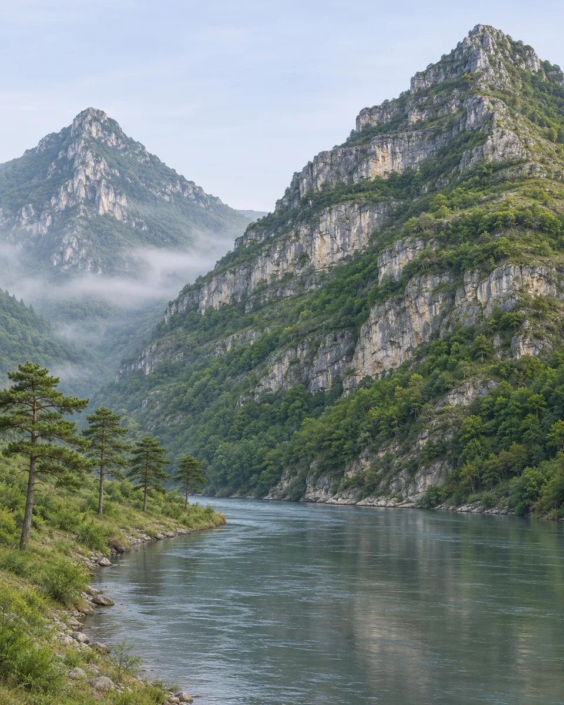
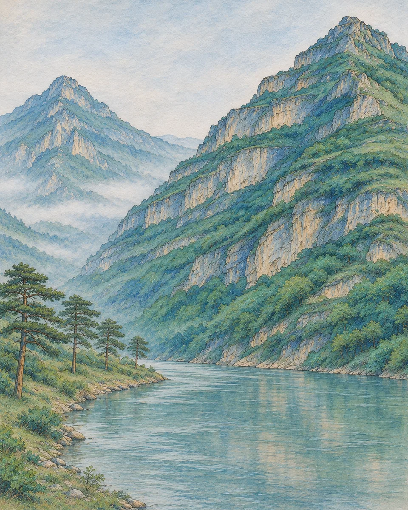

# 青绿山水 · Blue-Green Mineral Landscape

沿原照山脊和水路组织远近层次，以石青石绿般的矿彩覆盖山面，保留岩石结构与开阔水域，形成完整青绿山水。

Keep the source ridgelines and waterways while rebuilding depth through layered blue-green mineral mountains, articulated rock faces and open water.

原创方法说明，由 MuziGeek 编写；没有声称改编自外部提示词。

Original method instructions authored by MuziGeek; no external prompt adaptation is asserted.

## 输入分析与实际保留

1. 读取用户提供的原图；若没有可用图片，先请求图片。不要用本仓库示例代替用户输入。
2. 观察实际主体数量、身份与表情、朝向、肢体和连接、物体开口、相互遮挡、前后层次、光向及画幅；据实形成简短保留清单。样片说明只是样片，不能当成其他输入的事实。
3. 使用支持参考图编辑的可用工具，把原图作为编辑输入。先说明观察到的主体，再结合下方机制及 [recipe.yaml](recipe.yaml) 按顺序组合指令；工具名称不是必须安装的依赖。
4. 实际编辑默认沿用原图比例和完整内容，除非用户另有要求。配方的 4:5 是目录样片比例，不代表可裁去用户照片中的主体。
5. 对照输入检查结果；只修正发现的问题，不为了增强风格改变身份或添加无关景物。区分已完成的视觉检查与尚未验证的效果。

## Input analysis and preservation

1. Inspect the supplied image; request an image only when none is available. Never substitute a repository example for the user's input.
2. Record the observed subject count, identity, expression, direction, anatomy, attachments, openings, overlaps, depth, light and framing. Build preservation instructions from this image, not from the sample description.
3. Use an available reference-image editing tool. Combine the observed facts with the ordered mechanisms in [recipe.yaml](recipe.yaml); its model-family label does not require an installation script.
4. Keep the input aspect ratio and complete composition unless the user requests another format. The recipe's 4:5 ratio is a catalog-sample default, not authorization to crop a subject.
5. Compare output with input and correct observed failures. Report only visual checks actually completed; stronger styling must not override identity or scene integrity.

## 风格机制 · Style mechanism

- 沿原照山脊和水路组织远近层次，以石青石绿般的矿彩覆盖山面，保留岩石结构与开阔水域，形成完整青绿山水。
- 识别特征：青绿矿彩、山脊层叠、岩面皴线。
- Medium anchor: Transform the supplied landscape into blue-green mineral painting, using layered azurite-like blues and malachite-like greens over structurally drawn mountain forms.

10. **composition** — Follow the original major ridgelines, valley openings and river course; organize depth through overlapping terrain rather than newly invented mountains.
20. **line** — Define rock planes with tapered ink contours and short structural texture strokes aligned to the observed slopes and strata.
30. **palette** — Layer muted blue and green mineral colors across mountain faces; retain warm stone underpainting in selected edges and exposed planes.
40. **texture** — Make pigment granular and matte with visible underdrawing; preserve small unpainted separations between neighboring mountain planes.
50. **lighting** — Express distance with lighter, thinner pigment and softened contours; keep foreground slopes materially denser without cinematic light beams.
60. **finish** — Keep water and sky spacious with restrained pale washes; produce one full painting without scroll borders, calligraphy or added buildings.

## 保留约束 · Preservation constraints

在实际输入观察结果之上应用以下约束；清单不授权凭空添加图片中不存在的元素。

Apply these constraints to observed content; they never authorize inventing absent subjects.

- Number and relative scale of principal landforms
- Recognizable mountain silhouettes and watercourse direction
- Foreground, middle-distance and distant overlap order
- Locations of existing trees, paths and structures where visible

## 适用范围与几何边界 · Applicability and geometry

- 适用：风景。
- Applies to: Landscape.
- 仅用于含明确山体或岩石地形的风景；平坦街景、肖像和产品不套用山水模板，不凭空增造山峰。
- Use only for landscapes with legible mountain or rock structure; do not force portraits, products or flat streets into invented mountain compositions.
- 未明确允许的结构变化均不属于此风格；不把这些方法解释为复刻某位艺术家、品牌或现成作品的授权。
- Structural changes not explicitly allowed above are outside this method. This is not permission to reproduce a named artist, brand or existing artwork.

## 排除项 · Avoid

- Invented peaks, temples, bridges or boats
- Turquoise photographic color grading without painted structure
- Equal detail and saturation at every distance
- Miniature diorama depth or thick oil-paint relief
- Scroll frames, poetry, seals, labels and watermarks

## 验收 · Acceptance

- 主峰轮廓与水路走向可以对应原照
  Principal ridges and watercourse remain traceable to the source
- 山面存在清楚的勾线与矿彩覆盖层
  Mountain faces show drawn structure beneath mineral color
- 远近由重叠、色层厚薄和细节密度共同表达
  Overlap, pigment density and detail jointly establish depth
- 水域保持开阔，未添加楼阁船只或题字
  Water remains open with no added architecture, boats or inscriptions

## 配方、来源与许可 · Recipe, provenance and license

- [recipe.yaml](recipe.yaml): structured image-editing recipe / 结构化图像编辑配方。
- [provenance.json](provenance.json): original authorship, method context and example status / 原创归属、方法背景与示例状态。
- [LICENSE](LICENSE): MIT applies to MuziGeek's original contributions / MIT 适用于 MuziGeek 的原创贡献。
- 示例中的前后图均为 AI 合成，不是真人摄影或真实制作工艺的证据。结果会随模型与输入变化，不承诺相同输出。
- Example before/after images are AI-generated, not photographs of real people or evidence of physical craft production. Results vary by model and input.
- MIT 不授予用户输入、第三方作品、人物、商标或生成平台条款之外的权利；示例许可单独见 provenance。
- MIT grants no rights to user inputs, third-party works, likenesses or trademarks, and does not override generation-service terms; example terms are recorded separately in provenance.

## 示例状态 · Example status

ready：打包的原图与效果图均存在且记录了通过的视觉审核。

ready: both packaged source and effect exist and have recorded approved visual reviews.

| AI 合成原图 · Source | 通过审核的效果 · Approved effect |
| --- | --- |
|  |  |

- [AI source / AI 合成原图](examples/source.webp)
- [Generated interpretation / 生成效果](examples/effect.webp)
- [Generation and visual review / 生成与视觉审核记录](examples/generation.json)
