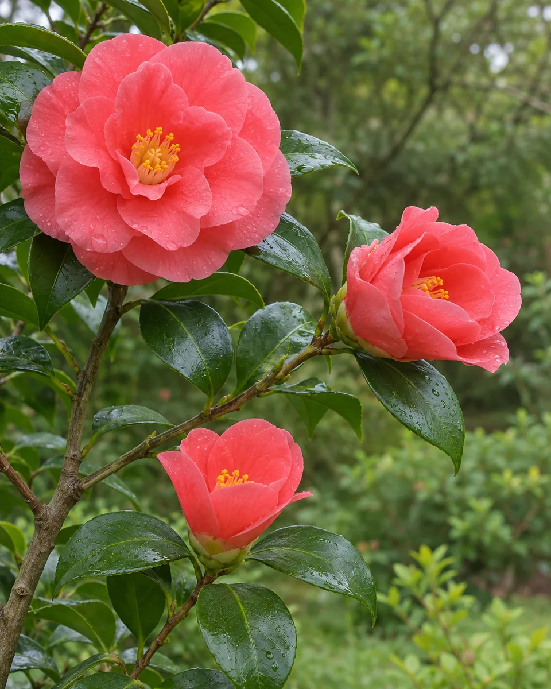
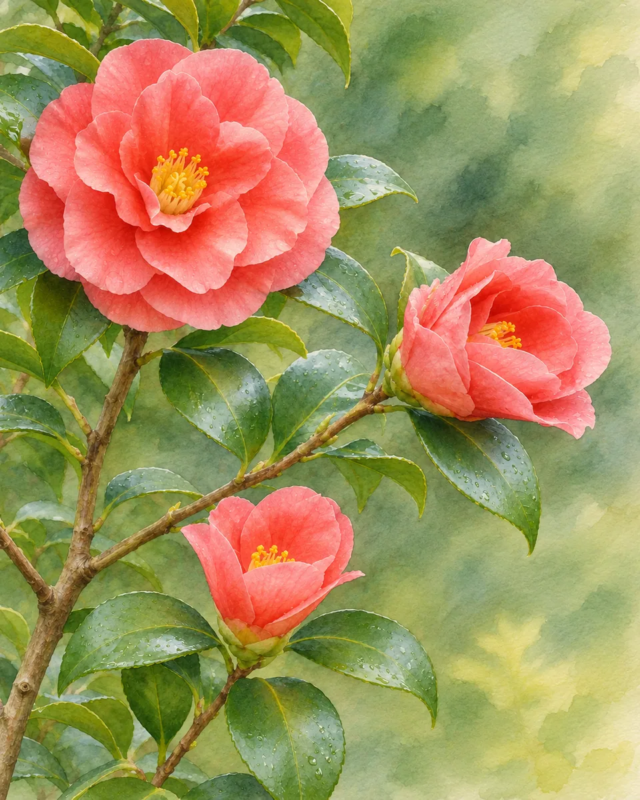

# 没骨花彩 · Boneless Pigment Wash

不先勾轮廓，以相接相融的湿润色面直接塑造花瓣与叶片，保留花朵的开合和前后关系，画出柔软但明确的体积。

Build petals and leaves directly from meeting washes, preserving botanical overlaps and soft volume without preliminary ink outlines.

原创方法说明，由 MuziGeek 编写；没有声称改编自外部提示词。

Original method instructions authored by MuziGeek; no external prompt adaptation is asserted.

## 输入分析与实际保留

1. 读取用户提供的原图；若没有可用图片，先请求图片。不要用本仓库示例代替用户输入。
2. 观察实际主体数量、身份与表情、朝向、肢体和连接、物体开口、相互遮挡、前后层次、光向及画幅；据实形成简短保留清单。样片说明只是样片，不能当成其他输入的事实。
3. 使用支持参考图编辑的可用工具，把原图作为编辑输入。先说明观察到的主体，再结合下方机制及 [recipe.yaml](recipe.yaml) 按顺序组合指令；工具名称不是必须安装的依赖。
4. 实际编辑默认沿用原图比例和完整内容，除非用户另有要求。配方的 4:5 是目录样片比例，不代表可裁去用户照片中的主体。
5. 对照输入检查结果；只修正发现的问题，不为了增强风格改变身份或添加无关景物。区分已完成的视觉检查与尚未验证的效果。

## Input analysis and preservation

1. Inspect the supplied image; request an image only when none is available. Never substitute a repository example for the user's input.
2. Record the observed subject count, identity, expression, direction, anatomy, attachments, openings, overlaps, depth, light and framing. Build preservation instructions from this image, not from the sample description.
3. Use an available reference-image editing tool. Combine the observed facts with the ordered mechanisms in [recipe.yaml](recipe.yaml); its model-family label does not require an installation script.
4. Keep the input aspect ratio and complete composition unless the user requests another format. The recipe's 4:5 ratio is a catalog-sample default, not authorization to crop a subject.
5. Compare output with input and correct observed failures. Report only visual checks actually completed; stronger styling must not override identity or scene integrity.

## 风格机制 · Style mechanism

- 不先勾轮廓，以相接相融的湿润色面直接塑造花瓣与叶片，保留花朵的开合和前后关系，画出柔软但明确的体积。
- 识别特征：无骨色面、湿色相接、柔润花形。
- Medium anchor: Repaint the photograph using boneless botanical color painting: forms arise directly from layered wet pigment masses without enclosing ink contours.

10. **medium** — Construct each major petal and leaf with joined pigment washes; let color boundaries define their forms without preliminary black outlines.
20. **palette** — Derive muted flower and foliage colors from the source; pool deeper pigment at observed overlaps instead of outlining every edge.
30. **detail** — Keep flower opening directions, petal whorls and stem attachments coherent; reserve lighter wash for folded petal tips.
40. **texture** — Alternate soft wet junctions with crisp dry edges; retain subtle absorbent-paper texture without uncontrolled blooms across focal flowers.
50. **composition** — Preserve the original arrangement and simplify background into sparse tonal washes; add neither botanical specimens nor decorative text.
60. **finish** — Deliver a complete color painting with luminous overlapping washes, not a faded photograph, outlined sketch or collection of separate stickers.

## 保留约束 · Preservation constraints

在实际输入观察结果之上应用以下约束；清单不授权凭空添加图片中不存在的元素。

Apply these constraints to observed content; they never authorize inventing absent subjects.

- Number, size hierarchy and opening directions of visible flowers or fruit
- Leaf attachment, stem continuity and overlap order
- Original subject arrangement and frame boundaries

## 适用范围与几何边界 · Applicability and geometry

- 适用：器物、美食。
- Applies to: Object, Food.
- 优先使用花卉、枝叶与果实原图；对花瓣、果皮和叶片分别设色，不把非植物产品强行改成花。
- Prefer flowers, foliage and fruit; handle their distinct surfaces separately and never convert unrelated products into invented plants.
- 未明确允许的结构变化均不属于此风格；不把这些方法解释为复刻某位艺术家、品牌或现成作品的授权。
- Structural changes not explicitly allowed above are outside this method. This is not permission to reproduce a named artist, brand or existing artwork.

## 排除项 · Avoid

- Black enclosing outlines
- Detached petals or impossible leaf attachments
- Photographic texture beneath a watercolor filter
- Uniform blurry edges everywhere
- Botanical labels, seals, signatures and sticker sheets

## 验收 · Acceptance

- 花朵数量、开合与主要枝叶位置对应原图
  Flower counts, opening directions and major foliage match the source
- 无黑色封闭外轮廓，色面承担造型
  Color masses define forms without black enclosing contours
- 湿边和清晰干边并存，焦点不糊成团
  Soft wet junctions coexist with crisp focal edges
- 整幅植物绘画，不添加标签或拼贴底板
  The result is one botanical painting without labels or collage backing

## 配方、来源与许可 · Recipe, provenance and license

- [recipe.yaml](recipe.yaml): structured image-editing recipe / 结构化图像编辑配方。
- [provenance.json](provenance.json): original authorship, method context and example status / 原创归属、方法背景与示例状态。
- [LICENSE](LICENSE): MIT applies to MuziGeek's original contributions / MIT 适用于 MuziGeek 的原创贡献。
- 示例中的前后图均为 AI 合成，不是真人摄影或真实制作工艺的证据。结果会随模型与输入变化，不承诺相同输出。
- Example before/after images are AI-generated, not photographs of real people or evidence of physical craft production. Results vary by model and input.
- MIT 不授予用户输入、第三方作品、人物、商标或生成平台条款之外的权利；示例许可单独见 provenance。
- MIT grants no rights to user inputs, third-party works, likenesses or trademarks, and does not override generation-service terms; example terms are recorded separately in provenance.

## 示例状态 · Example status

ready：打包的原图与效果图均存在且记录了通过的视觉审核。

ready: both packaged source and effect exist and have recorded approved visual reviews.

| AI 合成原图 · Source | 通过审核的效果 · Approved effect |
| --- | --- |
|  |  |

- [AI source / AI 合成原图](examples/source.webp)
- [Generated interpretation / 生成效果](examples/effect.webp)
- [Generation and visual review / 生成与视觉审核记录](examples/generation.json)
