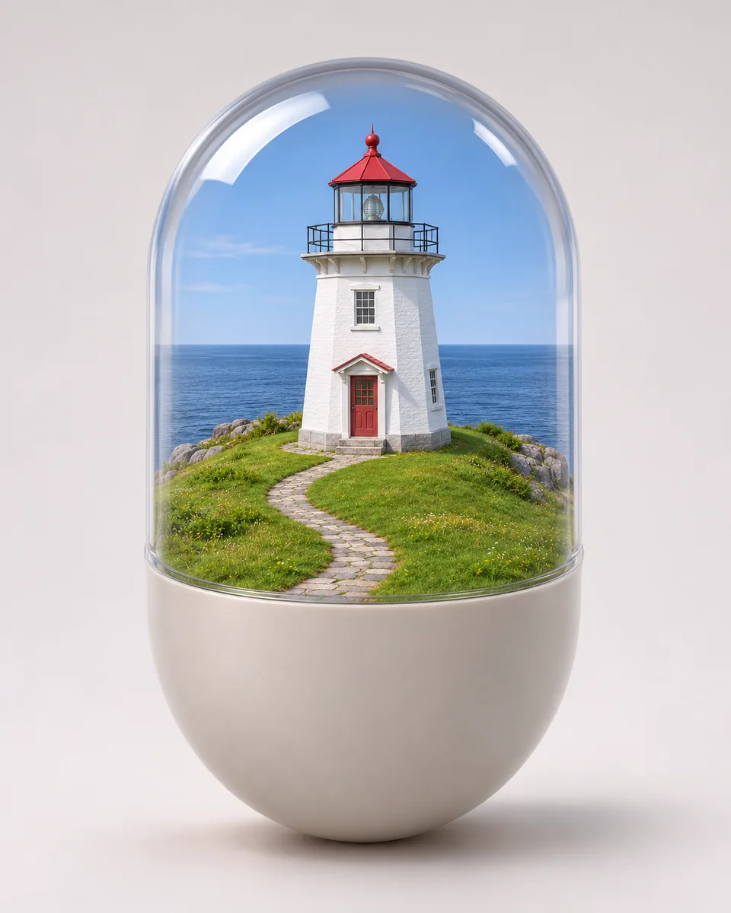

# 胶囊微型世界 · Capsule Memory World

把照片里可辨的地标和空间关系收进一枚半透明胶囊，以清晰外壳和微缩场景形成记忆容器，去除品牌与无关文字。

Contain the photographed landmarks inside a half-clear capsule, preserving their relationships as a miniature memory scene without branding or labels.

本方法改编自 Ege / @egeberkina; collected by ImgEdify 的 MIT 授权说明。原作者归属、来源与改动见 [provenance.json](provenance.json)，完整上游许可及其版权声明见 [LICENSE-THIRD-PARTY.txt](LICENSE-THIRD-PARTY.txt)。

Adapted from Ege / @egeberkina; collected by ImgEdify's MIT-licensed instructions. [provenance.json](provenance.json) records the original author, pinned source and modifications; [LICENSE-THIRD-PARTY.txt](LICENSE-THIRD-PARTY.txt) retains the complete upstream license and copyright notices.

原始归属 · Original attribution: Copyright (c) 2024 Awesome GPT4o Image Prompts Adapted by MuziGeek from Ege / @egeberkina; collected by ImgEdify; repository and original-post credits are retained.

## 输入分析与实际保留

1. 读取用户提供的原图；若没有可用图片，先请求图片。不要用本仓库示例代替用户输入。
2. 观察原图主体、身份、数量、连接、遮挡、光线和画幅。依据本 Skill 的保留约束与几何边界，区分需要保留及明确允许转化的部分。样片说明不能当作用户输入的事实。
3. 使用支持参考图编辑的可用工具，把原图作为编辑输入。先说明观察到的主体，再结合下方机制及 [recipe.yaml](recipe.yaml) 按顺序组合指令；工具名称不是必须安装的依赖。
4. 默认沿用原图比例；仅按用户要求及本 Skill 明确写出的构图或几何转化调整。配方的 4:5 是目录样片比例，不授权裁去必须保留的主体。
5. 对照输入检查结果；只修正发现的问题，不为了增强风格改变身份或添加无关景物。区分已完成的视觉检查与尚未验证的效果。

## Input analysis and preservation

1. Inspect the supplied image; request an image only when none is available. Never substitute a repository example for the user's input.
2. Inspect the real subjects, identity, counts, attachments, overlaps, light and framing. Distinguish preserved attributes from explicitly permitted transformations using this Skill’s preservation and geometry rules; sample descriptions are not facts about user input.
3. Use an available reference-image editing tool. Combine the observed facts with the ordered mechanisms in [recipe.yaml](recipe.yaml); its model-family label does not require an installation script.
4. Keep the input ratio by default; change composition or geometry only as requested by the user and expressly permitted below. The recipe’s 4:5 ratio is a catalog-sample default, not permission to crop protected subjects.
5. Compare output with input and correct observed failures. Report only visual checks actually completed; stronger styling must not override identity or scene integrity.

## 风格机制 · Style mechanism

- 把照片里可辨的地标和空间关系收进一枚半透明胶囊，以清晰外壳和微缩场景形成记忆容器，去除品牌与无关文字。
- 识别特征：半透明胶囊外壳、完整微型场景、无品牌记忆容器。
- Medium anchor: A single realistic half-opaque, half-clear capsule containing a coherent miniature of the supplied scene.

10. **medium** — Reinterpret the observed source scene as one unified miniature world inside a realistic transparent capsule.
20. **palette** — Choose a muted opaque half-shell color derived from the source palette; leave the other half optically clear.
30. **line** — Preserve identifiable landmark silhouettes and their internal left-right and foreground-background relationships.
40. **texture** — Render the shell with restrained clear-plastic thickness and believable reflections that do not obscure the miniature.
50. **lighting** — Use soft studio light with coherent miniature shadows and controlled translucent highlights.
60. **composition** — Reframe to show the complete capsule with generous background margins and every important source landmark contained inside.
70. **detail** — Keep the miniature coherent on one internal ground plane; add no unrelated floating brand artifacts.
80. **finish** — Remove original template branding, slogans, labels and logos; output a single clean product-style artwork.

## 保留约束 · Preservation constraints

在实际输入观察结果之上应用以下约束；清单不授权凭空添加图片中不存在的元素。

Apply these constraints to observed content; they never authorize inventing absent subjects.

- Observed main subject identities, count and distinctive clothing or landmark colors.
- Relative left-right placement and coherent relationships among source subjects inside the new container.
- Complete primary subjects with no invented people or missing faces; miniature staging is explicitly permitted.

## 适用范围与几何边界 · Applicability and geometry

- 适用：人像、合影、风景、美食、夜景、产品、器物。
- Applies to: Portrait, Group, Landscape, Food, Night, Product, Object.
- 允许把源场景缩微并重新取景进胶囊，添加唯一容器；保留主体数量和地标相对关系，禁止凭空补人物、车辆或品牌。
- Miniaturize and reframe the source scene inside one added capsule; preserve landmark count and relationships without invented people, vehicles or brands.
- 未明确允许的结构变化均不属于此风格；不把这些方法解释为复刻某位艺术家、品牌或现成作品的授权。
- Structural changes not explicitly allowed above are outside this method. This is not permission to reproduce a named artist, brand or existing artwork.

## 排除项 · Avoid

- Unrequested people, duplicate subjects or malformed anatomy.
- New logos, watermarks or unreadable pseudo-lettering.
- Clipping the main subject or erasing its identifying features.

## 验收 · Acceptance

- 完整胶囊可见且内含一个统一场景。
  One complete capsule contains a unified miniature scene.
- 地标数量和相对关系来自原图。
  Landmark counts and relationships derive from the source.
- 透明壳厚度与反光可信，不遮住主要主体。
  Shell thickness and reflections are believable without hiding key subjects.
- 无品牌、标签、额外人物或散乱漂浮物。
  No brands, labels, extra people or scattered unrelated artifacts appear.

## 配方、来源与许可 · Recipe, provenance and license

- [recipe.yaml](recipe.yaml): structured image-editing recipe / 结构化图像编辑配方。
- [provenance.json](provenance.json): original authorship, method context and example status / 原创归属、方法背景与示例状态。
- [LICENSE](LICENSE): MIT applies to MuziGeek's original contributions / MIT 适用于 MuziGeek 的原创贡献。
- [LICENSE-THIRD-PARTY.txt](LICENSE-THIRD-PARTY.txt): Ege / @egeberkina; collected by ImgEdify · MIT. Adapted material retains these terms and attribution / 改编材料保留原许可和归属。
- 示例中的前后图均为 AI 合成，不是真人摄影或真实制作工艺的证据。结果会随模型与输入变化，不承诺相同输出。
- Example before/after images are AI-generated, not photographs of real people or evidence of physical craft production. Results vary by model and input.
- MIT 不授予用户输入、第三方作品、人物、商标或生成平台条款之外的权利；示例许可单独见 provenance。
- MIT grants no rights to user inputs, third-party works, likenesses or trademarks, and does not override generation-service terms; example terms are recorded separately in provenance.

## 示例状态 · Example status

ready：打包的原图与效果图均存在且记录了通过的视觉审核。

ready: both packaged source and effect exist and have recorded approved visual reviews.

| AI 合成原图 · Source | 通过审核的效果 · Approved effect |
| --- | --- |
|  |  |

- [AI source / AI 合成原图](examples/source.webp)
- [Generated interpretation / 生成效果](examples/effect.webp)
- [Generation and visual review / 生成与视觉审核记录](examples/generation.json)
