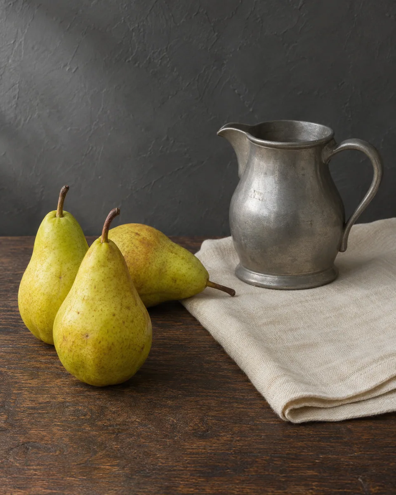
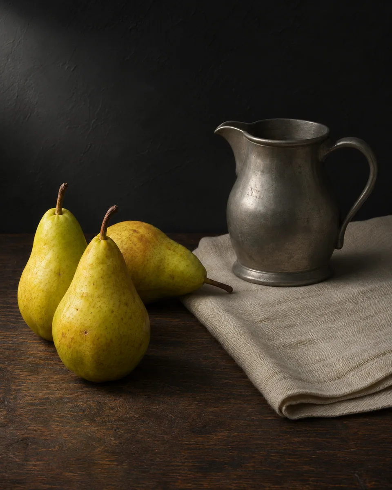

# 低调明暗 · Low-Key Light Study

沿原有光向收束亮部，让主体从深而有层次的阴影中显现，以克制的明暗过渡强调体积、肌理和空间距离。

Concentrate the existing light into a quiet low-key photograph, revealing volume and texture through controlled highlights and deep, detailed shadows.

原创方法说明，由 MuziGeek 编写；没有声称改编自外部提示词。

Original method instructions authored by MuziGeek; no external prompt adaptation is asserted.

## 输入分析与实际保留

1. 读取用户提供的原图；若没有可用图片，先请求图片。不要用本仓库示例代替用户输入。
2. 观察实际主体数量、身份与表情、朝向、肢体和连接、物体开口、相互遮挡、前后层次、光向及画幅；据实形成简短保留清单。样片说明只是样片，不能当成其他输入的事实。
3. 使用支持参考图编辑的可用工具，把原图作为编辑输入。先说明观察到的主体，再结合下方机制及 [recipe.yaml](recipe.yaml) 按顺序组合指令；工具名称不是必须安装的依赖。
4. 实际编辑默认沿用原图比例和完整内容，除非用户另有要求。配方的 4:5 是目录样片比例，不代表可裁去用户照片中的主体。
5. 对照输入检查结果；只修正发现的问题，不为了增强风格改变身份或添加无关景物。区分已完成的视觉检查与尚未验证的效果。

## Input analysis and preservation

1. Inspect the supplied image; request an image only when none is available. Never substitute a repository example for the user's input.
2. Record the observed subject count, identity, expression, direction, anatomy, attachments, openings, overlaps, depth, light and framing. Build preservation instructions from this image, not from the sample description.
3. Use an available reference-image editing tool. Combine the observed facts with the ordered mechanisms in [recipe.yaml](recipe.yaml); its model-family label does not require an installation script.
4. Keep the input aspect ratio and complete composition unless the user requests another format. The recipe's 4:5 ratio is a catalog-sample default, not authorization to crop a subject.
5. Compare output with input and correct observed failures. Report only visual checks actually completed; stronger styling must not override identity or scene integrity.

## 风格机制 · Style mechanism

- 沿原有光向收束亮部，让主体从深而有层次的阴影中显现，以克制的明暗过渡强调体积、肌理和空间距离。
- 识别特征：深暗保留层次、侧光塑造体积、克制局部亮面。
- Medium anchor: A low-key photographic light study with selective exposure control, broad tonal transitions and natural surface detail in deep shadows.

10. **medium** — Render a low-key photograph through controlled exposure and local contrast, retaining real photographic surfaces rather than painterly shading.
20. **lighting** — Concentrate the existing dominant light onto the subject's illuminated planes; deepen ambient fill without moving shadows or adding another light source.
30. **palette** — Retain subdued source colors in lit areas; let shadows approach neutral charcoal while preserving color differences near the light transition.
40. **texture** — Reveal pores, skin, wood and fabric through modest side-light contrast; avoid waxy smoothing, exaggerated sharpening or artificial brush texture.
50. **line** — Keep essential contours visible against nearby dark areas; allow gradual tonal loss only where the original shadow supports it.
60. **composition** — Preserve all objects, their placement, perspective and crop; darken the existing background without replacing it with an invented studio set.
70. **detail** — Protect specular highlights and important facial features; maintain small tonal separations inside the deepest meaningful shadows.
80. **finish** — Use broad natural tonal transitions and a clean full-frame finish; no spotlight circle, black vignette, border or theatrical smoke.

## 保留约束 · Preservation constraints

在实际输入观察结果之上应用以下约束；清单不授权凭空添加图片中不存在的元素。

Apply these constraints to observed content; they never authorize inventing absent subjects.

- Source light direction and physically consistent shadows
- Exact subject counts and all identifying features
- Original composition, background structure and perspective
- Material textures and essential shadow contours

## 适用范围与几何边界 · Applicability and geometry

- 适用：器物、美食、人像、合影、产品、夜景。
- Applies to: Object, Food, Portrait, Group, Product, Night.
- 低调处理不能把相邻物体合并成黑块；保留原有遮挡次序、接触阴影及每件物体的轮廓间隙。
- Low-key rendering must not merge separate objects into a black mass; preserve overlap order, contact shadows and the gaps between silhouettes.
- 未明确允许的结构变化均不属于此风格；不把这些方法解释为复刻某位艺术家、品牌或现成作品的授权。
- Structural changes not explicitly allowed above are outside this method. This is not permission to reproduce a named artist, brand or existing artwork.

## 排除项 · Avoid

- painted still life
- featureless black silhouette
- invented rim lights
- circular spotlight
- black corner vignette
- plastic sharpening halos
- smoke, new props, text, watermark or border

## 验收 · Acceptance

- 画面显著偏低调，但重要暗部轮廓和纹理仍可读。
  The image is distinctly low-key while important shadow contours and textures remain readable.
- 光向、投影及高光位置符合原图物理关系。
  Light direction, cast shadows and highlights remain physically consistent with the source.
- 主体数量、形体和背景结构均未改变。
  Subject counts, forms and background structures remain unchanged.
- 效果来自曝光和明暗层次，无绘画笔触或暗角遮罩。
  Exposure and tonal relationships create the effect, without painted strokes or a vignette mask.

## 配方、来源与许可 · Recipe, provenance and license

- [recipe.yaml](recipe.yaml): structured image-editing recipe / 结构化图像编辑配方。
- [provenance.json](provenance.json): original authorship, method context and example status / 原创归属、方法背景与示例状态。
- [LICENSE](LICENSE): MIT applies to MuziGeek's original contributions / MIT 适用于 MuziGeek 的原创贡献。
- 示例中的前后图均为 AI 合成，不是真人摄影或真实制作工艺的证据。结果会随模型与输入变化，不承诺相同输出。
- Example before/after images are AI-generated, not photographs of real people or evidence of physical craft production. Results vary by model and input.
- MIT 不授予用户输入、第三方作品、人物、商标或生成平台条款之外的权利；示例许可单独见 provenance。
- MIT grants no rights to user inputs, third-party works, likenesses or trademarks, and does not override generation-service terms; example terms are recorded separately in provenance.

## 示例状态 · Example status

ready：打包的原图与效果图均存在且记录了通过的视觉审核。

ready: both packaged source and effect exist and have recorded approved visual reviews.

| AI 合成原图 · Source | 通过审核的效果 · Approved effect |
| --- | --- |
|  |  |

- [AI source / AI 合成原图](examples/source.webp)
- [Generated interpretation / 生成效果](examples/effect.webp)
- [Generation and visual review / 生成与视觉审核记录](examples/generation.json)
