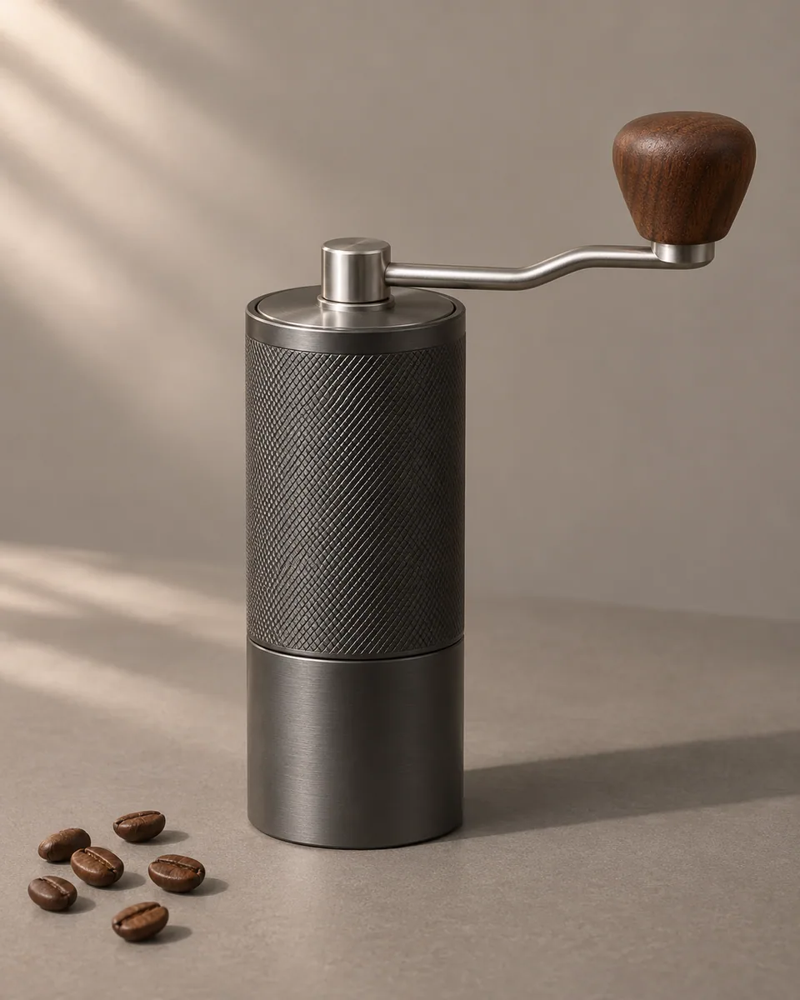
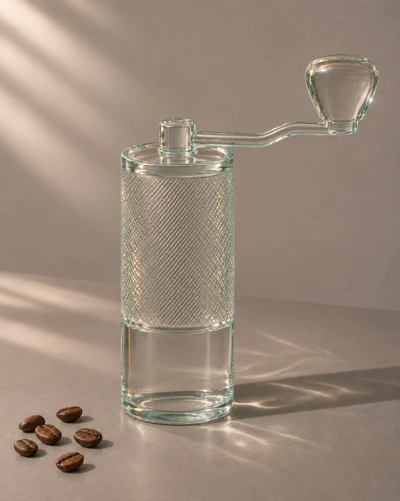

# 通透琉璃 · Clear cast glass

把主体实体转换为有厚度的透明浇铸玻璃，通过折射、边缘积色和柔和焦散表达体积，完整保留原有形状与空间关系。

Turn solid subject surfaces into thick cast glass with restrained refraction, edge color, and caustics while retaining recognizable geometry.

原创方法说明，由 MuziGeek 编写；没有声称改编自外部提示词。

Original method instructions authored by MuziGeek; no external prompt adaptation is asserted.

## 输入分析与实际保留

1. 读取用户提供的原图；若没有可用图片，先请求图片。不要用本仓库示例代替用户输入。
2. 观察实际主体数量、身份与表情、朝向、肢体和连接、物体开口、相互遮挡、前后层次、光向及画幅；据实形成简短保留清单。样片说明只是样片，不能当成其他输入的事实。
3. 使用支持参考图编辑的可用工具，把原图作为编辑输入。先说明观察到的主体，再结合下方机制及 [recipe.yaml](recipe.yaml) 按顺序组合指令；工具名称不是必须安装的依赖。
4. 实际编辑默认沿用原图比例和完整内容，除非用户另有要求。配方的 4:5 是目录样片比例，不代表可裁去用户照片中的主体。
5. 对照输入检查结果；只修正发现的问题，不为了增强风格改变身份或添加无关景物。区分已完成的视觉检查与尚未验证的效果。

## Input analysis and preservation

1. Inspect the supplied image; request an image only when none is available. Never substitute a repository example for the user's input.
2. Record the observed subject count, identity, expression, direction, anatomy, attachments, openings, overlaps, depth, light and framing. Build preservation instructions from this image, not from the sample description.
3. Use an available reference-image editing tool. Combine the observed facts with the ordered mechanisms in [recipe.yaml](recipe.yaml); its model-family label does not require an installation script.
4. Keep the input aspect ratio and complete composition unless the user requests another format. The recipe's 4:5 ratio is a catalog-sample default, not authorization to crop a subject.
5. Compare output with input and correct observed failures. Report only visual checks actually completed; stronger styling must not override identity or scene integrity.

## 风格机制 · Style mechanism

- 把主体实体转换为有厚度的透明浇铸玻璃，通过折射、边缘积色和柔和焦散表达体积，完整保留原有形状与空间关系。
- 识别特征：透明折射、边缘积色、柔和焦散。
- Medium anchor: Thick transparent cast glass with smooth broad surfaces, subtle trapped microbubbles, and physically plausible refraction.

10. **medium** — Transform existing solid subject surfaces into transparent cast glass; preserve each part's thickness, silhouette, attachment, and opening.
20. **palette** — Use nearly colorless glass with pale aqua edges and faint warm reflections sampled from the source environment.
30. **line** — Define contours through doubled refractive edges and thickness transitions, never with drawn black outlines.
40. **texture** — Add sparse microscopic bubbles within the glass and subtle casting irregularity, avoiding cracks or large inclusions.
50. **lighting** — Preserve illumination direction; create restrained caustics on the existing support and stronger reflections at glancing angles.
60. **composition** — Retain framing, part count, placement, camera angle, and source negative space.
70. **detail** — Refract the existing background through transparent volumes; do not invent objects, internal machinery, or decorative inserts.
80. **finish** — Balance transparency with readable volume; retain clear edges, grounded shadows, and believable local optical distortion.

## 保留约束 · Preservation constraints

在实际输入观察结果之上应用以下约束；清单不授权凭空添加图片中不存在的元素。

Apply these constraints to observed content; they never authorize inventing absent subjects.

- Recognizable outline, component attachments, and empty openings.
- Object positions, scale, support plane, and source viewpoint.
- Existing background content, visible through refracted volumes.

## 适用范围与几何边界 · Applicability and geometry

- 适用：产品、器物、美食。
- Applies to: Product, Object, Food.
- 保留实体几何；透明化引起的局部折射可见，但不改变物体边界和部件数量。
- Preserve solid geometry; allow local optical refraction without changing object boundaries or component counts.
- 未明确允许的结构变化均不属于此风格；不把这些方法解释为复刻某位艺术家、品牌或现成作品的授权。
- Structural changes not explicitly allowed above are outside this method. This is not permission to reproduce a named artist, brand or existing artwork.

## 排除项 · Avoid

- Opaque plastic, frosted opacity over the entire subject, or mirror chrome.
- Invented inclusions, internal machinery, extra objects, or enlarged bubbles.
- Broken silhouettes, disconnected parts, text, logos, or watermarks.

## 验收 · Acceptance

- 主体轮廓及部件连接关系与原图一致。
  The silhouette and component connections match the source.
- 玻璃有厚度，透明区域能看到合理折射。
  Transparent regions show thickness and plausible refraction.
- 焦散仅落在原有承托面，方向符合光源。
  Caustics remain on existing support surfaces and follow the light.
- 无新增内部结构、装饰物或大气泡。
  No invented internal structures, ornaments, or large bubbles appear.

## 配方、来源与许可 · Recipe, provenance and license

- [recipe.yaml](recipe.yaml): structured image-editing recipe / 结构化图像编辑配方。
- [provenance.json](provenance.json): original authorship, method context and example status / 原创归属、方法背景与示例状态。
- [LICENSE](LICENSE): MIT applies to MuziGeek's original contributions / MIT 适用于 MuziGeek 的原创贡献。
- 示例中的前后图均为 AI 合成，不是真人摄影或真实制作工艺的证据。结果会随模型与输入变化，不承诺相同输出。
- Example before/after images are AI-generated, not photographs of real people or evidence of physical craft production. Results vary by model and input.
- MIT 不授予用户输入、第三方作品、人物、商标或生成平台条款之外的权利；示例许可单独见 provenance。
- MIT grants no rights to user inputs, third-party works, likenesses or trademarks, and does not override generation-service terms; example terms are recorded separately in provenance.

## 示例状态 · Example status

ready：打包的原图与效果图均存在且记录了通过的视觉审核。

ready: both packaged source and effect exist and have recorded approved visual reviews.

| AI 合成原图 · Source | 通过审核的效果 · Approved effect |
| --- | --- |
|  |  |

- [AI source / AI 合成原图](examples/source.webp)
- [Generated interpretation / 生成效果](examples/effect.webp)
- [Generation and visual review / 生成与视觉审核记录](examples/generation.json)
