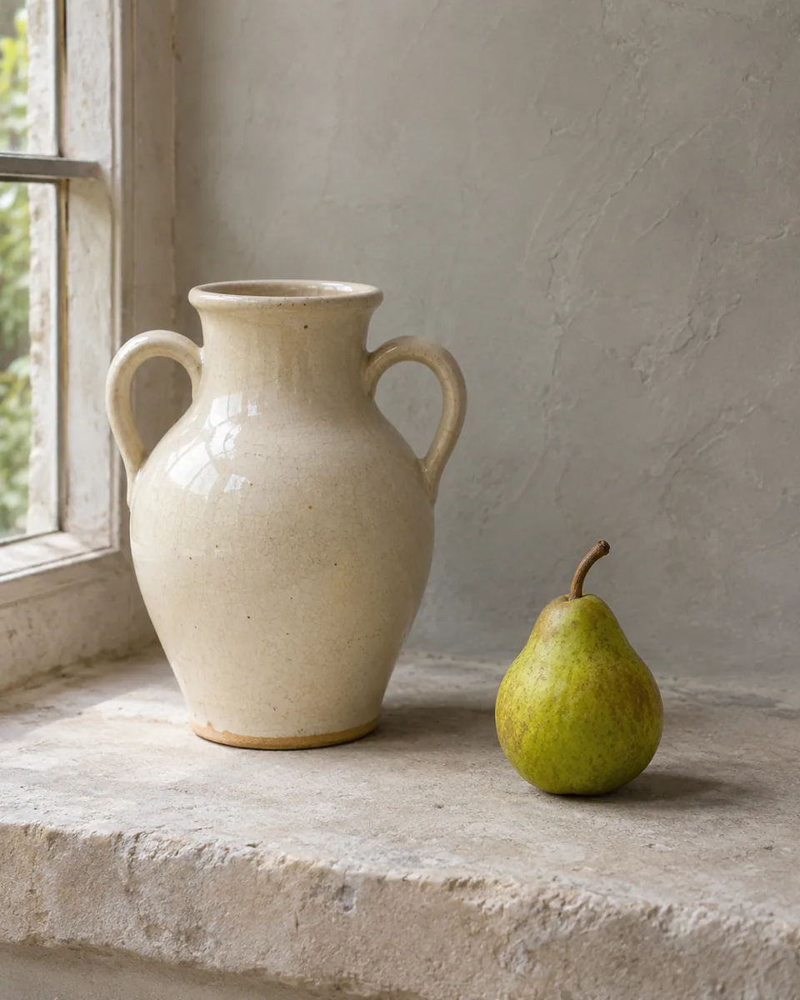
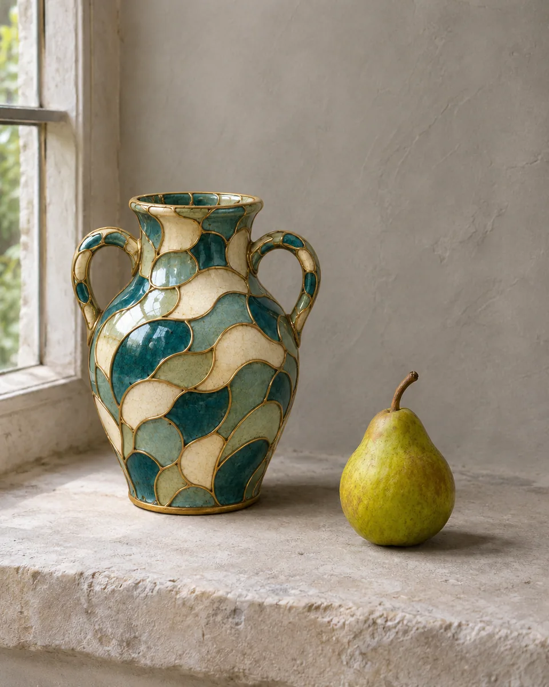

# 掐丝珐琅 · Cloisonne enamel

沿物体原有分区铺设细金属丝与饱满珐琅釉色，保留轮廓、开口和接触关系，呈现有重量的手工器物质感。

Recast the subject with fine metal partitions and pooled enamel while preserving its silhouette, openings, and physical contacts.

原创方法说明，由 MuziGeek 编写；没有声称改编自外部提示词。

Original method instructions authored by MuziGeek; no external prompt adaptation is asserted.

## 输入分析与实际保留

1. 读取用户提供的原图；若没有可用图片，先请求图片。不要用本仓库示例代替用户输入。
2. 观察实际主体数量、身份与表情、朝向、肢体和连接、物体开口、相互遮挡、前后层次、光向及画幅；据实形成简短保留清单。样片说明只是样片，不能当成其他输入的事实。
3. 使用支持参考图编辑的可用工具，把原图作为编辑输入。先说明观察到的主体，再结合下方机制及 [recipe.yaml](recipe.yaml) 按顺序组合指令；工具名称不是必须安装的依赖。
4. 实际编辑默认沿用原图比例和完整内容，除非用户另有要求。配方的 4:5 是目录样片比例，不代表可裁去用户照片中的主体。
5. 对照输入检查结果；只修正发现的问题，不为了增强风格改变身份或添加无关景物。区分已完成的视觉检查与尚未验证的效果。

## Input analysis and preservation

1. Inspect the supplied image; request an image only when none is available. Never substitute a repository example for the user's input.
2. Record the observed subject count, identity, expression, direction, anatomy, attachments, openings, overlaps, depth, light and framing. Build preservation instructions from this image, not from the sample description.
3. Use an available reference-image editing tool. Combine the observed facts with the ordered mechanisms in [recipe.yaml](recipe.yaml); its model-family label does not require an installation script.
4. Keep the input aspect ratio and complete composition unless the user requests another format. The recipe's 4:5 ratio is a catalog-sample default, not authorization to crop a subject.
5. Compare output with input and correct observed failures. Report only visual checks actually completed; stronger styling must not override identity or scene integrity.

## 风格机制 · Style mechanism

- 沿物体原有分区铺设细金属丝与饱满珐琅釉色，保留轮廓、开口和接触关系，呈现有重量的手工器物质感。
- 识别特征：细金属隔线、饱满釉色、玻璃质高光。
- Medium anchor: Fired vitreous enamel separated by slender metal cloisons fitted to the existing object's surfaces.

10. **medium** — Recast existing solid surfaces as fired cloisonne enamel with slender raised metal partitions; keep all original openings and object boundaries.
20. **palette** — Use deep teal, warm ivory, and muted brass; derive secondary enamel cells from source colors rather than adding new motifs.
30. **line** — Let thin metal wires follow existing contour changes and visible surface divisions; avoid decorative flowers, symbols, or invented borders.
40. **texture** — Show gently pooled glassy enamel, tiny edge menisci, and restrained firing variation within each cell.
50. **lighting** — Retain the source light direction; enamel catches small rounded highlights while metal partitions produce narrow brighter accents.
60. **composition** — Keep the source framing, object count, silhouette, relative size, negative space, and support contacts.
70. **detail** — Wrap partitions continuously around curved surfaces without bridging holes or floating above the object.
80. **finish** — Resolve as a believable crafted object with controlled gloss and no added display stand or ornamental setting.

## 保留约束 · Preservation constraints

在实际输入观察结果之上应用以下约束；清单不授权凭空添加图片中不存在的元素。

Apply these constraints to observed content; they never authorize inventing absent subjects.

- Object count, silhouette, openings, handles, and support contacts.
- Relative placement and source camera viewpoint.
- Recognizable subject identity and existing negative space.

## 适用范围与几何边界 · Applicability and geometry

- 适用：器物、产品、美食。
- Applies to: Object, Product, Food.
- 仅改变实体表面材质；不重构轮廓、开口、数量或摆放。
- Change solid-surface material only; preserve silhouettes, openings, counts, and placement.
- 未明确允许的结构变化均不属于此风格；不把这些方法解释为复刻某位艺术家、品牌或现成作品的授权。
- Structural changes not explicitly allowed above are outside this method. This is not permission to reproduce a named artist, brand or existing artwork.

## 排除项 · Avoid

- Lettering, logos, watermarks, floral decoration, or unrelated symbols.
- Extra handles, filled openings, displaced shadows, or floating wire.
- Uniform plastic shine or painted-on flat gold lines.

## 验收 · Acceptance

- 主体数量、开口及把手形状与原图一致。
  Subject counts, openings, and handle shapes match the source.
- 金属丝贴合体表，不跨越空洞或漂浮。
  Metal partitions follow surfaces without floating or crossing holes.
- 釉面分区来自原有结构，无新增装饰图案。
  Enamel cells follow existing structure without added decorative motifs.
- 釉面与金属反光有差异，光向保持一致。
  Enamel and metal reflect differently under the original light direction.

## 配方、来源与许可 · Recipe, provenance and license

- [recipe.yaml](recipe.yaml): structured image-editing recipe / 结构化图像编辑配方。
- [provenance.json](provenance.json): original authorship, method context and example status / 原创归属、方法背景与示例状态。
- [LICENSE](LICENSE): MIT applies to MuziGeek's original contributions / MIT 适用于 MuziGeek 的原创贡献。
- 示例中的前后图均为 AI 合成，不是真人摄影或真实制作工艺的证据。结果会随模型与输入变化，不承诺相同输出。
- Example before/after images are AI-generated, not photographs of real people or evidence of physical craft production. Results vary by model and input.
- MIT 不授予用户输入、第三方作品、人物、商标或生成平台条款之外的权利；示例许可单独见 provenance。
- MIT grants no rights to user inputs, third-party works, likenesses or trademarks, and does not override generation-service terms; example terms are recorded separately in provenance.

## 示例状态 · Example status

ready：打包的原图与效果图均存在且记录了通过的视觉审核。

ready: both packaged source and effect exist and have recorded approved visual reviews.

| AI 合成原图 · Source | 通过审核的效果 · Approved effect |
| --- | --- |
|  |  |

- [AI source / AI 合成原图](examples/source.webp)
- [Generated interpretation / 生成效果](examples/effect.webp)
- [Generation and visual review / 生成与视觉审核记录](examples/generation.json)
