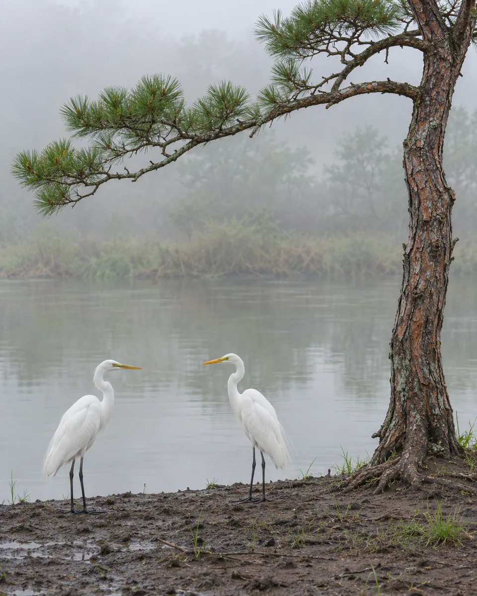
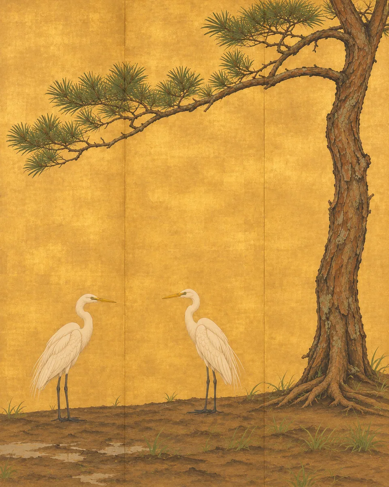

# 金地屏绘 · Gold-Ground Screen Painting

保留花木或动物的姿态，把背景压成细腻金箔地，以少量沉着设色和轻微屏面折线呈现装饰绘画，主体跨折面连续。

Keep botanical or animal poses while flattening the background into fine gold leaf, with restrained painted forms crossing subtle screen folds continuously.

原创方法说明，由 MuziGeek 编写；没有声称改编自外部提示词。

Original method instructions authored by MuziGeek; no external prompt adaptation is asserted.

## 输入分析与实际保留

1. 读取用户提供的原图；若没有可用图片，先请求图片。不要用本仓库示例代替用户输入。
2. 观察实际主体数量、身份与表情、朝向、肢体和连接、物体开口、相互遮挡、前后层次、光向及画幅；据实形成简短保留清单。样片说明只是样片，不能当成其他输入的事实。
3. 使用支持参考图编辑的可用工具，把原图作为编辑输入。先说明观察到的主体，再结合下方机制及 [recipe.yaml](recipe.yaml) 按顺序组合指令；工具名称不是必须安装的依赖。
4. 实际编辑默认沿用原图比例和完整内容，除非用户另有要求。配方的 4:5 是目录样片比例，不代表可裁去用户照片中的主体。
5. 对照输入检查结果；只修正发现的问题，不为了增强风格改变身份或添加无关景物。区分已完成的视觉检查与尚未验证的效果。

## Input analysis and preservation

1. Inspect the supplied image; request an image only when none is available. Never substitute a repository example for the user's input.
2. Record the observed subject count, identity, expression, direction, anatomy, attachments, openings, overlaps, depth, light and framing. Build preservation instructions from this image, not from the sample description.
3. Use an available reference-image editing tool. Combine the observed facts with the ordered mechanisms in [recipe.yaml](recipe.yaml); its model-family label does not require an installation script.
4. Keep the input aspect ratio and complete composition unless the user requests another format. The recipe's 4:5 ratio is a catalog-sample default, not authorization to crop a subject.
5. Compare output with input and correct observed failures. Report only visual checks actually completed; stronger styling must not override identity or scene integrity.

## 风格机制 · Style mechanism

- 保留花木或动物的姿态，把背景压成细腻金箔地，以少量沉着设色和轻微屏面折线呈现装饰绘画，主体跨折面连续。
- 识别特征：柔金箔地、跨折面连景、沉着设色。
- Medium anchor: Recompose the photograph as an original gold-ground screen painting, preserving its subjects while using subtle gold-leaf planes and disciplined decorative brushwork.

10. **composition** — Retain the observed subjects and their relative positions; simplify background into a continuous gold ground with two or three subtle vertical folds.
20. **texture** — Render gold as softly mottled leaf with faint square joins, not glitter, embossed foil, luminous yellow light or a mirror.
30. **line** — Use confident tapered contours for branches, feathers and leaves; simplify internal detail into deliberate decorative rhythms derived from the source.
40. **palette** — Keep restrained ink, muted greens and warm whites against the gold; preserve distinctive source subject colors where essential.
50. **detail** — Let branches and silhouettes cross fold lines without interruption, duplication or altered scale; folds affect the support, not subject anatomy.
60. **finish** — Fill the image with the painted screen surface; add no furniture, room mockup, ornamental outer frame, seals or inscriptions.

## 保留约束 · Preservation constraints

在实际输入观察结果之上应用以下约束；清单不授权凭空添加图片中不存在的元素。

Apply these constraints to observed content; they never authorize inventing absent subjects.

- Subject counts, poses and spatial spacing
- Continuity of branches, limbs and contours across folds
- Major color identities and existing negative-space relationships

## 适用范围与几何边界 · Applicability and geometry

- 适用：风景、器物。
- Applies to: Landscape, Object.
- 适合枝叶、花鸟和轮廓清晰的自然物；屏面折线只改变支撑面的轻微明暗，不能折断动物或枝干。
- Prefer foliage, birds and clear natural silhouettes; screen folds alter support shading subtly without breaking animals, stems or branches.
- 未明确允许的结构变化均不属于此风格；不把这些方法解释为复刻某位艺术家、品牌或现成作品的授权。
- Structural changes not explicitly allowed above are outside this method. This is not permission to reproduce a named artist, brand or existing artwork.

## 排除项 · Avoid

- Extra birds, invented flowers or decorative emblems
- Broken or repeated subjects at folds
- Sparkling glitter, embossed metal relief or mirror reflections
- Room mockups and freestanding screen furniture
- Historical signatures, calligraphy, seals and watermarks

## 验收 · Acceptance

- 主体数量与主要枝干方向吻合原照
  Subject counts and major branch directions match the photograph
- 金箔呈柔和片状而非金色灯光或浮雕
  Gold reads as softly joined leaf rather than lighting or relief
- 跨屏面折线的主体保持连续不重复
  Subjects remain continuous and unduplicated across screen folds
- 没有房间样机、外框、题字或印章
  No room mockup, external frame, inscription or seal appears

## 配方、来源与许可 · Recipe, provenance and license

- [recipe.yaml](recipe.yaml): structured image-editing recipe / 结构化图像编辑配方。
- [provenance.json](provenance.json): original authorship, method context and example status / 原创归属、方法背景与示例状态。
- [LICENSE](LICENSE): MIT applies to MuziGeek's original contributions / MIT 适用于 MuziGeek 的原创贡献。
- 示例中的前后图均为 AI 合成，不是真人摄影或真实制作工艺的证据。结果会随模型与输入变化，不承诺相同输出。
- Example before/after images are AI-generated, not photographs of real people or evidence of physical craft production. Results vary by model and input.
- MIT 不授予用户输入、第三方作品、人物、商标或生成平台条款之外的权利；示例许可单独见 provenance。
- MIT grants no rights to user inputs, third-party works, likenesses or trademarks, and does not override generation-service terms; example terms are recorded separately in provenance.

## 示例状态 · Example status

ready：打包的原图与效果图均存在且记录了通过的视觉审核。

ready: both packaged source and effect exist and have recorded approved visual reviews.

| AI 合成原图 · Source | 通过审核的效果 · Approved effect |
| --- | --- |
|  |  |

- [AI source / AI 合成原图](examples/source.webp)
- [Generated interpretation / 生成效果](examples/effect.webp)
- [Generation and visual review / 生成与视觉审核记录](examples/generation.json)
