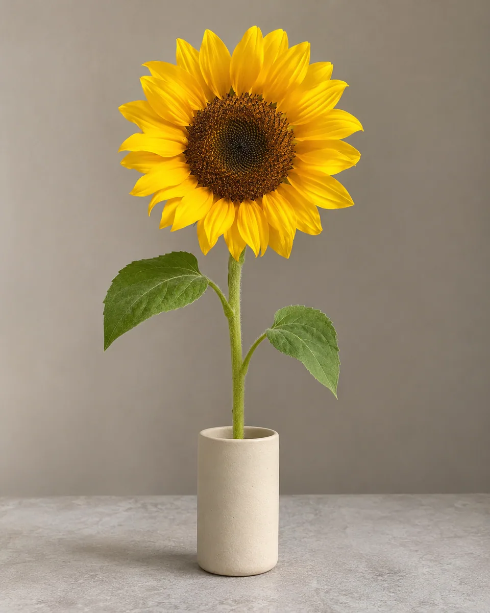
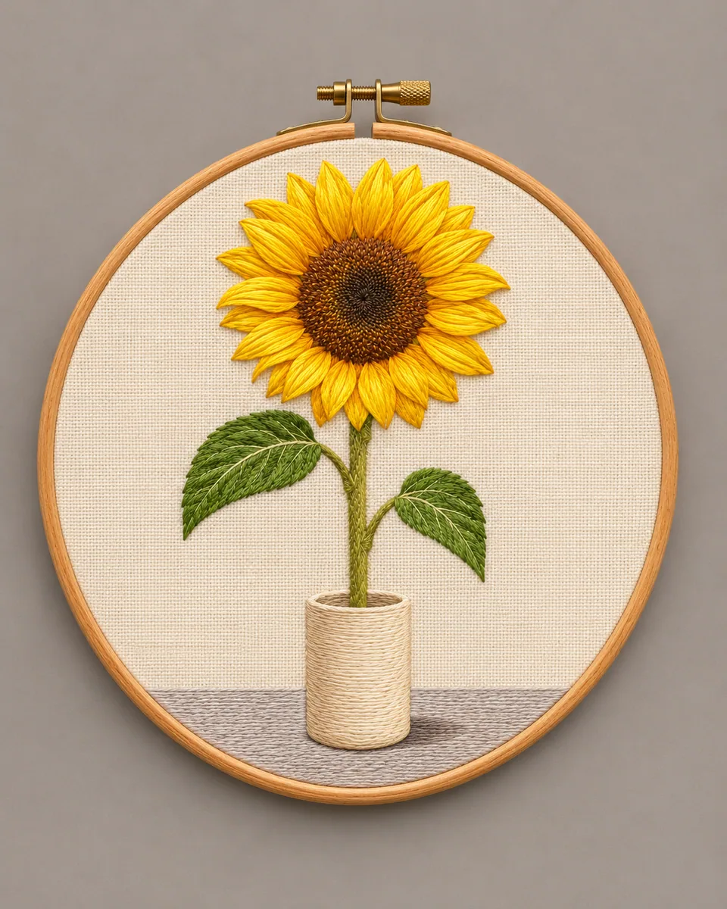

# 绣绷丝线图案 · Hoop Thread Embroidery

把照片构图绣成象牙织布上的平面细丝图案，以缎面针和方向性短针表现花瓣、叶脉与明暗，装进一只木绣绷，避免立体针织玩偶化。

Translate the photo into a flat fine-thread design on ivory cloth, using satin stitches and directional short stitches inside one wooden hoop rather than knitted objects.

本方法改编自 SeeAPI; editorial rewrite inspired by @ai_suxiaole 的 CC-BY-4.0 授权说明。原作者归属、来源与改动见 [provenance.json](provenance.json)，完整上游许可及其版权声明见 [LICENSE-THIRD-PARTY.txt](LICENSE-THIRD-PARTY.txt)。

Adapted from SeeAPI; editorial rewrite inspired by @ai_suxiaole's CC-BY-4.0-licensed instructions. [provenance.json](provenance.json) records the original author, pinned source and modifications; [LICENSE-THIRD-PARTY.txt](LICENSE-THIRD-PARTY.txt) retains the complete upstream license and copyright notices.

原始归属 · Original attribution: Copyright © 2026 SeeAPI. Adapted by MuziGeek from SeeAPI — Nano Banana Prompts for Image Editing, CC BY 4.0. Original inspiration credits are retained where supplied.

## 输入分析与实际保留

1. 读取用户提供的原图；若没有可用图片，先请求图片。不要用本仓库示例代替用户输入。
2. 观察原图主体、身份、数量、连接、遮挡、光线和画幅。依据本 Skill 的保留约束与几何边界，区分需要保留及明确允许转化的部分。样片说明不能当作用户输入的事实。
3. 使用支持参考图编辑的可用工具，把原图作为编辑输入。先说明观察到的主体，再结合下方机制及 [recipe.yaml](recipe.yaml) 按顺序组合指令；工具名称不是必须安装的依赖。
4. 默认沿用原图比例；仅按用户要求及本 Skill 明确写出的构图或几何转化调整。配方的 4:5 是目录样片比例，不授权裁去必须保留的主体。
5. 对照输入检查结果；只修正发现的问题，不为了增强风格改变身份或添加无关景物。区分已完成的视觉检查与尚未验证的效果。

## Input analysis and preservation

1. Inspect the supplied image; request an image only when none is available. Never substitute a repository example for the user's input.
2. Inspect the real subjects, identity, counts, attachments, overlaps, light and framing. Distinguish preserved attributes from explicitly permitted transformations using this Skill’s preservation and geometry rules; sample descriptions are not facts about user input.
3. Use an available reference-image editing tool. Combine the observed facts with the ordered mechanisms in [recipe.yaml](recipe.yaml); its model-family label does not require an installation script.
4. Keep the input ratio by default; change composition or geometry only as requested by the user and expressly permitted below. The recipe’s 4:5 ratio is a catalog-sample default, not permission to crop protected subjects.
5. Compare output with input and correct observed failures. Report only visual checks actually completed; stronger styling must not override identity or scene integrity.

## 风格机制 · Style mechanism

- 把照片构图绣成象牙织布上的平面细丝图案，以缎面针和方向性短针表现花瓣、叶脉与明暗，装进一只木绣绷，避免立体针织玩偶化。
- 识别特征：平面缎面细针、丝线方向光泽、单只完整木绣绷。
- Medium anchor: A flat silk-like thread embroidery picture stitched into taut ivory woven cloth inside one complete wooden embroidery hoop.

10. **medium** — Reinterpret the photographed composition as a flat hand-embroidered picture on taut ivory woven cloth inside one wooden hoop.
20. **palette** — Derive thread colors from the photographed subject, with restrained warm highlights and naturally colored shadows.
30. **line** — Use fine satin stitches for filled forms and short directional stitches for contours, veins and delicate structural detail.
40. **texture** — Keep low thread relief and visible fine strand sheen; show fabric weave only in the unstitched negative space.
50. **lighting** — Photograph the embroidery straight on under gentle side light that reveals stitch direction without deep sculptural shadows.
60. **composition** — Preserve the source subject count, recognizable outlines and relative arrangement within the complete circular hoop.
70. **detail** — Keep every pictorial element sewn into the cloth plane; do not transform subjects into freestanding knitted toys or stuffed fabric objects.
80. **finish** — Return only the finished hoop embroidery without before-after comparison, titles, edition text, captions, logos or watermark.

## 保留约束 · Preservation constraints

在实际输入观察结果之上应用以下约束；清单不授权凭空添加图片中不存在的元素。

Apply these constraints to observed content; they never authorize inventing absent subjects.

- Main subject count, recognizable silhouettes, distinctive colors and source spatial relationships.
- Observed petal, leaf, vessel or facial structure translated into planar stitches rather than invented elements.
- Complete principal subjects inside the single added hoop; mild reframing for the circular mounting is permitted.

## 适用范围与几何边界 · Applicability and geometry

- 适用：人像、合影、风景、美食、产品、器物。
- Applies to: Portrait, Group, Landscape, Food, Product, Object.
- 允许把照片内容平面化为布上丝线并增加一只绣绷，轻微重取景以容纳圆形外框；保留主体数量与相对关系，不把物体整体变成3D针织或毛线玩偶。
- Flatten source content into thread on cloth and add one hoop, reframing modestly for its circular boundary; preserve subject counts and relationships without 3D knitted-object conversion.
- 未明确允许的结构变化均不属于此风格；不把这些方法解释为复刻某位艺术家、品牌或现成作品的授权。
- Structural changes not explicitly allowed above are outside this method. This is not permission to reproduce a named artist, brand or existing artwork.

## 排除项 · Avoid

- Freestanding knitted objects, crocheted toys, stuffed figures or thick looped yarn sculpture.
- Printed or painted image on cloth without visible stitch construction.
- Extra subjects, omitted identifying parts, malformed anatomy or clipped main forms.
- Before-after collage, embroidered wording, labels, logos, watermark or signature.

## 验收 · Acceptance

- 照片图案由平面细针组成，能看清线向与丝线微光。
  The picture is built from flat fine stitches with readable direction and subtle strand sheen.
- 主体数量、轮廓、叶花关系和配色来自原图。
  Counts, silhouettes, flower/leaf relations and colors derive from the actual source.
- 只有一只完整绣绷，布底拉平，无立体玩偶或针织实体。
  One complete hoop holds taut cloth without freestanding toys or knitted objects.
- 无上下对照、文字、标签、标志或水印。
  No comparison layout, wording, labels, logos or watermark appears.

## 配方、来源与许可 · Recipe, provenance and license

- [recipe.yaml](recipe.yaml): structured image-editing recipe / 结构化图像编辑配方。
- [provenance.json](provenance.json): original authorship, method context and example status / 原创归属、方法背景与示例状态。
- [LICENSE](LICENSE): MIT applies to MuziGeek's original contributions / MIT 适用于 MuziGeek 的原创贡献。
- [LICENSE-THIRD-PARTY.txt](LICENSE-THIRD-PARTY.txt): SeeAPI; editorial rewrite inspired by @ai_suxiaole · CC-BY-4.0. Adapted material retains these terms and attribution / 改编材料保留原许可和归属。
- 示例中的前后图均为 AI 合成，不是真人摄影或真实制作工艺的证据。结果会随模型与输入变化，不承诺相同输出。
- Example before/after images are AI-generated, not photographs of real people or evidence of physical craft production. Results vary by model and input.
- MIT 不授予用户输入、第三方作品、人物、商标或生成平台条款之外的权利；示例许可单独见 provenance。
- MIT grants no rights to user inputs, third-party works, likenesses or trademarks, and does not override generation-service terms; example terms are recorded separately in provenance.

## 示例状态 · Example status

ready：打包的原图与效果图均存在且记录了通过的视觉审核。

ready: both packaged source and effect exist and have recorded approved visual reviews.

| AI 合成原图 · Source | 通过审核的效果 · Approved effect |
| --- | --- |
|  |  |

- [AI source / AI 合成原图](examples/source.webp)
- [Generated interpretation / 生成效果](examples/effect.webp)
- [Generation and visual review / 生成与视觉审核记录](examples/generation.json)
