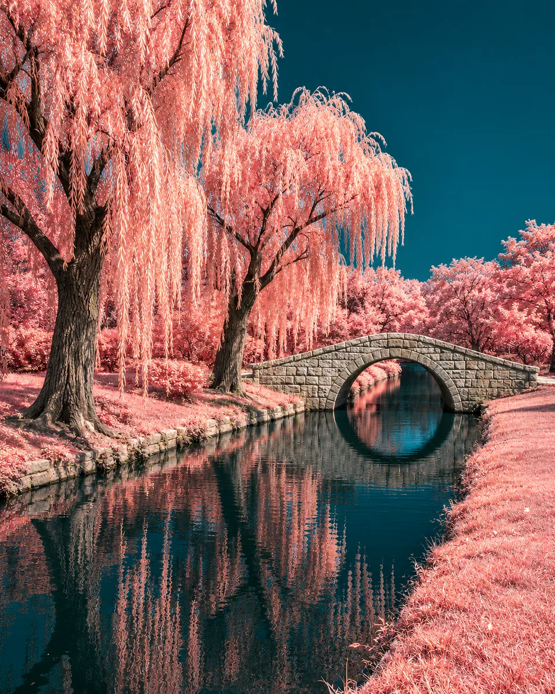

# 红外异色 · Infrared False Color

将近红外摄影的异色关系转译为柔粉植被、深青天空和清冷水面，改变光谱观感，同时保留真实地形、建筑及人物结构。

Reinterpret near-infrared tonal relationships through pale coral foliage, deep cyan skies and cool dark water while preserving the scene's real geometry.

原创方法说明，由 MuziGeek 编写；没有声称改编自外部提示词。

Original method instructions authored by MuziGeek; no external prompt adaptation is asserted.

## 输入分析与实际保留

1. 读取用户提供的原图；若没有可用图片，先请求图片。不要用本仓库示例代替用户输入。
2. 观察实际主体数量、身份与表情、朝向、肢体和连接、物体开口、相互遮挡、前后层次、光向及画幅；据实形成简短保留清单。样片说明只是样片，不能当成其他输入的事实。
3. 使用支持参考图编辑的可用工具，把原图作为编辑输入。先说明观察到的主体，再结合下方机制及 [recipe.yaml](recipe.yaml) 按顺序组合指令；工具名称不是必须安装的依赖。
4. 实际编辑默认沿用原图比例和完整内容，除非用户另有要求。配方的 4:5 是目录样片比例，不代表可裁去用户照片中的主体。
5. 对照输入检查结果；只修正发现的问题，不为了增强风格改变身份或添加无关景物。区分已完成的视觉检查与尚未验证的效果。

## Input analysis and preservation

1. Inspect the supplied image; request an image only when none is available. Never substitute a repository example for the user's input.
2. Record the observed subject count, identity, expression, direction, anatomy, attachments, openings, overlaps, depth, light and framing. Build preservation instructions from this image, not from the sample description.
3. Use an available reference-image editing tool. Combine the observed facts with the ordered mechanisms in [recipe.yaml](recipe.yaml); its model-family label does not require an installation script.
4. Keep the input aspect ratio and complete composition unless the user requests another format. The recipe's 4:5 ratio is a catalog-sample default, not authorization to crop a subject.
5. Compare output with input and correct observed failures. Report only visual checks actually completed; stronger styling must not override identity or scene integrity.

## 风格机制 · Style mechanism

- 将近红外摄影的异色关系转译为柔粉植被、深青天空和清冷水面，改变光谱观感，同时保留真实地形、建筑及人物结构。
- 识别特征：柔粉高亮植被、深青天空水面、材质分区异色。
- Medium anchor: Photographic near-infrared false-color interpretation with material-specific spectral separation, luminous foliage and dark cool water.

10. **medium** — Interpret the source as near-infrared false-color photography, retaining photographic texture and physically coherent spatial depth.
20. **palette** — Map living foliage to luminous pale coral and rose; keep sky and water deep cyan, with stone and manufactured surfaces comparatively neutral.
30. **lighting** — Lift foliage luminance while preserving leaf shadow structure; darken open water and sky without changing the original sun direction.
40. **line** — Keep branch networks, shorelines and architecture crisp; recoloring must respect exact material boundaries without colored edge fringes.
50. **texture** — Preserve leaf clusters, stone pores and water ripples; use fine photographic texture rather than plastic smoothing or painted foliage.
60. **composition** — Maintain the original view, horizon, object counts and reflection geometry; introduce no vegetation, mountains, structures or celestial objects.
70. **detail** — Keep faces recognizable and skin softly neutral; apply spectral color differences by material instead of washing every surface pink.
80. **finish** — Balance luminous vegetation against cool shadows with controlled saturation; finish edge to edge without film borders or infrared-camera overlays.

## 保留约束 · Preservation constraints

在实际输入观察结果之上应用以下约束；清单不授权凭空添加图片中不存在的元素。

Apply these constraints to observed content; they never authorize inventing absent subjects.

- Terrain, building geometry and horizon placement
- Exact trees, people and object counts
- Material boundaries and recognizable human features
- Original lighting direction and aligned water reflections

## 适用范围与几何边界 · Applicability and geometry

- 适用：风景、人像、合影、器物。
- Applies to: Landscape, Portrait, Group, Object.
- 异色只作用于现有材质区域；保留叶簇、天空缺口、建筑透视与倒影对应关系，不凭空补充植被。
- Apply false color only within existing material regions; preserve foliage clusters, sky gaps, perspective and reflection correspondence without adding plants.
- 未明确允许的结构变化均不属于此风格；不把这些方法解释为复刻某位艺术家、品牌或现成作品的授权。
- Structural changes not explicitly allowed above are outside this method. This is not permission to reproduce a named artist, brand or existing artwork.

## 排除项 · Avoid

- uniform pink color wash
- thermal-camera rainbow colors
- new foliage or extra trees
- fantasy planets or altered terrain
- magenta skin
- haloed vegetation edges
- borders, camera readouts, text or watermark

## 验收 · Acceptance

- 植被、天空水面及石材有明确的材质分区映射。
  Foliage, sky, water and stone receive distinct material-specific color mappings.
- 树木数量、岸线、桥体和倒影几何与原图一致。
  Tree counts, shorelines, bridge structure and reflection geometry match the source.
- 叶片亮而有层次，水面深而保留原有反射。
  Bright foliage retains layers while dark water preserves existing reflections.
- 不出现热成像色带、粉色肤质、额外景物或画框。
  No thermal rainbow, pink skin, added scenery or frame appears.

## 配方、来源与许可 · Recipe, provenance and license

- [recipe.yaml](recipe.yaml): structured image-editing recipe / 结构化图像编辑配方。
- [provenance.json](provenance.json): original authorship, method context and example status / 原创归属、方法背景与示例状态。
- [LICENSE](LICENSE): MIT applies to MuziGeek's original contributions / MIT 适用于 MuziGeek 的原创贡献。
- 示例中的前后图均为 AI 合成，不是真人摄影或真实制作工艺的证据。结果会随模型与输入变化，不承诺相同输出。
- Example before/after images are AI-generated, not photographs of real people or evidence of physical craft production. Results vary by model and input.
- MIT 不授予用户输入、第三方作品、人物、商标或生成平台条款之外的权利；示例许可单独见 provenance。
- MIT grants no rights to user inputs, third-party works, likenesses or trademarks, and does not override generation-service terms; example terms are recorded separately in provenance.

## 示例状态 · Example status

ready：打包的原图与效果图均存在且记录了通过的视觉审核。

ready: both packaged source and effect exist and have recorded approved visual reviews.

| AI 合成原图 · Source | 通过审核的效果 · Approved effect |
| --- | --- |
|  |  |

- [AI source / AI 合成原图](examples/source.webp)
- [Generated interpretation / 生成效果](examples/effect.webp)
- [Generation and visual review / 生成与视觉审核记录](examples/generation.json)
