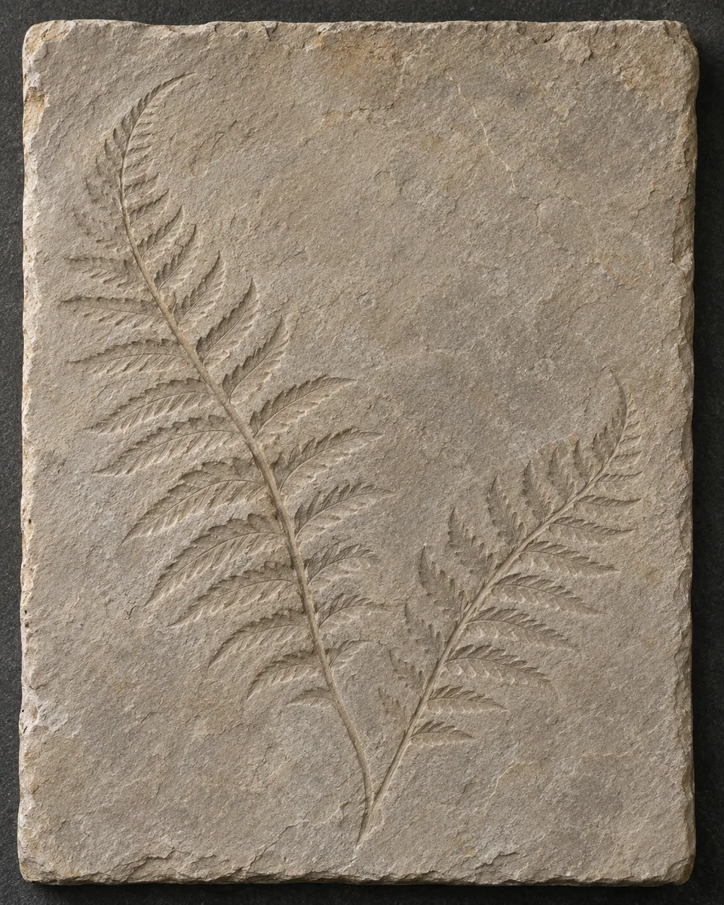
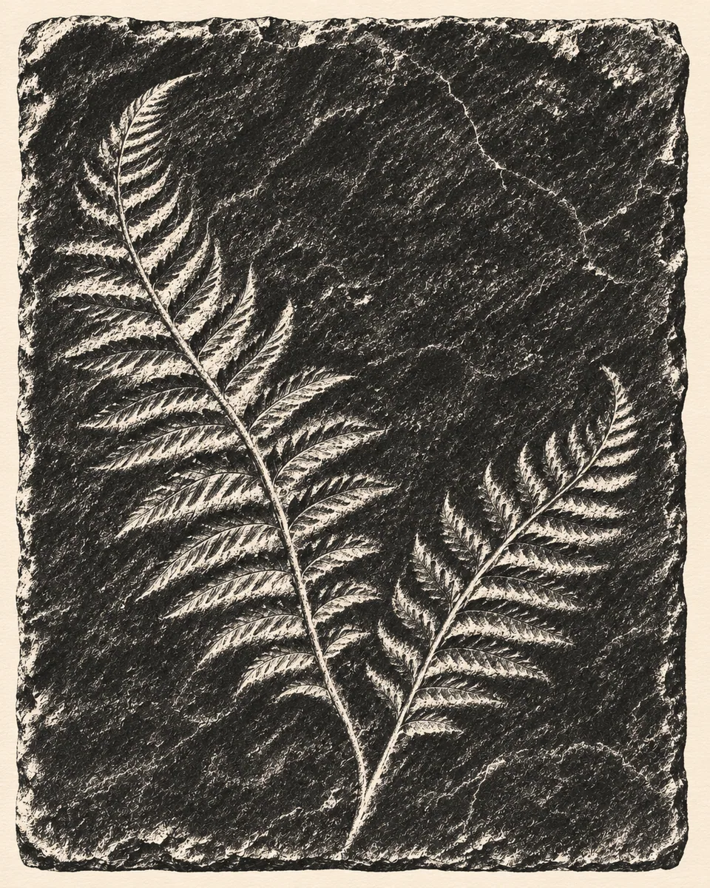

# 墨拓白形 · White Forms in Ink Rubbing

把器物表面和浅浮雕纹理转换为黑墨中的白色拓痕，以压印的虚实保留细节和轮廓，呈现纸张贴附表面的直接触感。

Translate surface relief into white impressions within dense black ink, retaining readable texture and contours through uneven paper contact.

原创方法说明，由 MuziGeek 编写；没有声称改编自外部提示词。

Original method instructions authored by MuziGeek; no external prompt adaptation is asserted.

## 输入分析与实际保留

1. 读取用户提供的原图；若没有可用图片，先请求图片。不要用本仓库示例代替用户输入。
2. 观察实际主体数量、身份与表情、朝向、肢体和连接、物体开口、相互遮挡、前后层次、光向及画幅；据实形成简短保留清单。样片说明只是样片，不能当成其他输入的事实。
3. 使用支持参考图编辑的可用工具，把原图作为编辑输入。先说明观察到的主体，再结合下方机制及 [recipe.yaml](recipe.yaml) 按顺序组合指令；工具名称不是必须安装的依赖。
4. 实际编辑默认沿用原图比例和完整内容，除非用户另有要求。配方的 4:5 是目录样片比例，不代表可裁去用户照片中的主体。
5. 对照输入检查结果；只修正发现的问题，不为了增强风格改变身份或添加无关景物。区分已完成的视觉检查与尚未验证的效果。

## Input analysis and preservation

1. Inspect the supplied image; request an image only when none is available. Never substitute a repository example for the user's input.
2. Record the observed subject count, identity, expression, direction, anatomy, attachments, openings, overlaps, depth, light and framing. Build preservation instructions from this image, not from the sample description.
3. Use an available reference-image editing tool. Combine the observed facts with the ordered mechanisms in [recipe.yaml](recipe.yaml); its model-family label does not require an installation script.
4. Keep the input aspect ratio and complete composition unless the user requests another format. The recipe's 4:5 ratio is a catalog-sample default, not authorization to crop a subject.
5. Compare output with input and correct observed failures. Report only visual checks actually completed; stronger styling must not override identity or scene integrity.

## 风格机制 · Style mechanism

- 把器物表面和浅浮雕纹理转换为黑墨中的白色拓痕，以压印的虚实保留细节和轮廓，呈现纸张贴附表面的直接触感。
- 识别特征：黑墨白拓、压印虚实、表面细痕。
- Medium anchor: Render the observed textured object as an ink-rubbing-inspired image: dense matte ink surrounds white relief impressions and irregular paper-contact marks.

10. **medium** — Translate visible relief into white impressions within dense black ink; derive every major mark from actual surface contours and texture.
20. **texture** — Vary ink contact along raised edges and recessed grooves; create tiny broken paper impressions without scattering unrelated scratches across the image.
30. **palette** — Use matte charcoal-black ink and warm paper white; avoid colored antiquing washes, metallic highlights and photographic tonal gradients.
40. **composition** — Preserve the object's outline, orientation and principal relief pattern; simplify the surrounding setting to quiet paper without introducing a comparison panel.
50. **detail** — Retain the hierarchy between broad relief shapes and fine tool marks; keep narrow gaps readable rather than filling them with solid black.
60. **finish** — Present an original artistic interpretation, without invented inscriptions, dates, museum labels or claims that a physical historical rubbing was made.

## 保留约束 · Preservation constraints

在实际输入观察结果之上应用以下约束；清单不授权凭空添加图片中不存在的元素。

Apply these constraints to observed content; they never authorize inventing absent subjects.

- Object boundary, orientation and principal relief motifs
- Existing relief overlaps and branching directions
- Surface-detail hierarchy visible in the photograph

## 适用范围与几何边界 · Applicability and geometry

- 适用：器物、产品。
- Applies to: Object, Product.
- 仅用于表面结构清楚的器物或浅浮雕；平滑人脸与无纹理风景不适合，不凭空添加铭文。
- Use objects or shallow relief with readable surface structure; avoid smooth faces or textureless landscapes, and never invent inscriptions.
- 未明确允许的结构变化均不属于此风格；不把这些方法解释为复刻某位艺术家、品牌或现成作品的授权。
- Structural changes not explicitly allowed above are outside this method. This is not permission to reproduce a named artist, brand or existing artwork.

## 排除项 · Avoid

- Invented inscriptions, characters or ownership stamps
- Uniform threshold filter with no contact texture
- Unrelated scratch overlays
- Photographic lighting retained inside printed marks
- Historical provenance claims, labels, borders and watermarks

## 验收 · Acceptance

- 物体外形和主要浮雕纹路对应原照
  Object outline and major relief patterns match the source
- 白色拓痕与黑墨之间有自然接触变化
  White impressions show natural variation against dense ink
- 细小纹路仍可辨，不是简单黑白阈值化
  Fine marks remain readable beyond simple threshold conversion
- 没有编造文字、年代或历史拓本身份
  No inscriptions, dates or claims of historical authenticity are invented

## 配方、来源与许可 · Recipe, provenance and license

- [recipe.yaml](recipe.yaml): structured image-editing recipe / 结构化图像编辑配方。
- [provenance.json](provenance.json): original authorship, method context and example status / 原创归属、方法背景与示例状态。
- [LICENSE](LICENSE): MIT applies to MuziGeek's original contributions / MIT 适用于 MuziGeek 的原创贡献。
- 示例中的前后图均为 AI 合成，不是真人摄影或真实制作工艺的证据。结果会随模型与输入变化，不承诺相同输出。
- Example before/after images are AI-generated, not photographs of real people or evidence of physical craft production. Results vary by model and input.
- MIT 不授予用户输入、第三方作品、人物、商标或生成平台条款之外的权利；示例许可单独见 provenance。
- MIT grants no rights to user inputs, third-party works, likenesses or trademarks, and does not override generation-service terms; example terms are recorded separately in provenance.

## 示例状态 · Example status

ready：打包的原图与效果图均存在且记录了通过的视觉审核。

ready: both packaged source and effect exist and have recorded approved visual reviews.

| AI 合成原图 · Source | 通过审核的效果 · Approved effect |
| --- | --- |
|  |  |

- [AI source / AI 合成原图](examples/source.webp)
- [Generated interpretation / 生成效果](examples/effect.webp)
- [Generation and visual review / 生成与视觉审核记录](examples/generation.json)
