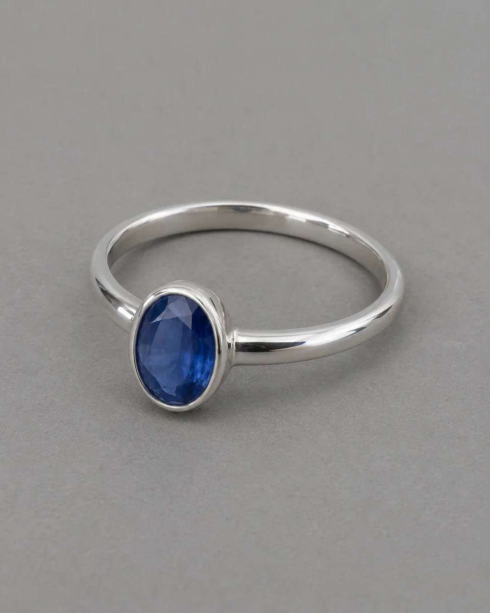
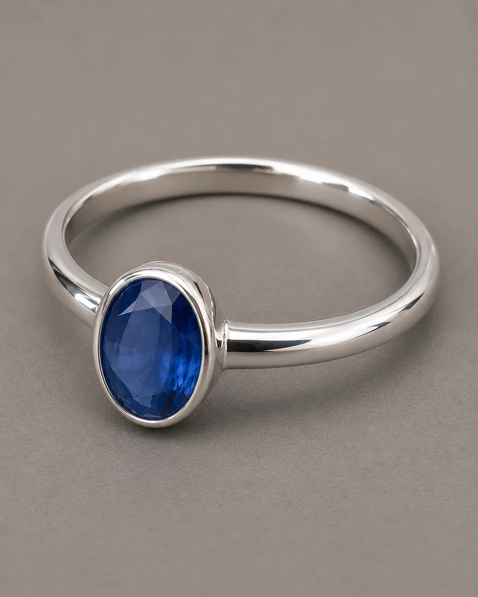

# 首饰微距广告 · Jewelry Macro Campaign

在保持首饰本体设计的前提下加强微距细节，以干净背景和精确高光呈现金属、宝石与镶嵌结构，避免增添钻石或改变成色。

Create a macro jewelry campaign photo that retains the exact design while clarifying metal, gemstone and setting detail with precise controlled highlights.

本方法改编自 Photoshoot.app 的 CC-BY-4.0 授权说明。原作者归属、来源与改动见 [provenance.json](provenance.json)，完整上游许可及其版权声明见 [LICENSE-THIRD-PARTY.txt](LICENSE-THIRD-PARTY.txt)。

Adapted from Photoshoot.app's CC-BY-4.0-licensed instructions. [provenance.json](provenance.json) records the original author, pinned source and modifications; [LICENSE-THIRD-PARTY.txt](LICENSE-THIRD-PARTY.txt) retains the complete upstream license and copyright notices.

原始归属 · Original attribution: Copyright © 2026 Photoshoot.app Adapted by MuziGeek from Photoshoot.app; repository and original-post credits are retained.

## 输入分析与实际保留

1. 读取用户提供的原图；若没有可用图片，先请求图片。不要用本仓库示例代替用户输入。
2. 观察原图主体、身份、数量、连接、遮挡、光线和画幅。依据本 Skill 的保留约束与几何边界，区分需要保留及明确允许转化的部分。样片说明不能当作用户输入的事实。
3. 使用支持参考图编辑的可用工具，把原图作为编辑输入。先说明观察到的主体，再结合下方机制及 [recipe.yaml](recipe.yaml) 按顺序组合指令；工具名称不是必须安装的依赖。
4. 默认沿用原图比例；仅按用户要求及本 Skill 明确写出的构图或几何转化调整。配方的 4:5 是目录样片比例，不授权裁去必须保留的主体。
5. 对照输入检查结果；只修正发现的问题，不为了增强风格改变身份或添加无关景物。区分已完成的视觉检查与尚未验证的效果。

## Input analysis and preservation

1. Inspect the supplied image; request an image only when none is available. Never substitute a repository example for the user's input.
2. Inspect the real subjects, identity, counts, attachments, overlaps, light and framing. Distinguish preserved attributes from explicitly permitted transformations using this Skill’s preservation and geometry rules; sample descriptions are not facts about user input.
3. Use an available reference-image editing tool. Combine the observed facts with the ordered mechanisms in [recipe.yaml](recipe.yaml); its model-family label does not require an installation script.
4. Keep the input ratio by default; change composition or geometry only as requested by the user and expressly permitted below. The recipe’s 4:5 ratio is a catalog-sample default, not permission to crop protected subjects.
5. Compare output with input and correct observed failures. Report only visual checks actually completed; stronger styling must not override identity or scene integrity.

## 风格机制 · Style mechanism

- 在保持首饰本体设计的前提下加强微距细节，以干净背景和精确高光呈现金属、宝石与镶嵌结构，避免增添钻石或改变成色。
- 识别特征：精准微距细节、金属宝石分质、原有镶嵌结构。
- Medium anchor: A precise macro jewelry photograph with controlled metal highlights, realistic gem optics and the exact original setting design.

10. **medium** — Create a refined macro jewelry photograph of the exact item supplied in the reference.
20. **palette** — Preserve original metal color, gemstone hue and material distinctions against a quiet warm-gray background.
30. **line** — Keep band geometry, gemstone count, stone cut, prongs, engraving and proportions unchanged.
40. **texture** — Resolve fine polish, restrained surface texture and realistic gemstone refraction without excessive sparkle.
50. **lighting** — Use controlled soft studio highlights with small targeted reflections that explain metal and gem surfaces.
60. **composition** — Reframe closer while keeping the entire main jewelry piece inside the image and its setting clearly readable.
70. **detail** — Do not add diamonds, new facets, extra jewelry, luxury branding or unsupported material-value claims.
80. **finish** — Return one sharp photographic product image without hands, slogans, text, logos or watermark.

## 保留约束 · Preservation constraints

在实际输入观察结果之上应用以下约束；清单不授权凭空添加图片中不存在的元素。

Apply these constraints to observed content; they never authorize inventing absent subjects.

- Identity, age, expression and body proportions of observed people.
- Exact geometry and recognizable details of subjects not explicitly selected for change.
- Camera viewpoint and original composition except changes specifically permitted by this Skill.

## 适用范围与几何边界 · Applicability and geometry

- 适用：产品、器物。
- Applies to: Product, Object.
- 允许更近取景、调整首饰摆放、背景与布光；保持戒圈、宝石数量形状、镶爪及金属色，不新增钻石或夸大材质价值。
- Allow macro reframing, placement, backdrop and lighting changes; preserve band, gemstone count and shape, prongs and metal color without adding stones or value claims.
- 未明确允许的结构变化均不属于此风格；不把这些方法解释为复刻某位艺术家、品牌或现成作品的授权。
- Structural changes not explicitly allowed above are outside this method. This is not permission to reproduce a named artist, brand or existing artwork.

## 排除项 · Avoid

- Unrequested people, duplicate subjects or malformed anatomy.
- New logos, watermarks or unreadable pseudo-lettering.
- Clipping the main subject or erasing its identifying features.

## 验收 · Acceptance

- 戒圈、镶爪、宝石形状和数量保持。
  Band, prongs, gemstone shape and count remain exact.
- 金属与宝石光学表现可区分。
  Metal and gemstone optical behavior are distinct.
- 细节清楚而非虚假星芒或过度闪烁。
  Detail stays clear without false starbursts or excessive sparkle.
- 完整首饰可见，无新增钻石、文字或价值宣称。
  The complete item remains visible without added stones, text or value claims.

## 配方、来源与许可 · Recipe, provenance and license

- [recipe.yaml](recipe.yaml): structured image-editing recipe / 结构化图像编辑配方。
- [provenance.json](provenance.json): original authorship, method context and example status / 原创归属、方法背景与示例状态。
- [LICENSE](LICENSE): MIT applies to MuziGeek's original contributions / MIT 适用于 MuziGeek 的原创贡献。
- [LICENSE-THIRD-PARTY.txt](LICENSE-THIRD-PARTY.txt): Photoshoot.app · CC-BY-4.0. Adapted material retains these terms and attribution / 改编材料保留原许可和归属。
- 示例中的前后图均为 AI 合成，不是真人摄影或真实制作工艺的证据。结果会随模型与输入变化，不承诺相同输出。
- Example before/after images are AI-generated, not photographs of real people or evidence of physical craft production. Results vary by model and input.
- MIT 不授予用户输入、第三方作品、人物、商标或生成平台条款之外的权利；示例许可单独见 provenance。
- MIT grants no rights to user inputs, third-party works, likenesses or trademarks, and does not override generation-service terms; example terms are recorded separately in provenance.

## 示例状态 · Example status

ready：打包的原图与效果图均存在且记录了通过的视觉审核。

ready: both packaged source and effect exist and have recorded approved visual reviews.

| AI 合成原图 · Source | 通过审核的效果 · Approved effect |
| --- | --- |
|  |  |

- [AI source / AI 合成原图](examples/source.webp)
- [Generated interpretation / 生成效果](examples/effect.webp)
- [Generation and visual review / 生成与视觉审核记录](examples/generation.json)
