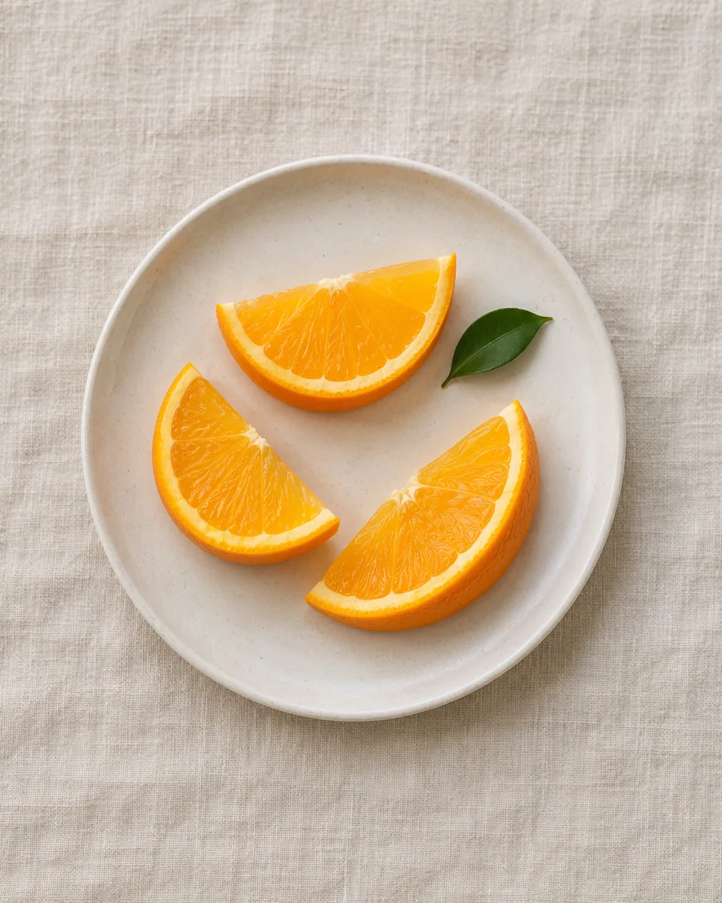
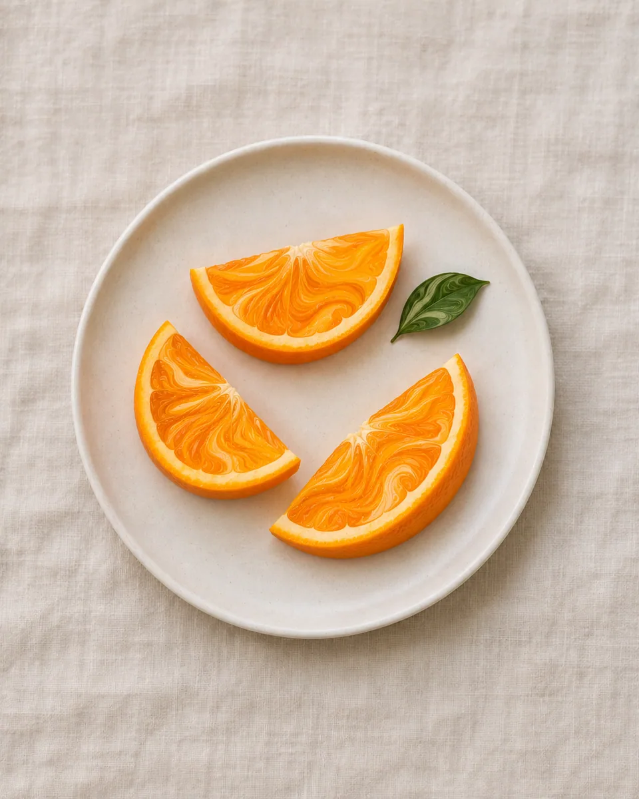

# 液态大理纹 · Liquid marbling

把主体内部色块转化为流动交织的细密色纹，在边界内进行有限拉伸与回旋，保留主体轮廓、数量和核心识别色。

Transform internal color masses into interleaved marbled ribbons, allowing bounded stretching and eddies while retaining silhouettes and defining colors.

原创方法说明，由 MuziGeek 编写；没有声称改编自外部提示词。

Original method instructions authored by MuziGeek; no external prompt adaptation is asserted.

## 输入分析与实际保留

1. 读取用户提供的原图；若没有可用图片，先请求图片。不要用本仓库示例代替用户输入。
2. 观察实际主体数量、身份与表情、朝向、肢体和连接、物体开口、相互遮挡、前后层次、光向及画幅；据实形成简短保留清单。样片说明只是样片，不能当成其他输入的事实。
3. 使用支持参考图编辑的可用工具，把原图作为编辑输入。先说明观察到的主体，再结合下方机制及 [recipe.yaml](recipe.yaml) 按顺序组合指令；工具名称不是必须安装的依赖。
4. 实际编辑默认沿用原图比例和完整内容，除非用户另有要求。配方的 4:5 是目录样片比例，不代表可裁去用户照片中的主体。
5. 对照输入检查结果；只修正发现的问题，不为了增强风格改变身份或添加无关景物。区分已完成的视觉检查与尚未验证的效果。

## Input analysis and preservation

1. Inspect the supplied image; request an image only when none is available. Never substitute a repository example for the user's input.
2. Record the observed subject count, identity, expression, direction, anatomy, attachments, openings, overlaps, depth, light and framing. Build preservation instructions from this image, not from the sample description.
3. Use an available reference-image editing tool. Combine the observed facts with the ordered mechanisms in [recipe.yaml](recipe.yaml); its model-family label does not require an installation script.
4. Keep the input aspect ratio and complete composition unless the user requests another format. The recipe's 4:5 ratio is a catalog-sample default, not authorization to crop a subject.
5. Compare output with input and correct observed failures. Report only visual checks actually completed; stronger styling must not override identity or scene integrity.

## 风格机制 · Style mechanism

- 把主体内部色块转化为流动交织的细密色纹，在边界内进行有限拉伸与回旋，保留主体轮廓、数量和核心识别色。
- 识别特征：细密流动色纹、边界内回旋、稳定主体轮廓。
- Medium anchor: Fluid marbling of source-derived pigment ribbons constrained within recognizable source regions and silhouettes.

10. **medium** — Repaint internal color regions as fluid marbled pigment ribbons while retaining the source's main silhouettes and object separations.
20. **palette** — Retain dominant source color roles with warm orange, ivory, and deep green accents only where compatible with existing regions.
30. **line** — Stretch internal color boundaries into slender ribbons and bounded eddies; avoid pulling whole subjects across the frame.
40. **texture** — Use smooth matte pigment interleaving with a few fine veins, not glossy stone slabs or realistic mineral cracks.
50. **lighting** — Preserve the broad source light-dark pattern as subtle value shifts across the flowing colors.
60. **composition** — Keep object count, plate shape, relative positions, framing, and negative space; confine fluid deformation within source regions.
70. **detail** — Retain distinctive arcs, tips, and structural transitions as recognition cues while allowing internal texture to become fine marbled flow.
80. **finish** — Resolve flowing details around stable silhouettes so the source reads clearly before the marbled texture.

## 保留约束 · Preservation constraints

在实际输入观察结果之上应用以下约束；清单不授权凭空添加图片中不存在的元素。

Apply these constraints to observed content; they never authorize inventing absent subjects.

- Subject count, outer boundaries, relative positions, and source framing.
- Key geometric identity cues such as rind arcs and object tips.
- Dominant source color roles and separations between adjacent objects.

## 适用范围与几何边界 · Applicability and geometry

- 适用：美食、器物、产品、风景、人像。
- Applies to: Food, Object, Product, Landscape, Portrait.
- 允许主体内部色块拉伸、回旋和纹理重排；不改变外轮廓、数量、相对位置及关键形状。
- Allow internal color stretching, eddies, and texture remapping; preserve silhouettes, counts, relative positions, and defining shapes.
- 未明确允许的结构变化均不属于此风格；不把这些方法解释为复刻某位艺术家、品牌或现成作品的授权。
- Structural changes not explicitly allowed above are outside this method. This is not permission to reproduce a named artist, brand or existing artwork.

## 排除项 · Avoid

- Extra wedges, merged subjects, new holes, or stretched outer silhouettes.
- Unrelated marble countertop, metallic veins, or glossy stone replacement.
- Text, signatures, logos, watermarks, or decorative swirls outside subject regions.

## 验收 · Acceptance

- 主体数量、外边界及相互间距与原图一致。
  Counts, outer boundaries, and spacing match the source.
- 液态拉伸局限于主体内部，不合并不同物体。
  Fluid stretching stays inside regions without merging separate objects.
- 主要识别形状和色彩仍可辨。
  Defining shapes and color roles remain recognizable.
- 纹理是色流重绘，不增加大理石台面或金属纹。
  The result reads as pigment flow, without new stone surfaces or metallic veins.

## 配方、来源与许可 · Recipe, provenance and license

- [recipe.yaml](recipe.yaml): structured image-editing recipe / 结构化图像编辑配方。
- [provenance.json](provenance.json): original authorship, method context and example status / 原创归属、方法背景与示例状态。
- [LICENSE](LICENSE): MIT applies to MuziGeek's original contributions / MIT 适用于 MuziGeek 的原创贡献。
- 示例中的前后图均为 AI 合成，不是真人摄影或真实制作工艺的证据。结果会随模型与输入变化，不承诺相同输出。
- Example before/after images are AI-generated, not photographs of real people or evidence of physical craft production. Results vary by model and input.
- MIT 不授予用户输入、第三方作品、人物、商标或生成平台条款之外的权利；示例许可单独见 provenance。
- MIT grants no rights to user inputs, third-party works, likenesses or trademarks, and does not override generation-service terms; example terms are recorded separately in provenance.

## 示例状态 · Example status

ready：打包的原图与效果图均存在且记录了通过的视觉审核。

ready: both packaged source and effect exist and have recorded approved visual reviews.

| AI 合成原图 · Source | 通过审核的效果 · Approved effect |
| --- | --- |
|  |  |

- [AI source / AI 合成原图](examples/source.webp)
- [Generated interpretation / 生成效果](examples/effect.webp)
- [Generation and visual review / 生成与视觉审核记录](examples/generation.json)
