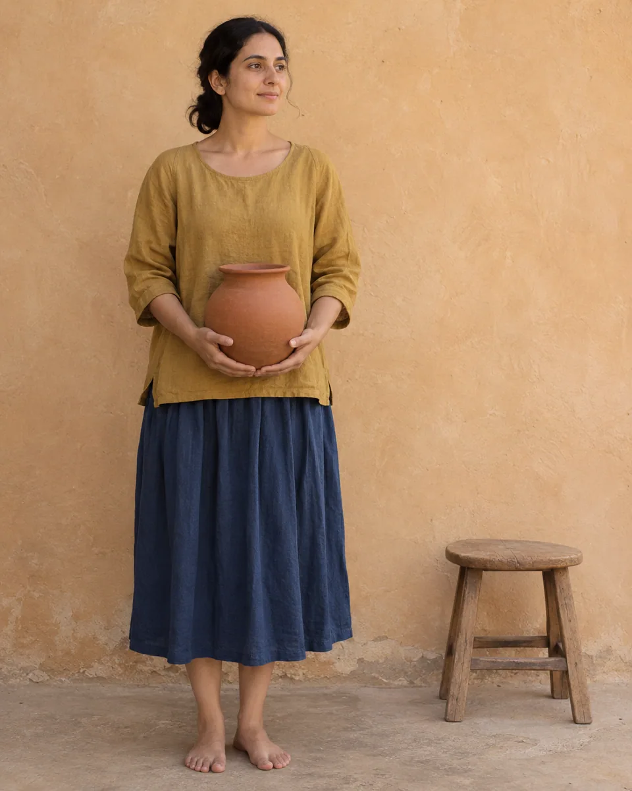
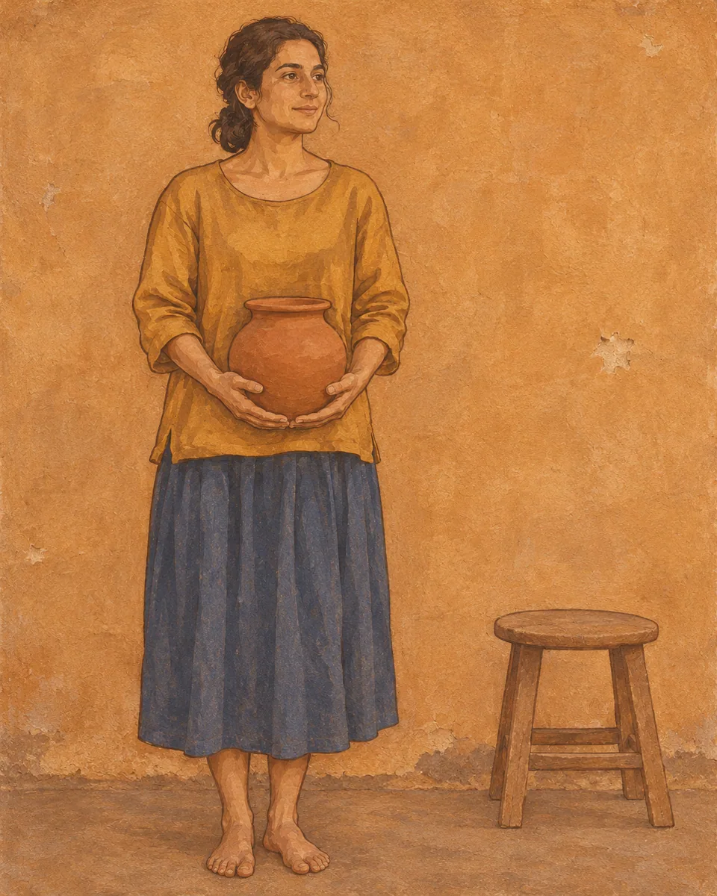

# 矿彩壁画 · Mineral Fresco Scene

把照片重绘成铺在墙面上的哑光矿彩，轮廓沉稳、色块层叠，少量风化露出底层，仍保留原场景和人物姿态。

Repaint the photograph as matte mineral pigment on plaster, with steady contours, layered color and selective weathering that preserves the original scene.

原创方法说明，由 MuziGeek 编写；没有声称改编自外部提示词。

Original method instructions authored by MuziGeek; no external prompt adaptation is asserted.

## 输入分析与实际保留

1. 读取用户提供的原图；若没有可用图片，先请求图片。不要用本仓库示例代替用户输入。
2. 观察实际主体数量、身份与表情、朝向、肢体和连接、物体开口、相互遮挡、前后层次、光向及画幅；据实形成简短保留清单。样片说明只是样片，不能当成其他输入的事实。
3. 使用支持参考图编辑的可用工具，把原图作为编辑输入。先说明观察到的主体，再结合下方机制及 [recipe.yaml](recipe.yaml) 按顺序组合指令；工具名称不是必须安装的依赖。
4. 实际编辑默认沿用原图比例和完整内容，除非用户另有要求。配方的 4:5 是目录样片比例，不代表可裁去用户照片中的主体。
5. 对照输入检查结果；只修正发现的问题，不为了增强风格改变身份或添加无关景物。区分已完成的视觉检查与尚未验证的效果。

## Input analysis and preservation

1. Inspect the supplied image; request an image only when none is available. Never substitute a repository example for the user's input.
2. Record the observed subject count, identity, expression, direction, anatomy, attachments, openings, overlaps, depth, light and framing. Build preservation instructions from this image, not from the sample description.
3. Use an available reference-image editing tool. Combine the observed facts with the ordered mechanisms in [recipe.yaml](recipe.yaml); its model-family label does not require an installation script.
4. Keep the input aspect ratio and complete composition unless the user requests another format. The recipe's 4:5 ratio is a catalog-sample default, not authorization to crop a subject.
5. Compare output with input and correct observed failures. Report only visual checks actually completed; stronger styling must not override identity or scene integrity.

## 风格机制 · Style mechanism

- 把照片重绘成铺在墙面上的哑光矿彩，轮廓沉稳、色块层叠，少量风化露出底层，仍保留原场景和人物姿态。
- 识别特征：哑光矿彩、墙面底层、局部风化。
- Medium anchor: Repaint the photograph as an original mineral-pigment wall painting with matte earthen colors, deliberate outlines and restrained plaster weathering.

10. **medium** — Rebuild every visible subject as layered matte mineral pigment on plaster; retain the source scene rather than imitating a specific historic mural.
20. **line** — Use deliberate dark-earth contours to describe silhouettes, facial landmarks and folds; simplify shading into broad connected planes.
30. **palette** — Translate source hues into ochre, clay red, mineral blue and subdued earth colors; retain recognizable clothing and object color relationships.
40. **texture** — Add fine plaster grain and a few localized pigment losses; keep faces, hands and important object boundaries sufficiently intact.
50. **composition** — Preserve poses, contacts and scene spacing; avoid adding religious figures, halos, ornamental borders or historical costumes.
60. **finish** — Keep weathering subordinate to readable painted forms; do not collage cracked-wall photographs over otherwise unchanged source imagery.

## 保留约束 · Preservation constraints

在实际输入观察结果之上应用以下约束；清单不授权凭空添加图片中不存在的元素。

Apply these constraints to observed content; they never authorize inventing absent subjects.

- Identity-defining facial proportions and source pose
- Hand-to-object contacts and visible anatomy
- Subject count, clothing silhouette and object placement
- Relative color relationships and original framing

## 适用范围与几何边界 · Applicability and geometry

- 适用：人像、合影、风景。
- Applies to: Portrait, Group, Landscape.
- 适合人物与生活场景；完整保留身份、动作和衣物结构，只转换画材，不把人物扮成特定古画角色。
- Use portraits and everyday scenes; preserve identity, gestures and garment structure while changing medium rather than recasting subjects as historical figures.
- 未明确允许的结构变化均不属于此风格；不把这些方法解释为复刻某位艺术家、品牌或现成作品的授权。
- Structural changes not explicitly allowed above are outside this method. This is not permission to reproduce a named artist, brand or existing artwork.

## 排除项 · Avoid

- Copied historical compositions or religious iconography
- Invented halos, jewelry or costume motifs
- Cracks obscuring faces and hands
- Photographic skin beneath a wall overlay
- Borders, inscriptions, signatures and watermarks

## 验收 · Acceptance

- 人物姿态、手部接触和物体数量正确
  Poses, hand contacts and object counts remain correct
- 所有主体均转为绘制形体而非照片贴墙
  All subjects are painted rather than photographs pasted onto plaster
- 风化只在局部，不遮蔽主要五官和动作
  Weathering is local and leaves important features readable
- 没有凭空添加宗教符号或历史装饰
  No religious symbols or historical ornament are invented

## 配方、来源与许可 · Recipe, provenance and license

- [recipe.yaml](recipe.yaml): structured image-editing recipe / 结构化图像编辑配方。
- [provenance.json](provenance.json): original authorship, method context and example status / 原创归属、方法背景与示例状态。
- [LICENSE](LICENSE): MIT applies to MuziGeek's original contributions / MIT 适用于 MuziGeek 的原创贡献。
- 示例中的前后图均为 AI 合成，不是真人摄影或真实制作工艺的证据。结果会随模型与输入变化，不承诺相同输出。
- Example before/after images are AI-generated, not photographs of real people or evidence of physical craft production. Results vary by model and input.
- MIT 不授予用户输入、第三方作品、人物、商标或生成平台条款之外的权利；示例许可单独见 provenance。
- MIT grants no rights to user inputs, third-party works, likenesses or trademarks, and does not override generation-service terms; example terms are recorded separately in provenance.

## 示例状态 · Example status

ready：打包的原图与效果图均存在且记录了通过的视觉审核。

ready: both packaged source and effect exist and have recorded approved visual reviews.

| AI 合成原图 · Source | 通过审核的效果 · Approved effect |
| --- | --- |
|  |  |

- [AI source / AI 合成原图](examples/source.webp)
- [Generated interpretation / 生成效果](examples/effect.webp)
- [Generation and visual review / 生成与视觉审核记录](examples/generation.json)
