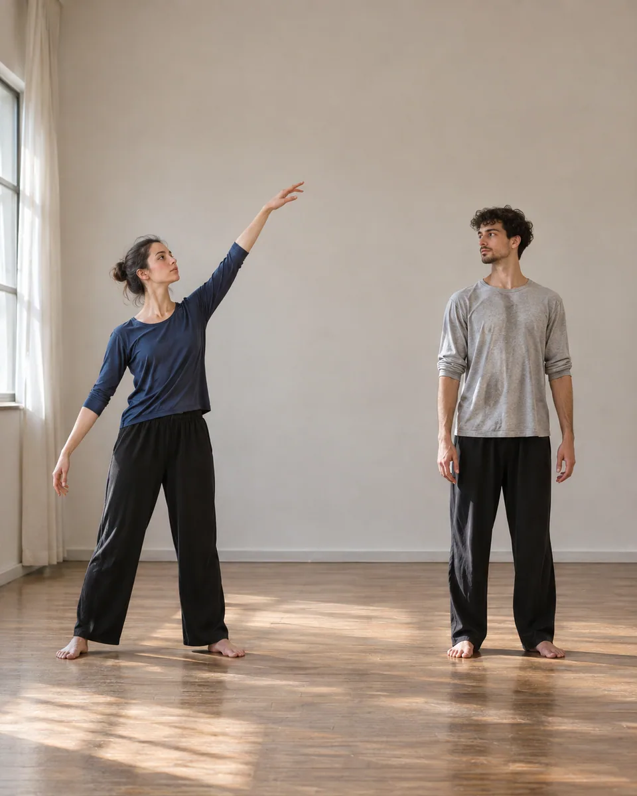
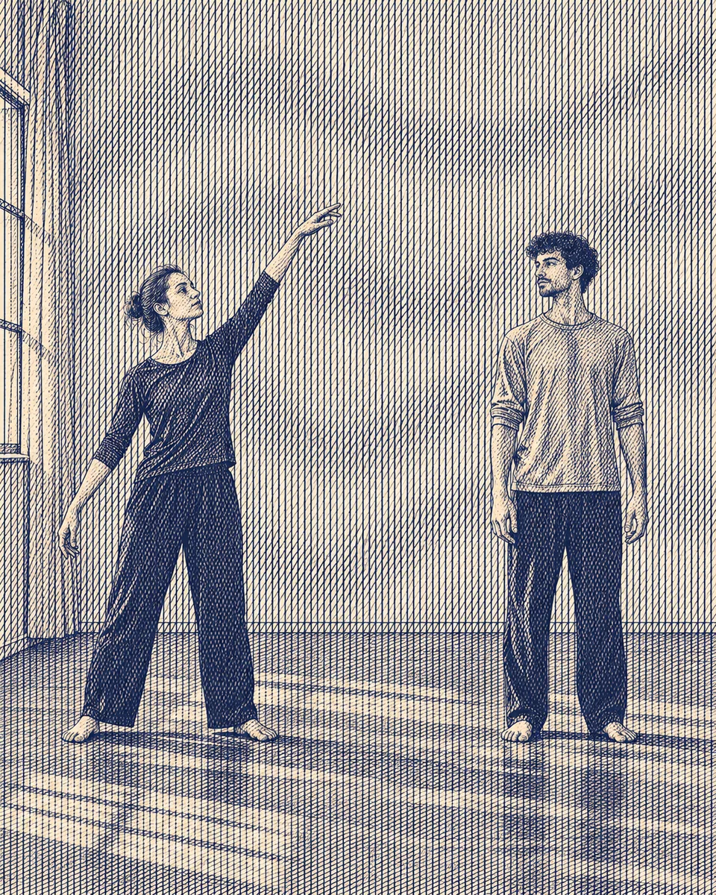

# 摩尔纹叠场 · Moire interference field

以两组轻微错角的细线场重绘明暗，在原有形体内形成缓慢起伏的干涉带，保留主体姿态、边界和空间分离。

Repaint tone with two slightly offset line fields whose interference creates broad waves within recognizable forms while preserving pose and separation.

原创方法说明，由 MuziGeek 编写；没有声称改编自外部提示词。

Original method instructions authored by MuziGeek; no external prompt adaptation is asserted.

## 输入分析与实际保留

1. 读取用户提供的原图；若没有可用图片，先请求图片。不要用本仓库示例代替用户输入。
2. 观察实际主体数量、身份与表情、朝向、肢体和连接、物体开口、相互遮挡、前后层次、光向及画幅；据实形成简短保留清单。样片说明只是样片，不能当成其他输入的事实。
3. 使用支持参考图编辑的可用工具，把原图作为编辑输入。先说明观察到的主体，再结合下方机制及 [recipe.yaml](recipe.yaml) 按顺序组合指令；工具名称不是必须安装的依赖。
4. 实际编辑默认沿用原图比例和完整内容，除非用户另有要求。配方的 4:5 是目录样片比例，不代表可裁去用户照片中的主体。
5. 对照输入检查结果；只修正发现的问题，不为了增强风格改变身份或添加无关景物。区分已完成的视觉检查与尚未验证的效果。

## Input analysis and preservation

1. Inspect the supplied image; request an image only when none is available. Never substitute a repository example for the user's input.
2. Record the observed subject count, identity, expression, direction, anatomy, attachments, openings, overlaps, depth, light and framing. Build preservation instructions from this image, not from the sample description.
3. Use an available reference-image editing tool. Combine the observed facts with the ordered mechanisms in [recipe.yaml](recipe.yaml); its model-family label does not require an installation script.
4. Keep the input aspect ratio and complete composition unless the user requests another format. The recipe's 4:5 ratio is a catalog-sample default, not authorization to crop a subject.
5. Compare output with input and correct observed failures. Report only visual checks actually completed; stronger styling must not override identity or scene integrity.

## 风格机制 · Style mechanism

- 以两组轻微错角的细线场重绘明暗，在原有形体内形成缓慢起伏的干涉带，保留主体姿态、边界和空间分离。
- 识别特征：微错角双线场、缓慢干涉波带、形体内疏密。
- Medium anchor: Two controlled, slightly rotated fine-line fields creating broad moire interference bands guided by source tone and form.

10. **medium** — Repaint tonal regions with two fine line fields whose slight angular offset produces broad controlled moire interference bands.
20. **palette** — Use warm paper, deep navy, and soft graphite values; preserve source color contrasts and figure-ground separation.
30. **line** — Keep each line field smooth and consistent, gently adapting orientation to major body and background planes.
40. **texture** — Use crisp matte ink lines with subtle paper grain; avoid pixel noise, scan artifacts, or photographic glitch textures.
50. **lighting** — Represent source shading through line spacing and interference amplitude while maintaining the original light-dark hierarchy.
60. **composition** — Preserve subject count, full-body silhouettes, poses, framing, and the visible gap between figures.
70. **detail** — Keep small identity-critical features readable by reducing interference near important boundaries, including visible faces, hands, or functional details.
80. **finish** — Finish with broad slow visual waves and quiet intervals; avoid excessively dense patterns that erase figures at normal viewing size.

## 保留约束 · Preservation constraints

在实际输入观察结果之上应用以下约束；清单不授权凭空添加图片中不存在的元素。

Apply these constraints to observed content; they never authorize inventing absent subjects.

- Subject count, full-body pose, silhouette, and physical separation.
- Recognizable facial and limb cues without duplicated anatomy.
- Source framing, floor contacts, clothing contrast, and tonal hierarchy.

## 适用范围与几何边界 · Applicability and geometry

- 适用：合影、人像、风景、器物、产品。
- Applies to: Group, Portrait, Landscape, Object, Product.
- 只允许内部线场轻微错角、曲率与间距变化；外轮廓、姿态、数量和人物间隙不变。
- Allow slight internal line-field rotation, curvature, and spacing changes; preserve silhouettes, poses, counts, and gaps between figures.
- 未明确允许的结构变化均不属于此风格；不把这些方法解释为复刻某位艺术家、品牌或现成作品的授权。
- Structural changes not explicitly allowed above are outside this method. This is not permission to reproduce a named artist, brand or existing artwork.

## 排除项 · Avoid

- Extra people, mirrored figures, multiplied limbs, or merged silhouettes.
- Random pixel glitches, scanlines, strobing contrast, or uniform opaque striping.
- Text, logos, watermarks, labels, or unrelated geometric symbols.

## 验收 · Acceptance

- 人物数量、姿态、肢体边界与间距保持一致。
  Figure count, poses, limb boundaries, and spacing match the source.
- 摩尔纹来自双线场叠加，不是随机故障噪点。
  Moire arises from overlapping line fields rather than random glitch noise.
- 干涉波带缓慢清楚，缩略图仍能读出人物。
  Broad interference waves remain readable while figures survive at thumbnail size.
- 五官和手部附近减少纹理，不出现多余肢体。
  Reduced interference around faces and hands prevents spurious anatomy.

## 配方、来源与许可 · Recipe, provenance and license

- [recipe.yaml](recipe.yaml): structured image-editing recipe / 结构化图像编辑配方。
- [provenance.json](provenance.json): original authorship, method context and example status / 原创归属、方法背景与示例状态。
- [LICENSE](LICENSE): MIT applies to MuziGeek's original contributions / MIT 适用于 MuziGeek 的原创贡献。
- 示例中的前后图均为 AI 合成，不是真人摄影或真实制作工艺的证据。结果会随模型与输入变化，不承诺相同输出。
- Example before/after images are AI-generated, not photographs of real people or evidence of physical craft production. Results vary by model and input.
- MIT 不授予用户输入、第三方作品、人物、商标或生成平台条款之外的权利；示例许可单独见 provenance。
- MIT grants no rights to user inputs, third-party works, likenesses or trademarks, and does not override generation-service terms; example terms are recorded separately in provenance.

## 示例状态 · Example status

ready：打包的原图与效果图均存在且记录了通过的视觉审核。

ready: both packaged source and effect exist and have recorded approved visual reviews.

| AI 合成原图 · Source | 通过审核的效果 · Approved effect |
| --- | --- |
|  |  |

- [AI source / AI 合成原图](examples/source.webp)
- [Generated interpretation / 生成效果](examples/effect.webp)
- [Generation and visual review / 生成与视觉审核记录](examples/generation.json)
