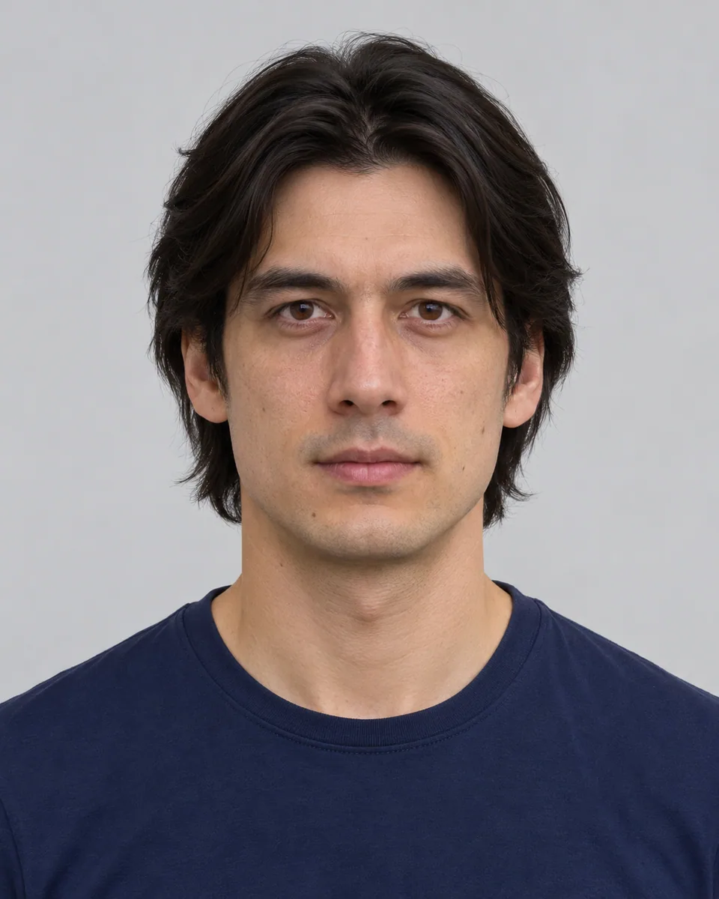
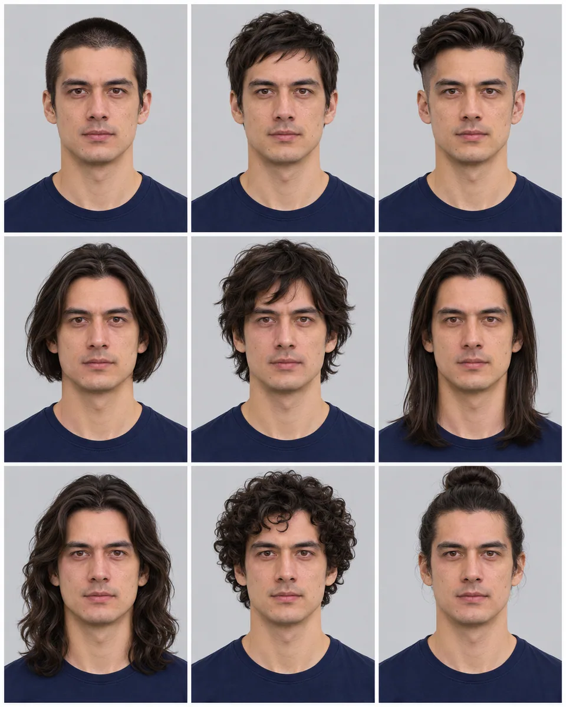

# 九宫格发型试览 · Nine Hairstyle Study

在一张九宫格图片中比较同一人的九种发型，只改头发形状，统一脸型、服装、光照和裁切，让差别清晰可比较。

Compare nine genuinely different hairstyles for the same person in one equal-cell grid while holding identity, clothing, light and framing constant.

本方法改编自 SeeAPI 的 CC-BY-4.0 授权说明。原作者归属、来源与改动见 [provenance.json](provenance.json)，完整上游许可及其版权声明见 [LICENSE-THIRD-PARTY.txt](LICENSE-THIRD-PARTY.txt)。

Adapted from SeeAPI's CC-BY-4.0-licensed instructions. [provenance.json](provenance.json) records the original author, pinned source and modifications; [LICENSE-THIRD-PARTY.txt](LICENSE-THIRD-PARTY.txt) retains the complete upstream license and copyright notices.

原始归属 · Original attribution: Copyright © 2026 SeeAPI. Adapted by MuziGeek from SeeAPI; repository and original-post credits are retained.

## 输入分析与实际保留

1. 读取用户提供的原图；若没有可用图片，先请求图片。不要用本仓库示例代替用户输入。
2. 观察原图主体、身份、数量、连接、遮挡、光线和画幅。依据本 Skill 的保留约束与几何边界，区分需要保留及明确允许转化的部分。样片说明不能当作用户输入的事实。
3. 使用支持参考图编辑的可用工具，把原图作为编辑输入。先说明观察到的主体，再结合下方机制及 [recipe.yaml](recipe.yaml) 按顺序组合指令；工具名称不是必须安装的依赖。
4. 默认沿用原图比例；仅按用户要求及本 Skill 明确写出的构图或几何转化调整。配方的 4:5 是目录样片比例，不授权裁去必须保留的主体。
5. 对照输入检查结果；只修正发现的问题，不为了增强风格改变身份或添加无关景物。区分已完成的视觉检查与尚未验证的效果。

## Input analysis and preservation

1. Inspect the supplied image; request an image only when none is available. Never substitute a repository example for the user's input.
2. Inspect the real subjects, identity, counts, attachments, overlaps, light and framing. Distinguish preserved attributes from explicitly permitted transformations using this Skill’s preservation and geometry rules; sample descriptions are not facts about user input.
3. Use an available reference-image editing tool. Combine the observed facts with the ordered mechanisms in [recipe.yaml](recipe.yaml); its model-family label does not require an installation script.
4. Keep the input ratio by default; change composition or geometry only as requested by the user and expressly permitted below. The recipe’s 4:5 ratio is a catalog-sample default, not permission to crop protected subjects.
5. Compare output with input and correct observed failures. Report only visual checks actually completed; stronger styling must not override identity or scene integrity.

## 风格机制 · Style mechanism

- 在一张九宫格图片中比较同一人的九种发型，只改头发形状，统一脸型、服装、光照和裁切，让差别清晰可比较。
- 识别特征：九种不同发型、同一身份统一裁切、整齐三乘三网格。
- Medium anchor: One clean 3×3 hairstyle comparison grid of the same unchanged face with nine distinct scalp-hair designs.

10. **medium** — Create one clean three-by-three grid with exactly nine equal head-and-shoulders portraits of the same observed person.
20. **palette** — Keep original hair color, skin tone, clothing color and neutral background consistent across all nine cells.
30. **line** — Change only scalp hairstyle; retain face shape, age, expression, facial hair and gender presentation.
40. **texture** — Show nine cuts in order: buzz, pixie, undercut, bob, shag, long straight, long waves, tight curls and high bun.
50. **lighting** — Keep identical soft lighting, exposure and natural skin texture across the whole grid.
60. **composition** — Use consistent camera angle and crop, fully visible hair and narrow even gutters in every cell.
70. **detail** — Make each cut visibly distinct and realistically fitted to the same scalp; never repeat a hairstyle or change the face.
80. **finish** — Return a single nine-cell image without labels, missing cells, extra identities, logos or watermark.

## 保留约束 · Preservation constraints

在实际输入观察结果之上应用以下约束；清单不授权凭空添加图片中不存在的元素。

Apply these constraints to observed content; they never authorize inventing absent subjects.

- Identity, age, expression and body proportions of observed people.
- Exact geometry and recognizable details of subjects not explicitly selected for change.
- Camera viewpoint and original composition except changes specifically permitted by this Skill.

## 适用范围与几何边界 · Applicability and geometry

- 适用：人像。
- Applies to: Portrait.
- 明确允许将同一人重复排成一张3×3九宫格，仅头皮发型改变；每格保持脸型、年龄、肤色、服装、表情和光照，不增加其他身份。
- Explicitly repeat one identity into one 3×3 grid and change scalp hairstyles only; preserve face, age, skin, clothing, expression and light in every cell.
- 未明确允许的结构变化均不属于此风格；不把这些方法解释为复刻某位艺术家、品牌或现成作品的授权。
- Structural changes not explicitly allowed above are outside this method. This is not permission to reproduce a named artist, brand or existing artwork.

## 排除项 · Avoid

- Different identities, unintended extra cells or malformed anatomy; nine repeated views of the same person are explicitly required.
- New logos, watermarks or unreadable pseudo-lettering.
- Clipping the main subject or erasing its identifying features.

## 验收 · Acceptance

- 恰好3×3九格，每格为同一身份。
  Exactly nine cells form one 3×3 grid with the same identity.
- 九种发型明显不同，没有重复或缺格。
  All nine hairstyles differ visibly without repeats or missing cells.
- 只有头发改变，脸型服装表情光线一致。
  Only hair changes; face, wardrobe, expression and light remain fixed.
- 发型完整可见，间隔整齐且没有标签。
  Hair remains complete within even gutters and without labels.

## 配方、来源与许可 · Recipe, provenance and license

- [recipe.yaml](recipe.yaml): structured image-editing recipe / 结构化图像编辑配方。
- [provenance.json](provenance.json): original authorship, method context and example status / 原创归属、方法背景与示例状态。
- [LICENSE](LICENSE): MIT applies to MuziGeek's original contributions / MIT 适用于 MuziGeek 的原创贡献。
- [LICENSE-THIRD-PARTY.txt](LICENSE-THIRD-PARTY.txt): SeeAPI · CC-BY-4.0. Adapted material retains these terms and attribution / 改编材料保留原许可和归属。
- 示例中的前后图均为 AI 合成，不是真人摄影或真实制作工艺的证据。结果会随模型与输入变化，不承诺相同输出。
- Example before/after images are AI-generated, not photographs of real people or evidence of physical craft production. Results vary by model and input.
- MIT 不授予用户输入、第三方作品、人物、商标或生成平台条款之外的权利；示例许可单独见 provenance。
- MIT grants no rights to user inputs, third-party works, likenesses or trademarks, and does not override generation-service terms; example terms are recorded separately in provenance.

## 示例状态 · Example status

ready：打包的原图与效果图均存在且记录了通过的视觉审核。

ready: both packaged source and effect exist and have recorded approved visual reviews.

| AI 合成原图 · Source | 通过审核的效果 · Approved effect |
| --- | --- |
|  |  |

- [AI source / AI 合成原图](examples/source.webp)
- [Generated interpretation / 生成效果](examples/effect.webp)
- [Generation and visual review / 生成与视觉审核记录](examples/generation.json)
