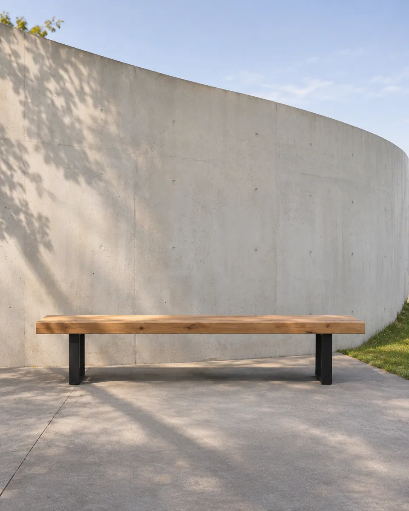
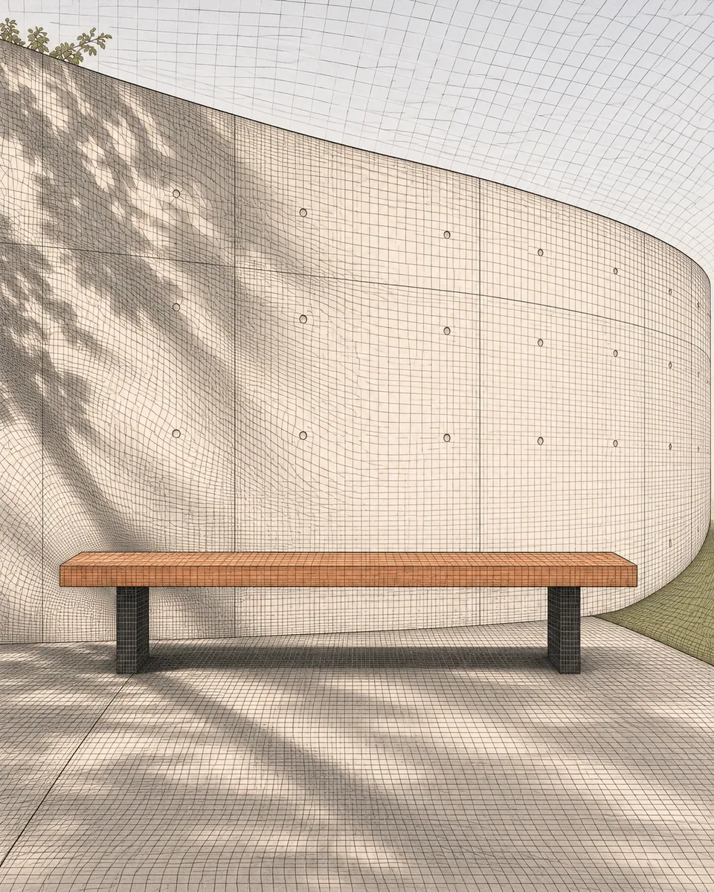

# 视错网场 · Optical grid field

以连续网格的弯曲、压缩与疏密重绘画面，让网格响应原有体积与明暗，保持主体轮廓和位置，形成克制的视错节奏。

Repaint forms through a continuous grid whose bends, compression, and spacing follow the source volume while preserving major boundaries and placement.

原创方法说明，由 MuziGeek 编写；没有声称改编自外部提示词。

Original method instructions authored by MuziGeek; no external prompt adaptation is asserted.

## 输入分析与实际保留

1. 读取用户提供的原图；若没有可用图片，先请求图片。不要用本仓库示例代替用户输入。
2. 观察实际主体数量、身份与表情、朝向、肢体和连接、物体开口、相互遮挡、前后层次、光向及画幅；据实形成简短保留清单。样片说明只是样片，不能当成其他输入的事实。
3. 使用支持参考图编辑的可用工具，把原图作为编辑输入。先说明观察到的主体，再结合下方机制及 [recipe.yaml](recipe.yaml) 按顺序组合指令；工具名称不是必须安装的依赖。
4. 实际编辑默认沿用原图比例和完整内容，除非用户另有要求。配方的 4:5 是目录样片比例，不代表可裁去用户照片中的主体。
5. 对照输入检查结果；只修正发现的问题，不为了增强风格改变身份或添加无关景物。区分已完成的视觉检查与尚未验证的效果。

## Input analysis and preservation

1. Inspect the supplied image; request an image only when none is available. Never substitute a repository example for the user's input.
2. Record the observed subject count, identity, expression, direction, anatomy, attachments, openings, overlaps, depth, light and framing. Build preservation instructions from this image, not from the sample description.
3. Use an available reference-image editing tool. Combine the observed facts with the ordered mechanisms in [recipe.yaml](recipe.yaml); its model-family label does not require an installation script.
4. Keep the input aspect ratio and complete composition unless the user requests another format. The recipe's 4:5 ratio is a catalog-sample default, not authorization to crop a subject.
5. Compare output with input and correct observed failures. Report only visual checks actually completed; stronger styling must not override identity or scene integrity.

## 风格机制 · Style mechanism

- 以连续网格的弯曲、压缩与疏密重绘画面，让网格响应原有体积与明暗，保持主体轮廓和位置，形成克制的视错节奏。
- 识别特征：连续弯曲网格、疏密错视、轮廓约束。
- Medium anchor: A continuous fine graphic grid locally warped by source-derived volume and tonal gradients, with restrained high-contrast optical rhythm.

10. **medium** — Rebuild the image as a continuous graphic grid whose local curvature responds to the source's volume and tonal structure.
20. **palette** — Use warm white, charcoal, and one muted clay accent; preserve the original distribution of light and dark masses.
30. **line** — Compress grid spacing near shadow transitions and bend it over major forms without moving their outer boundaries.
40. **texture** — Use crisp matte line intersections with slight paper texture; avoid photographic textures or metallic relief.
50. **lighting** — Translate source illumination into grid density and tonal fields rather than adding a second lighting system.
60. **composition** — Keep subject count, framing, horizon, support contacts, and major object positions; permit only bounded internal grid deformation.
70. **detail** — Maintain clear separation between adjacent subjects, support surfaces, background, and shadows through changes in grid direction and density.
80. **finish** — Balance tight optical passages with calm open regions so the source remains readable at thumbnail size.

## 保留约束 · Preservation constraints

在实际输入观察结果之上应用以下约束；清单不授权凭空添加图片中不存在的元素。

Apply these constraints to observed content; they never authorize inventing absent subjects.

- Subject count, silhouettes, support contacts, and major spatial boundaries.
- Camera viewpoint, horizon, framing, and source light-dark hierarchy.
- Recognizable distinction between subject and background.

## 适用范围与几何边界 · Applicability and geometry

- 适用：风景、产品、器物、人像。
- Applies to: Landscape, Product, Object, Portrait.
- 允许主体内部网格局部弯曲、压缩与拉伸；外轮廓、支点和主要分界不移动。
- Allow local grid bending, compression, and stretching inside forms; keep silhouettes, support points, and major boundaries fixed.
- 未明确允许的结构变化均不属于此风格；不把这些方法解释为复刻某位艺术家、品牌或现成作品的授权。
- Structural changes not explicitly allowed above are outside this method. This is not permission to reproduce a named artist, brand or existing artwork.

## 排除项 · Avoid

- New checkerboard objects, extra architecture, or unrelated geometric symbols.
- Warping that changes object count, moves support contacts, or destroys silhouettes.
- Extreme strobing contrast, text, logos, numbers, or watermarks.

## 验收 · Acceptance

- 主体位置、外轮廓与支撑关系保持清楚。
  Subject positions, silhouettes, and support relationships remain clear.
- 网格弯曲响应体积，不成为无关背景贴图。
  Grid curvature responds to volume rather than acting as unrelated wallpaper.
- 疏密与明暗转折相关，画面主次可读。
  Density follows tonal transitions and preserves visual hierarchy.
- 没有新增图形符号、建筑或强烈闪烁纹理。
  No symbols, architecture, or excessive high-frequency contrast are added.

## 配方、来源与许可 · Recipe, provenance and license

- [recipe.yaml](recipe.yaml): structured image-editing recipe / 结构化图像编辑配方。
- [provenance.json](provenance.json): original authorship, method context and example status / 原创归属、方法背景与示例状态。
- [LICENSE](LICENSE): MIT applies to MuziGeek's original contributions / MIT 适用于 MuziGeek 的原创贡献。
- 示例中的前后图均为 AI 合成，不是真人摄影或真实制作工艺的证据。结果会随模型与输入变化，不承诺相同输出。
- Example before/after images are AI-generated, not photographs of real people or evidence of physical craft production. Results vary by model and input.
- MIT 不授予用户输入、第三方作品、人物、商标或生成平台条款之外的权利；示例许可单独见 provenance。
- MIT grants no rights to user inputs, third-party works, likenesses or trademarks, and does not override generation-service terms; example terms are recorded separately in provenance.

## 示例状态 · Example status

ready：打包的原图与效果图均存在且记录了通过的视觉审核。

ready: both packaged source and effect exist and have recorded approved visual reviews.

| AI 合成原图 · Source | 通过审核的效果 · Approved effect |
| --- | --- |
|  |  |

- [AI source / AI 合成原图](examples/source.webp)
- [Generated interpretation / 生成效果](examples/effect.webp)
- [Generation and visual review / 生成与视觉审核记录](examples/generation.json)
