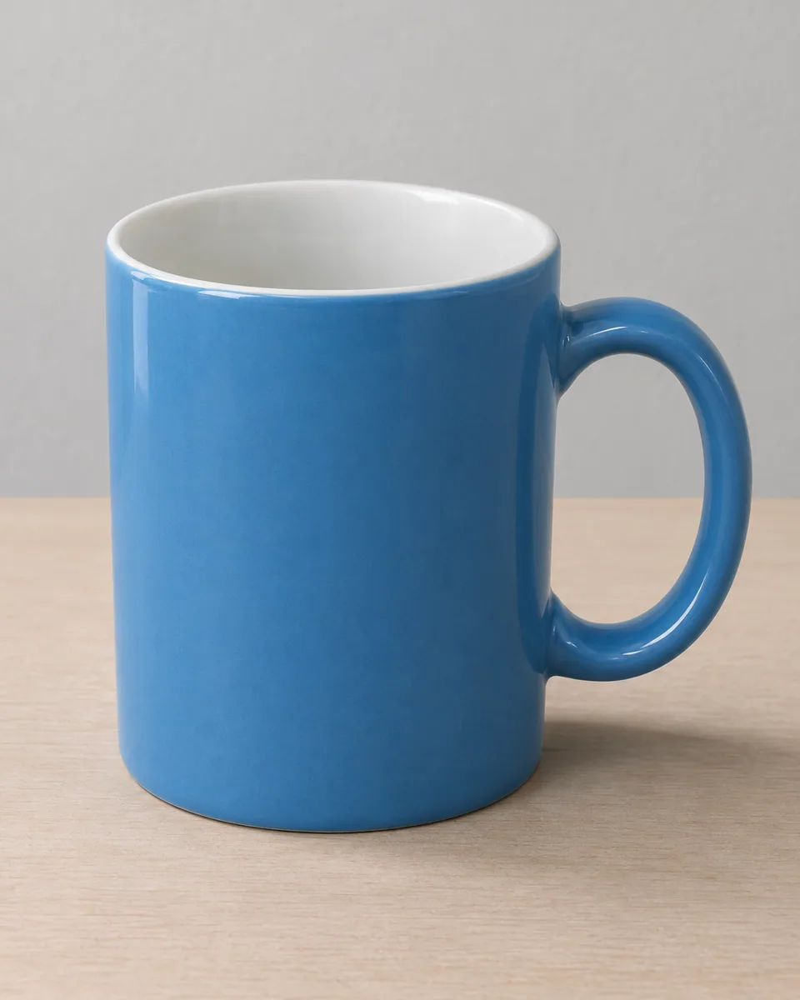
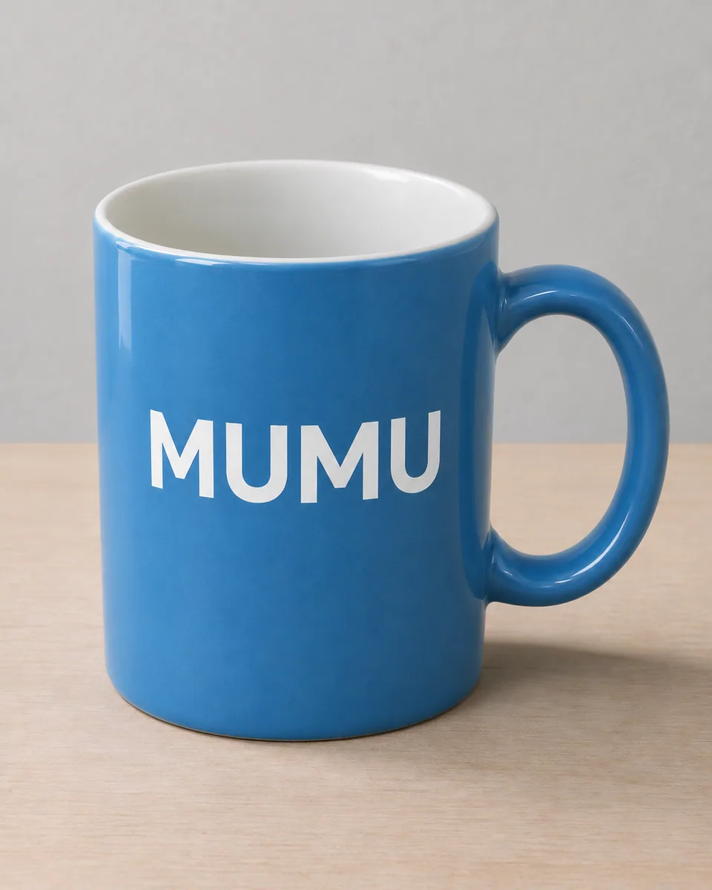

# 曲面短词印字 · Photo Surface Lettering

把用户给定的短词自然印到照片物体的指定表面，让字形随弧度、透视和光照贴合，同时保留物体材质、轮廓与背景。

Apply exact user-supplied short wording to a selected photographed surface, fitting curvature, perspective and light while preserving the object and surroundings.

本方法改编自 SeeAPI 的 CC-BY-4.0 授权说明。原作者归属、来源与改动见 [provenance.json](provenance.json)，完整上游许可及其版权声明见 [LICENSE-THIRD-PARTY.txt](LICENSE-THIRD-PARTY.txt)。

Adapted from SeeAPI's CC-BY-4.0-licensed instructions. [provenance.json](provenance.json) records the original author, pinned source and modifications; [LICENSE-THIRD-PARTY.txt](LICENSE-THIRD-PARTY.txt) retains the complete upstream license and copyright notices.

原始归属 · Original attribution: Copyright © 2026 SeeAPI. Adapted by MuziGeek from SeeAPI — Nano Banana Prompts for Image Editing, CC BY 4.0. Original inspiration credits are retained where supplied.

## 输入分析与实际保留

1. 读取用户提供的原图；若没有可用图片，先请求图片。不要用本仓库示例代替用户输入。
2. 观察原图主体、身份、数量、连接、遮挡、光线和画幅。依据本 Skill 的保留约束与几何边界，区分需要保留及明确允许转化的部分。样片说明不能当作用户输入的事实。
3. 使用支持参考图编辑的可用工具，把原图作为编辑输入。先说明观察到的主体，再结合下方机制及 [recipe.yaml](recipe.yaml) 按顺序组合指令；工具名称不是必须安装的依赖。
4. 默认沿用原图比例；仅按用户要求及本 Skill 明确写出的构图或几何转化调整。配方的 4:5 是目录样片比例，不授权裁去必须保留的主体。
5. 对照输入检查结果；只修正发现的问题，不为了增强风格改变身份或添加无关景物。区分已完成的视觉检查与尚未验证的效果。

## Input analysis and preservation

1. Inspect the supplied image; request an image only when none is available. Never substitute a repository example for the user's input.
2. Inspect the real subjects, identity, counts, attachments, overlaps, light and framing. Distinguish preserved attributes from explicitly permitted transformations using this Skill’s preservation and geometry rules; sample descriptions are not facts about user input.
3. Use an available reference-image editing tool. Combine the observed facts with the ordered mechanisms in [recipe.yaml](recipe.yaml); its model-family label does not require an installation script.
4. Keep the input ratio by default; change composition or geometry only as requested by the user and expressly permitted below. The recipe’s 4:5 ratio is a catalog-sample default, not permission to crop protected subjects.
5. Compare output with input and correct observed failures. Report only visual checks actually completed; stronger styling must not override identity or scene integrity.

## 风格机制 · Style mechanism

- 把用户给定的短词自然印到照片物体的指定表面，让字形随弧度、透视和光照贴合，同时保留物体材质、轮廓与背景。
- 识别特征：指定短词逐字准确、字形贴合曲面、局部印字其余保持。
- Medium anchor: A localized photographic lettering edit with exactly supplied wording conforming to the actual surface curvature, perspective, texture and illumination.

10. **medium** — Add only the exact user-supplied wording to the selected object surface; the catalog sample uses the uppercase word MUMU.
20. **palette** — For the sample use clean white sans-serif letters on the blue ceramic mug, preserving all other original colors.
30. **line** — Place the word once centered on the visible front body, with realistic horizontal curvature and perspective compression.
40. **texture** — Make the lettering resemble thin applied print on ceramic, retaining underlying surface texture rather than a floating graphic label.
50. **lighting** — Match original light, reflections and occlusion so the printed word belongs to the photographed surface.
60. **composition** — Keep object geometry, handle, rim, interior, position, camera framing, background and contact shadows unchanged.
70. **detail** — Reproduce the exact spelling, case and character count; add no punctuation, translation, repeated word or extra symbol.
80. **finish** — Return one naturally edited photograph without captions, decorative borders, logos, watermark or changes outside the selected lettering.

## 保留约束 · Preservation constraints

在实际输入观察结果之上应用以下约束；清单不授权凭空添加图片中不存在的元素。

Apply these constraints to observed content; they never authorize inventing absent subjects.

- Exact source object count, geometry, body proportions, rim and handle structure.
- Original ceramic material, blue exterior, white interior, background, viewpoint and lighting.
- All unselected image areas and existing unrelated details; only the specified short text may be added.

## 适用范围与几何边界 · Applicability and geometry

- 适用：产品、器物。
- Applies to: Product, Object.
- 仅允许在选定表面增加一次给定短词，并按曲面与透视变形字形；不改变物体轮廓、把手、颜色、材质、位置、机位、背景或阴影。
- Add the exact short word once to the selected surface and warp only the lettering for curvature and perspective; retain object shape, handle, color, material, placement, camera, background and shadows.
- 未明确允许的结构变化均不属于此风格；不把这些方法解释为复刻某位艺术家、品牌或现成作品的授权。
- Structural changes not explicitly allowed above are outside this method. This is not permission to reproduce a named artist, brand or existing artwork.

## 排除项 · Avoid

- Misspelled, repeated, missing, translated or additional letters and symbols.
- Floating flat overlay, sticker border, label rectangle or text that ignores surface curvature.
- Recolored object, changed handle, altered backdrop or extra product copies.
- Captions, branding, logos, watermark, signatures or decorative typography outside the selected surface.

## 验收 · Acceptance

- 准确且仅出现一次MUMU，大小写与字母数量正确。
  MUMU appears exactly once with correct case, spelling and character count.
- 文字沿杯体弧面与透视自然贴合，不像悬浮贴图。
  Lettering follows the mug curvature and perspective rather than floating over it.
- 杯子、把手、杯口、材质、背景和阴影保持原样。
  Mug, handle, rim, material, background and shadows remain unchanged.
- 没有额外文字、标签框、标志或水印。
  No extra wording, label border, logo or watermark appears.

## 配方、来源与许可 · Recipe, provenance and license

- [recipe.yaml](recipe.yaml): structured image-editing recipe / 结构化图像编辑配方。
- [provenance.json](provenance.json): original authorship, method context and example status / 原创归属、方法背景与示例状态。
- [LICENSE](LICENSE): MIT applies to MuziGeek's original contributions / MIT 适用于 MuziGeek 的原创贡献。
- [LICENSE-THIRD-PARTY.txt](LICENSE-THIRD-PARTY.txt): SeeAPI · CC-BY-4.0. Adapted material retains these terms and attribution / 改编材料保留原许可和归属。
- 示例中的前后图均为 AI 合成，不是真人摄影或真实制作工艺的证据。结果会随模型与输入变化，不承诺相同输出。
- Example before/after images are AI-generated, not photographs of real people or evidence of physical craft production. Results vary by model and input.
- MIT 不授予用户输入、第三方作品、人物、商标或生成平台条款之外的权利；示例许可单独见 provenance。
- MIT grants no rights to user inputs, third-party works, likenesses or trademarks, and does not override generation-service terms; example terms are recorded separately in provenance.

## 示例状态 · Example status

ready：打包的原图与效果图均存在且记录了通过的视觉审核。

ready: both packaged source and effect exist and have recorded approved visual reviews.

| AI 合成原图 · Source | 通过审核的效果 · Approved effect |
| --- | --- |
|  |  |

- [AI source / AI 合成原图](examples/source.webp)
- [Generated interpretation / 生成效果](examples/effect.webp)
- [Generation and visual review / 生成与视觉审核记录](examples/generation.json)
