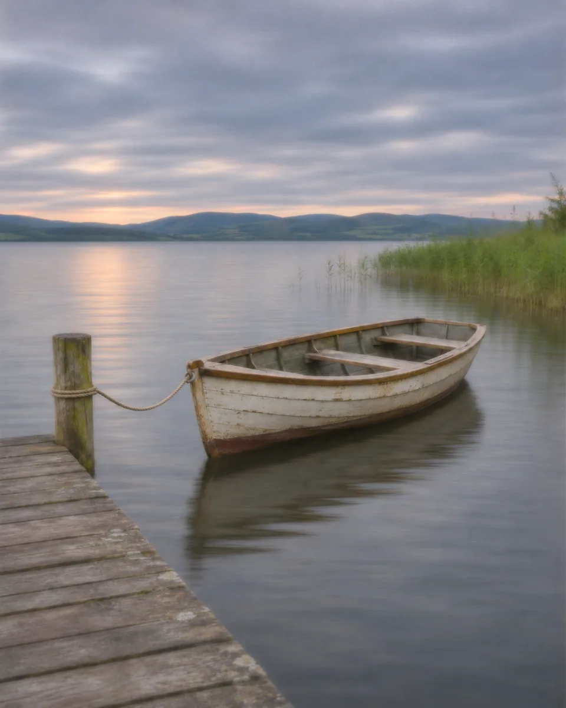

# 针孔柔影 · Pinhole Soft Image

用针孔成像般均匀而克制的柔化弱化锐利边缘，让水面和空气带有缓慢曝光感，同时保持完整空间关系与主体辨识度。

Apply the quiet, even softness of pinhole imaging with gentle long-exposure atmosphere, preserving the scene's spatial relationships and recognizable subjects.

原创方法说明，由 MuziGeek 编写；没有声称改编自外部提示词。

Original method instructions authored by MuziGeek; no external prompt adaptation is asserted.

## 输入分析与实际保留

1. 读取用户提供的原图；若没有可用图片，先请求图片。不要用本仓库示例代替用户输入。
2. 观察实际主体数量、身份与表情、朝向、肢体和连接、物体开口、相互遮挡、前后层次、光向及画幅；据实形成简短保留清单。样片说明只是样片，不能当成其他输入的事实。
3. 使用支持参考图编辑的可用工具，把原图作为编辑输入。先说明观察到的主体，再结合下方机制及 [recipe.yaml](recipe.yaml) 按顺序组合指令；工具名称不是必须安装的依赖。
4. 实际编辑默认沿用原图比例和完整内容，除非用户另有要求。配方的 4:5 是目录样片比例，不代表可裁去用户照片中的主体。
5. 对照输入检查结果；只修正发现的问题，不为了增强风格改变身份或添加无关景物。区分已完成的视觉检查与尚未验证的效果。

## Input analysis and preservation

1. Inspect the supplied image; request an image only when none is available. Never substitute a repository example for the user's input.
2. Record the observed subject count, identity, expression, direction, anatomy, attachments, openings, overlaps, depth, light and framing. Build preservation instructions from this image, not from the sample description.
3. Use an available reference-image editing tool. Combine the observed facts with the ordered mechanisms in [recipe.yaml](recipe.yaml); its model-family label does not require an installation script.
4. Keep the input aspect ratio and complete composition unless the user requests another format. The recipe's 4:5 ratio is a catalog-sample default, not authorization to crop a subject.
5. Compare output with input and correct observed failures. Report only visual checks actually completed; stronger styling must not override identity or scene integrity.

## 风格机制 · Style mechanism

- 用针孔成像般均匀而克制的柔化弱化锐利边缘，让水面和空气带有缓慢曝光感，同时保持完整空间关系与主体辨识度。
- 识别特征：均匀针孔柔化、水面缓慢曝光、低反差自然色。
- Medium anchor: A restrained pinhole-camera photograph with even optical softness, deep spatial continuity and gently accumulated exposure on moving water.

10. **medium** — Render a pinhole-camera photograph with gentle image-wide optical softness and continuous depth, not shallow-focus lens blur.
20. **palette** — Keep subdued natural colors with cool gray shadows and quiet warm highlights; do not force monochrome or a vintage brown wash.
30. **line** — Soften high-frequency edges slightly while retaining each subject's readable silhouette, internal openings and straight structural lines.
40. **lighting** — Let existing bright areas bloom very softly; retain the source light direction and avoid fog veiling the entire scene.
50. **texture** — Gently integrate motion only in water, clouds or already-moving fabric; keep stationary architecture and bodies spatially stable.
60. **composition** — Preserve original perspective, horizon, crop and all object positions; do not widen the view or curve straight edges.
70. **detail** — Retain enough facial and material information for recognition; avoid artificial bokeh circles, radial streaks and doubled objects.
80. **finish** — Use a low-contrast photographic finish with faint irregular grain, no dark corner mask, film frame or light-leak decoration.

## 保留约束 · Preservation constraints

在实际输入观察结果之上应用以下约束；清单不授权凭空添加图片中不存在的元素。

Apply these constraints to observed content; they never authorize inventing absent subjects.

- Subject counts, recognizable silhouettes and openings
- Camera perspective, straight lines and horizon
- Original crop, attachments and object positions
- Stationary faces and structural details

## 适用范围与几何边界 · Applicability and geometry

- 适用：风景、器物、人像、合影、夜景。
- Applies to: Landscape, Object, Portrait, Group, Night.
- 均匀柔化不能改变透视或吞掉细窄连接；水面可轻微平滑，但船体、人物与建筑不得产生第二套轮廓。
- Even softness must not alter perspective or erase narrow connections; water may smooth gently, but boats, people and buildings keep one coherent outline.
- 未明确允许的结构变化均不属于此风格；不把这些方法解释为复刻某位艺术家、品牌或现成作品的授权。
- Structural changes not explicitly allowed above are outside this method. This is not permission to reproduce a named artist, brand or existing artwork.

## 排除项 · Avoid

- extreme defocus
- tilt-shift miniature effect
- bokeh disks
- radial blur or bent architecture
- duplicate boats or ghost people
- heavy fog veil
- vignette, film edge, light leak, text or watermark

## 验收 · Acceptance

- 边缘略柔但主体可辨，不出现明显景深虚化。
  Edges soften gently while subjects remain recognizable, without obvious shallow-focus blur.
- 静止结构、水平线、连接和原始裁切保持不变。
  Stationary structures, horizon, attachments and the original crop remain intact.
- 曝光流动感只在合理的可动区域出现。
  Accumulated motion appears only in plausible moving regions.
- 无重影复制、暗角蒙版、漏光或装饰边框。
  No duplicated subjects, corner masks, light leaks or decorative frames appear.

## 配方、来源与许可 · Recipe, provenance and license

- [recipe.yaml](recipe.yaml): structured image-editing recipe / 结构化图像编辑配方。
- [provenance.json](provenance.json): original authorship, method context and example status / 原创归属、方法背景与示例状态。
- [LICENSE](LICENSE): MIT applies to MuziGeek's original contributions / MIT 适用于 MuziGeek 的原创贡献。
- 示例中的前后图均为 AI 合成，不是真人摄影或真实制作工艺的证据。结果会随模型与输入变化，不承诺相同输出。
- Example before/after images are AI-generated, not photographs of real people or evidence of physical craft production. Results vary by model and input.
- MIT 不授予用户输入、第三方作品、人物、商标或生成平台条款之外的权利；示例许可单独见 provenance。
- MIT grants no rights to user inputs, third-party works, likenesses or trademarks, and does not override generation-service terms; example terms are recorded separately in provenance.

## 示例状态 · Example status

ready：打包的原图与效果图均存在且记录了通过的视觉审核。

ready: both packaged source and effect exist and have recorded approved visual reviews.

| AI 合成原图 · Source | 通过审核的效果 · Approved effect |
| --- | --- |
|  |  |

- [AI source / AI 合成原图](examples/source.webp)
- [Generated interpretation / 生成效果](examples/effect.webp)
- [Generation and visual review / 生成与视觉审核记录](examples/generation.json)
