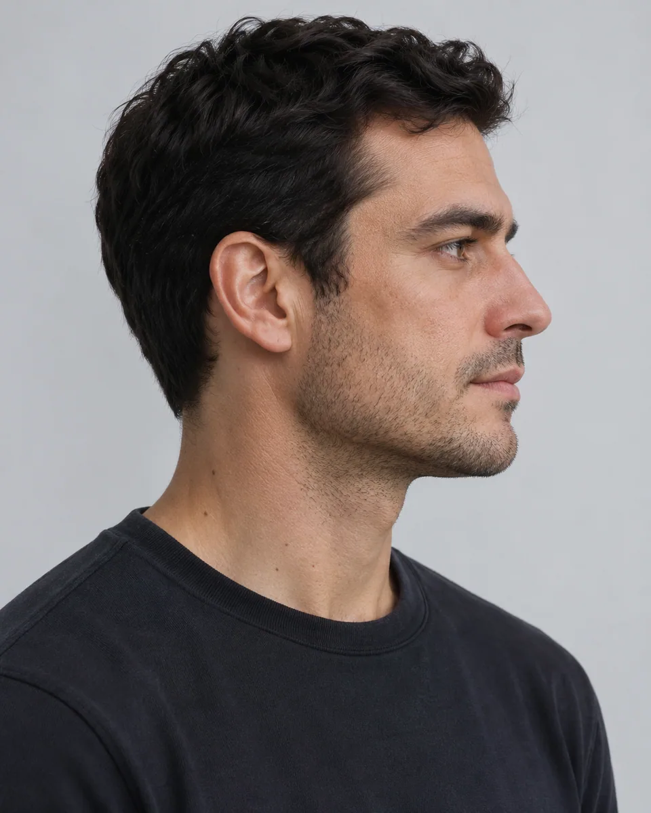
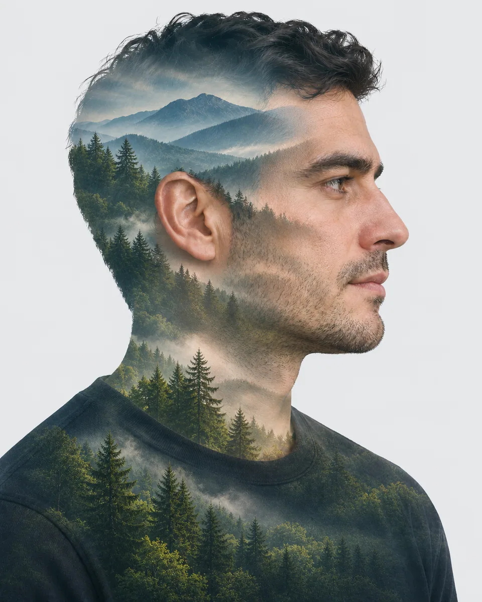

# 肖像双重曝光 · Portrait Double Exposure

把照片人物的清晰侧影与原创山林景观叠合，让风景顺着人物轮廓与明暗展开，在保留身份识别的同时产生安静的叙事层次。

Blend the photographed profile with an original mountain-and-forest landscape, letting the environment follow facial contours while retaining recognizable identity.

本方法改编自 rezzycheck (Sora); translated and collected by Jamez Bondos 的 CC-BY-4.0 授权说明。原作者归属、来源与改动见 [provenance.json](provenance.json)，完整上游许可及其版权声明见 [LICENSE-THIRD-PARTY.txt](LICENSE-THIRD-PARTY.txt)。

Adapted from rezzycheck (Sora); translated and collected by Jamez Bondos's CC-BY-4.0-licensed instructions. [provenance.json](provenance.json) records the original author, pinned source and modifications; [LICENSE-THIRD-PARTY.txt](LICENSE-THIRD-PARTY.txt) retains the complete upstream license and copyright notices.

原始归属 · Original attribution: Copyright and Similar Adapted by MuziGeek from rezzycheck (Sora); translated and collected by Jamez Bondos; repository and original-post credits are retained.

## 输入分析与实际保留

1. 读取用户提供的原图；若没有可用图片，先请求图片。不要用本仓库示例代替用户输入。
2. 观察原图主体、身份、数量、连接、遮挡、光线和画幅。依据本 Skill 的保留约束与几何边界，区分需要保留及明确允许转化的部分。样片说明不能当作用户输入的事实。
3. 使用支持参考图编辑的可用工具，把原图作为编辑输入。先说明观察到的主体，再结合下方机制及 [recipe.yaml](recipe.yaml) 按顺序组合指令；工具名称不是必须安装的依赖。
4. 默认沿用原图比例；仅按用户要求及本 Skill 明确写出的构图或几何转化调整。配方的 4:5 是目录样片比例，不授权裁去必须保留的主体。
5. 对照输入检查结果；只修正发现的问题，不为了增强风格改变身份或添加无关景物。区分已完成的视觉检查与尚未验证的效果。

## Input analysis and preservation

1. Inspect the supplied image; request an image only when none is available. Never substitute a repository example for the user's input.
2. Inspect the real subjects, identity, counts, attachments, overlaps, light and framing. Distinguish preserved attributes from explicitly permitted transformations using this Skill’s preservation and geometry rules; sample descriptions are not facts about user input.
3. Use an available reference-image editing tool. Combine the observed facts with the ordered mechanisms in [recipe.yaml](recipe.yaml); its model-family label does not require an installation script.
4. Keep the input ratio by default; change composition or geometry only as requested by the user and expressly permitted below. The recipe’s 4:5 ratio is a catalog-sample default, not permission to crop protected subjects.
5. Compare output with input and correct observed failures. Report only visual checks actually completed; stronger styling must not override identity or scene integrity.

## 风格机制 · Style mechanism

- 把照片人物的清晰侧影与原创山林景观叠合，让风景顺着人物轮廓与明暗展开，在保留身份识别的同时产生安静的叙事层次。
- 识别特征：人物侧影轮廓、山林层叠曝光、浅底清晰留白。
- Medium anchor: A restrained double exposure combining the actual portrait silhouette with an original forest landscape on a clean pale background.

10. **medium** — Create a double-exposure interpretation of the actual portrait, retaining the observed profile rather than substituting a fictional character.
20. **palette** — Blend deep green forest, muted mountain blue and source skin tones against a clean pale background.
30. **line** — Keep the nose, lips, chin and outer hair silhouette deliberately defined and recognizable.
40. **texture** — Layer softly textured pine trees and distant ridgelines inside the portrait without covering identity anchors.
50. **lighting** — Use coherent soft daylight across the blended landscape and retain subtle facial tonal clues.
60. **composition** — Concentrate landscape detail within the silhouette; leave generous calm negative space around it.
70. **detail** — Remove source references to named artists, franchise characters and unrelated animals; create an original landscape.
80. **finish** — Return one complete poetic double exposure without text, logos, frame or additional faces.

## 保留约束 · Preservation constraints

在实际输入观察结果之上应用以下约束；清单不授权凭空添加图片中不存在的元素。

Apply these constraints to observed content; they never authorize inventing absent subjects.

- Recognizable identity, expression, subject count and distinctive source colors.
- Observed anatomical connections, essential openings and relationships between subjects.
- Complete main subjects within the final frame; no accidental crop.

## 适用范围与几何边界 · Applicability and geometry

- 适用：人像、合影。
- Applies to: Portrait, Group.
- 允许人物轮廓内部叠加原创山林并简化背景；保留脸型、朝向、人数和主要神态，不复制来源中的现成角色或艺术家风格。
- Overlay an original forest landscape within the silhouette and simplify the backdrop; retain facial profile, direction, count and expression without copying named characters.
- 未明确允许的结构变化均不属于此风格；不把这些方法解释为复刻某位艺术家、品牌或现成作品的授权。
- Structural changes not explicitly allowed above are outside this method. This is not permission to reproduce a named artist, brand or existing artwork.

## 排除项 · Avoid

- Unrequested people, duplicate subjects or malformed anatomy.
- New logos, watermarks or unreadable pseudo-lettering.
- Clipping the main subject or erasing its identifying features.

## 验收 · Acceptance

- 人物侧影可辨，鼻唇下巴轮廓未被替换。
  The profile remains recognizable with the original nose, lips and chin.
- 山林叠加集中在人物形体中，层次清楚。
  Landscape layers concentrate within the silhouette with clear depth.
- 没有来源角色、艺术家署名或复制场景。
  No source franchise character, artist signature or copied scene is used.
- 无额外人脸、文字、标志或相框。
  There are no extra faces, lettering, logos or frames.

## 配方、来源与许可 · Recipe, provenance and license

- [recipe.yaml](recipe.yaml): structured image-editing recipe / 结构化图像编辑配方。
- [provenance.json](provenance.json): original authorship, method context and example status / 原创归属、方法背景与示例状态。
- [LICENSE](LICENSE): MIT applies to MuziGeek's original contributions / MIT 适用于 MuziGeek 的原创贡献。
- [LICENSE-THIRD-PARTY.txt](LICENSE-THIRD-PARTY.txt): rezzycheck (Sora); translated and collected by Jamez Bondos · CC-BY-4.0. Adapted material retains these terms and attribution / 改编材料保留原许可和归属。
- 示例中的前后图均为 AI 合成，不是真人摄影或真实制作工艺的证据。结果会随模型与输入变化，不承诺相同输出。
- Example before/after images are AI-generated, not photographs of real people or evidence of physical craft production. Results vary by model and input.
- MIT 不授予用户输入、第三方作品、人物、商标或生成平台条款之外的权利；示例许可单独见 provenance。
- MIT grants no rights to user inputs, third-party works, likenesses or trademarks, and does not override generation-service terms; example terms are recorded separately in provenance.

## 示例状态 · Example status

ready：打包的原图与效果图均存在且记录了通过的视觉审核。

ready: both packaged source and effect exist and have recorded approved visual reviews.

| AI 合成原图 · Source | 通过审核的效果 · Approved effect |
| --- | --- |
|  |  |

- [AI source / AI 合成原图](examples/source.webp)
- [Generated interpretation / 生成效果](examples/effect.webp)
- [Generation and visual review / 生成与视觉审核记录](examples/generation.json)
