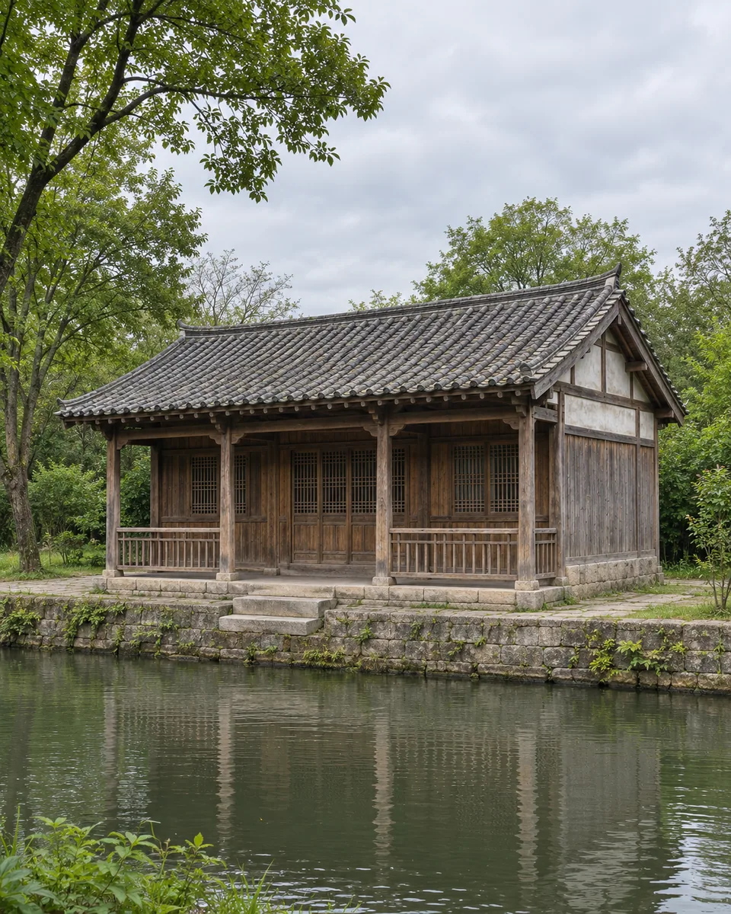
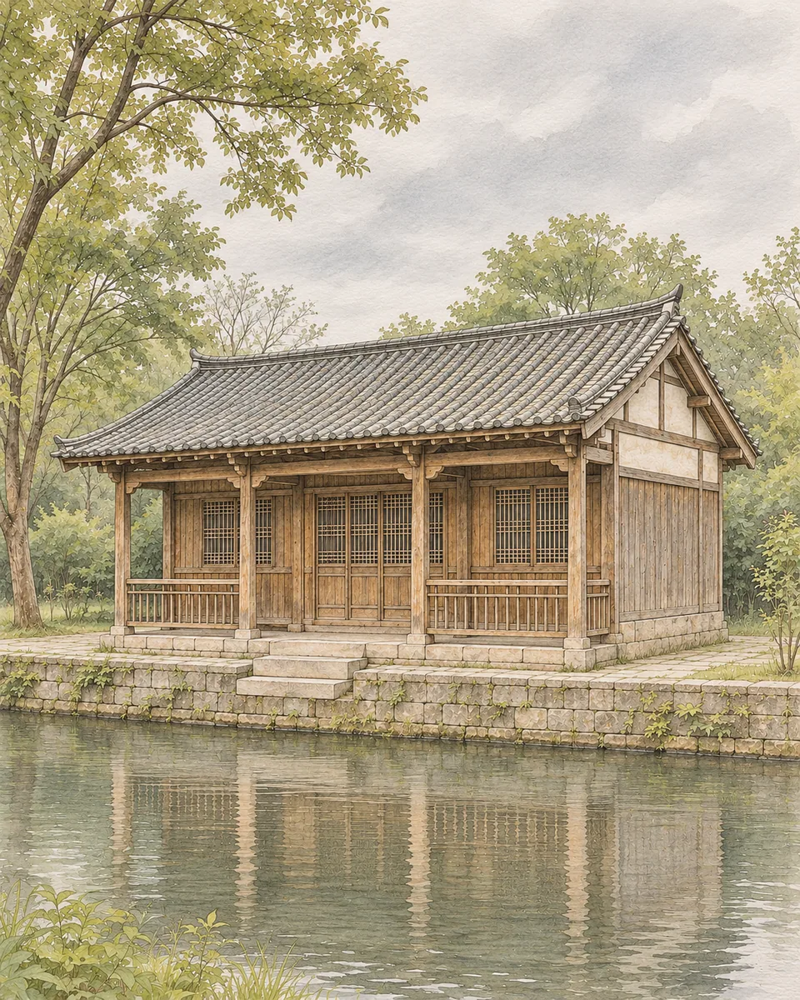

# 界画建筑 · Ruled-Line Architectural Painting

以整齐而有轻微笔性的界线重绘建筑，保留梁柱、檐口与窗格的真实关系，用薄淡设色区分材料和远近。

Rebuild architecture with precise brush-like ruled lines, faithful structural connections and thin color washes that distinguish materials and depth.

原创方法说明，由 MuziGeek 编写；没有声称改编自外部提示词。

Original method instructions authored by MuziGeek; no external prompt adaptation is asserted.

## 输入分析与实际保留

1. 读取用户提供的原图；若没有可用图片，先请求图片。不要用本仓库示例代替用户输入。
2. 观察实际主体数量、身份与表情、朝向、肢体和连接、物体开口、相互遮挡、前后层次、光向及画幅；据实形成简短保留清单。样片说明只是样片，不能当成其他输入的事实。
3. 使用支持参考图编辑的可用工具，把原图作为编辑输入。先说明观察到的主体，再结合下方机制及 [recipe.yaml](recipe.yaml) 按顺序组合指令；工具名称不是必须安装的依赖。
4. 实际编辑默认沿用原图比例和完整内容，除非用户另有要求。配方的 4:5 是目录样片比例，不代表可裁去用户照片中的主体。
5. 对照输入检查结果；只修正发现的问题，不为了增强风格改变身份或添加无关景物。区分已完成的视觉检查与尚未验证的效果。

## Input analysis and preservation

1. Inspect the supplied image; request an image only when none is available. Never substitute a repository example for the user's input.
2. Record the observed subject count, identity, expression, direction, anatomy, attachments, openings, overlaps, depth, light and framing. Build preservation instructions from this image, not from the sample description.
3. Use an available reference-image editing tool. Combine the observed facts with the ordered mechanisms in [recipe.yaml](recipe.yaml); its model-family label does not require an installation script.
4. Keep the input aspect ratio and complete composition unless the user requests another format. The recipe's 4:5 ratio is a catalog-sample default, not authorization to crop a subject.
5. Compare output with input and correct observed failures. Report only visual checks actually completed; stronger styling must not override identity or scene integrity.

## 风格机制 · Style mechanism

- 以整齐而有轻微笔性的界线重绘建筑，保留梁柱、檐口与窗格的真实关系，用薄淡设色区分材料和远近。
- 识别特征：梁柱界线、檐口秩序、薄淡设色。
- Medium anchor: Render the architecture as ruled-line painting, combining precise structural brush lines with restrained ink washes and light earth-colored pigment.

10. **line** — Trace beams, posts, eaves and window divisions with precise ruled lines; retain slight brush variation without wobbling their structural alignment.
20. **composition** — Follow the source perspective, building footprint and visible bay count; keep converging edges consistent within each architectural plane.
30. **detail** — Preserve load-bearing connections, railing joins and roof intersections; simplify repeated tiles while maintaining their direction and spacing hierarchy.
40. **palette** — Apply thin warm wood, gray tile and muted water washes within the drawn structure; avoid opaque graphic color blocks.
50. **lighting** — Describe recesses with restrained layered ink, preserving open windows and under-eave depth without heavy photorealistic shadows.
60. **finish** — Deliver one complete architectural painting, not a technical blueprint, exploded diagram, editorial poster or invented historic monument.

## 保留约束 · Preservation constraints

在实际输入观察结果之上应用以下约束；清单不授权凭空添加图片中不存在的元素。

Apply these constraints to observed content; they never authorize inventing absent subjects.

- Observed perspective and complete building silhouette
- Number of visible structural bays and support posts
- Connections between roofs, columns, rails, doors and windows
- Existing setting and waterline or ground contacts

## 适用范围与几何边界 · Applicability and geometry

- 适用：风景、器物。
- Applies to: Landscape, Object.
- 用于建筑或真实建筑模型，先核对承重与透视；不将任意城市楼房改造成古代宫殿。
- Use architecture or physical architectural models; verify support connections and perspective, and never replace ordinary buildings with invented palaces.
- 未明确允许的结构变化均不属于此风格；不把这些方法解释为复刻某位艺术家、品牌或现成作品的授权。
- Structural changes not explicitly allowed above are outside this method. This is not permission to reproduce a named artist, brand or existing artwork.

## 排除项 · Avoid

- New wings, extra posts or altered roof styles
- Contradictory vanishing points
- Unconnected beams or closed window openings
- Dimension labels, plans, exploded views and diagrams
- Decorative titles, seals and watermarks

## 验收 · Acceptance

- 梁柱、屋顶和窗格数量按原图核对
  Structural bay, post and window counts match the source
- 透视线一致，构件有真实连接
  Perspective is coherent and structural elements connect
- 界线准确且有笔性，设色薄而安静
  Precise brush-like lines carry thin quiet washes
- 未新增古建装饰、标注或海报文字
  No historic ornament, measurements or poster typography are invented

## 配方、来源与许可 · Recipe, provenance and license

- [recipe.yaml](recipe.yaml): structured image-editing recipe / 结构化图像编辑配方。
- [provenance.json](provenance.json): original authorship, method context and example status / 原创归属、方法背景与示例状态。
- [LICENSE](LICENSE): MIT applies to MuziGeek's original contributions / MIT 适用于 MuziGeek 的原创贡献。
- 示例中的前后图均为 AI 合成，不是真人摄影或真实制作工艺的证据。结果会随模型与输入变化，不承诺相同输出。
- Example before/after images are AI-generated, not photographs of real people or evidence of physical craft production. Results vary by model and input.
- MIT 不授予用户输入、第三方作品、人物、商标或生成平台条款之外的权利；示例许可单独见 provenance。
- MIT grants no rights to user inputs, third-party works, likenesses or trademarks, and does not override generation-service terms; example terms are recorded separately in provenance.

## 示例状态 · Example status

ready：打包的原图与效果图均存在且记录了通过的视觉审核。

ready: both packaged source and effect exist and have recorded approved visual reviews.

| AI 合成原图 · Source | 通过审核的效果 · Approved effect |
| --- | --- |
|  |  |

- [AI source / AI 合成原图](examples/source.webp)
- [Generated interpretation / 生成效果](examples/effect.webp)
- [Generation and visual review / 生成与视觉审核记录](examples/generation.json)
