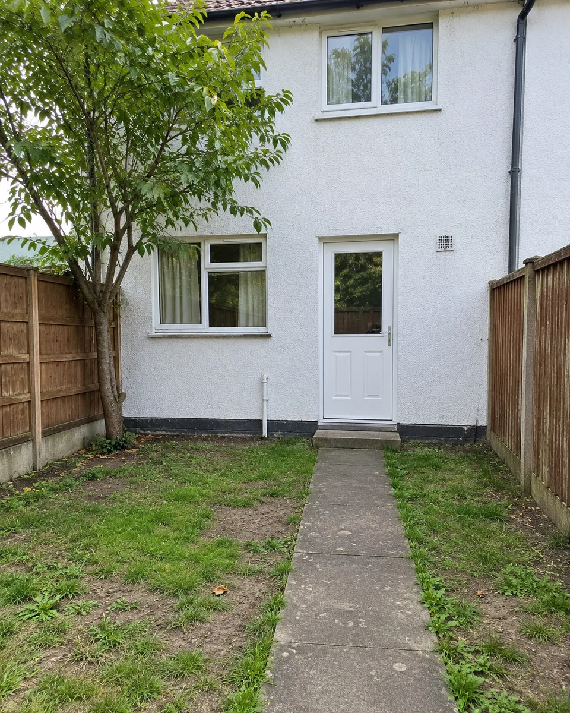
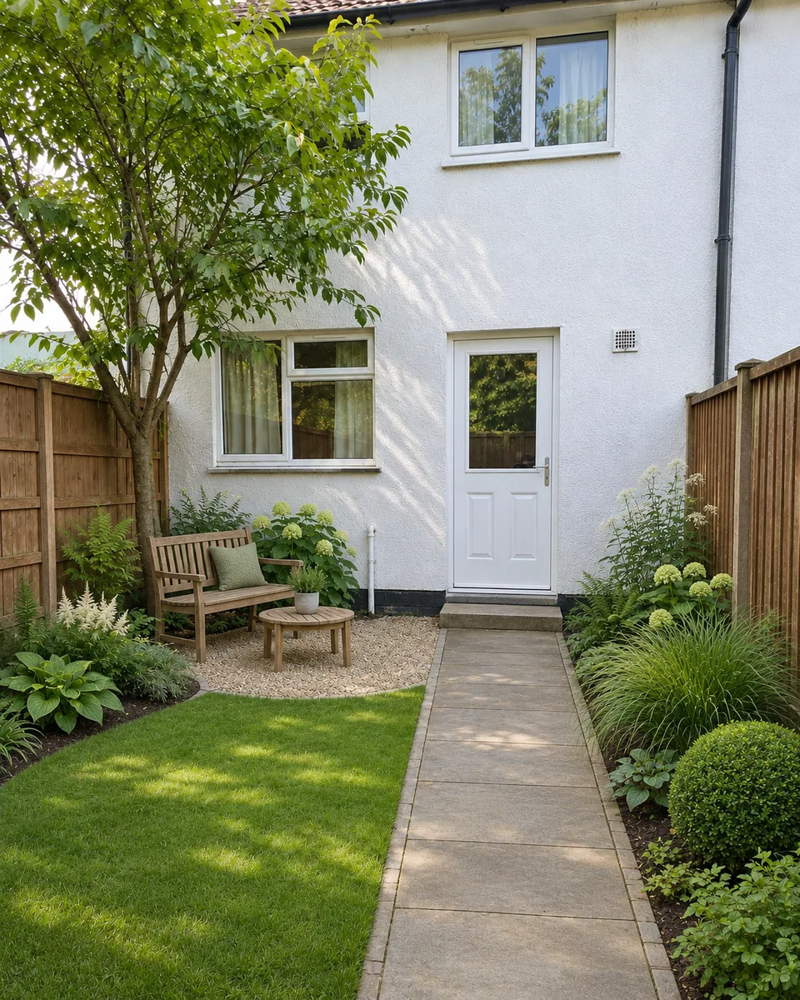

# 同庭院景观改造 · Same Yard Landscape Design

在照片原有庭院边界内规划种植、路径与座椅，保留建筑和地形，以合理的植物尺度、间距和光影呈现同一场地的新方案。

Redesign planting, paths and outdoor seating inside the photographed property boundaries while preserving architecture, terrain and believable plant scale.

本方法改编自 SeeAPI 的 CC-BY-4.0 授权说明。原作者归属、来源与改动见 [provenance.json](provenance.json)，完整上游许可及其版权声明见 [LICENSE-THIRD-PARTY.txt](LICENSE-THIRD-PARTY.txt)。

Adapted from SeeAPI's CC-BY-4.0-licensed instructions. [provenance.json](provenance.json) records the original author, pinned source and modifications; [LICENSE-THIRD-PARTY.txt](LICENSE-THIRD-PARTY.txt) retains the complete upstream license and copyright notices.

原始归属 · Original attribution: Copyright © 2026 SeeAPI. Adapted by MuziGeek from SeeAPI; repository and original-post credits are retained.

## 输入分析与实际保留

1. 读取用户提供的原图；若没有可用图片，先请求图片。不要用本仓库示例代替用户输入。
2. 观察原图主体、身份、数量、连接、遮挡、光线和画幅。依据本 Skill 的保留约束与几何边界，区分需要保留及明确允许转化的部分。样片说明不能当作用户输入的事实。
3. 使用支持参考图编辑的可用工具，把原图作为编辑输入。先说明观察到的主体，再结合下方机制及 [recipe.yaml](recipe.yaml) 按顺序组合指令；工具名称不是必须安装的依赖。
4. 默认沿用原图比例；仅按用户要求及本 Skill 明确写出的构图或几何转化调整。配方的 4:5 是目录样片比例，不授权裁去必须保留的主体。
5. 对照输入检查结果；只修正发现的问题，不为了增强风格改变身份或添加无关景物。区分已完成的视觉检查与尚未验证的效果。

## Input analysis and preservation

1. Inspect the supplied image; request an image only when none is available. Never substitute a repository example for the user's input.
2. Inspect the real subjects, identity, counts, attachments, overlaps, light and framing. Distinguish preserved attributes from explicitly permitted transformations using this Skill’s preservation and geometry rules; sample descriptions are not facts about user input.
3. Use an available reference-image editing tool. Combine the observed facts with the ordered mechanisms in [recipe.yaml](recipe.yaml); its model-family label does not require an installation script.
4. Keep the input ratio by default; change composition or geometry only as requested by the user and expressly permitted below. The recipe’s 4:5 ratio is a catalog-sample default, not permission to crop protected subjects.
5. Compare output with input and correct observed failures. Report only visual checks actually completed; stronger styling must not override identity or scene integrity.

## 风格机制 · Style mechanism

- 在照片原有庭院边界内规划种植、路径与座椅，保留建筑和地形，以合理的植物尺度、间距和光影呈现同一场地的新方案。
- 识别特征：原场地边界、合理种植尺度、清晰可用路径。
- Medium anchor: A photorealistic redesign of the same compact garden with coherent planting, walkways and realistic mature plant scale.

10. **medium** — Redesign the actual yard as a tidy temperate garden with coherent planting beds, a usable path and modest seating.
20. **palette** — Use a restrained green planting palette with natural stone and wood, suited to a mild temperate location.
30. **line** — Preserve property boundaries, house footprint, door locations, fences, structural elements and terrain slope.
40. **texture** — Render believable mature plant sizes, spacing, soil, foliage and paving texture.
50. **lighting** — Match the original time of day and daylight direction with consistent natural shadows.
60. **composition** — Keep the original camera viewpoint and the yard actual dimensions; retain the existing established tree where observed.
70. **detail** — Maintain a clear route to the entrance and keep planting or furniture out of walls and paths.
80. **finish** — Return one plausible landscape visualization of the same property without labels, plan overlays or text.

## 保留约束 · Preservation constraints

在实际输入观察结果之上应用以下约束；清单不授权凭空添加图片中不存在的元素。

Apply these constraints to observed content; they never authorize inventing absent subjects.

- Identity, age, expression and body proportions of observed people.
- Exact geometry and recognizable details of subjects not explicitly selected for change.
- Camera viewpoint and original composition except changes specifically permitted by this Skill.

## 适用范围与几何边界 · Applicability and geometry

- 适用：风景。
- Applies to: Landscape.
- 允许在原边界内调整植物、铺地、路径和少量座椅；保留房屋占地、门口、围栏、地形坡度和机位，不把小庭院扩大成公园。
- Change planting, paving, paths and limited seating inside existing boundaries; preserve building footprint, entrances, fences, terrain slope and viewpoint without enlarging the property.
- 未明确允许的结构变化均不属于此风格；不把这些方法解释为复刻某位艺术家、品牌或现成作品的授权。
- Structural changes not explicitly allowed above are outside this method. This is not permission to reproduce a named artist, brand or existing artwork.

## 排除项 · Avoid

- Unrequested people, duplicate subjects or malformed anatomy.
- New logos, watermarks or unreadable pseudo-lettering.
- Clipping the main subject or erasing its identifying features.

## 验收 · Acceptance

- 建筑、边界、地形和机位保留。
  Building, boundaries, terrain and viewpoint remain unchanged.
- 植物尺度与间距适合原庭院。
  Plant size and spacing fit the actual yard.
- 通往门口的路径清晰可用。
  Access to the door remains clear and usable.
- 无扩地、穿墙植物、标签或平面叠图。
  No enlarged property, intersecting plants, labels or plan overlays appear.

## 配方、来源与许可 · Recipe, provenance and license

- [recipe.yaml](recipe.yaml): structured image-editing recipe / 结构化图像编辑配方。
- [provenance.json](provenance.json): original authorship, method context and example status / 原创归属、方法背景与示例状态。
- [LICENSE](LICENSE): MIT applies to MuziGeek's original contributions / MIT 适用于 MuziGeek 的原创贡献。
- [LICENSE-THIRD-PARTY.txt](LICENSE-THIRD-PARTY.txt): SeeAPI · CC-BY-4.0. Adapted material retains these terms and attribution / 改编材料保留原许可和归属。
- 示例中的前后图均为 AI 合成，不是真人摄影或真实制作工艺的证据。结果会随模型与输入变化，不承诺相同输出。
- Example before/after images are AI-generated, not photographs of real people or evidence of physical craft production. Results vary by model and input.
- MIT 不授予用户输入、第三方作品、人物、商标或生成平台条款之外的权利；示例许可单独见 provenance。
- MIT grants no rights to user inputs, third-party works, likenesses or trademarks, and does not override generation-service terms; example terms are recorded separately in provenance.

## 示例状态 · Example status

ready：打包的原图与效果图均存在且记录了通过的视觉审核。

ready: both packaged source and effect exist and have recorded approved visual reviews.

| AI 合成原图 · Source | 通过审核的效果 · Approved effect |
| --- | --- |
|  |  |

- [AI source / AI 合成原图](examples/source.webp)
- [Generated interpretation / 生成效果](examples/effect.webp)
- [Generation and visual review / 生成与视觉审核记录](examples/generation.json)
