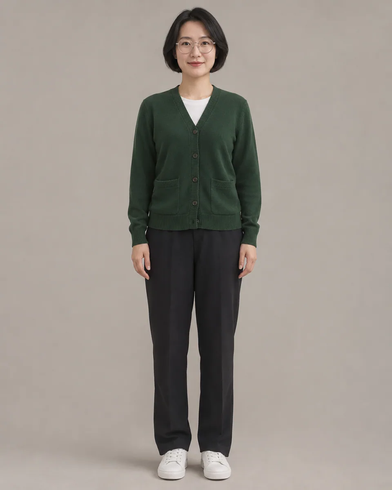
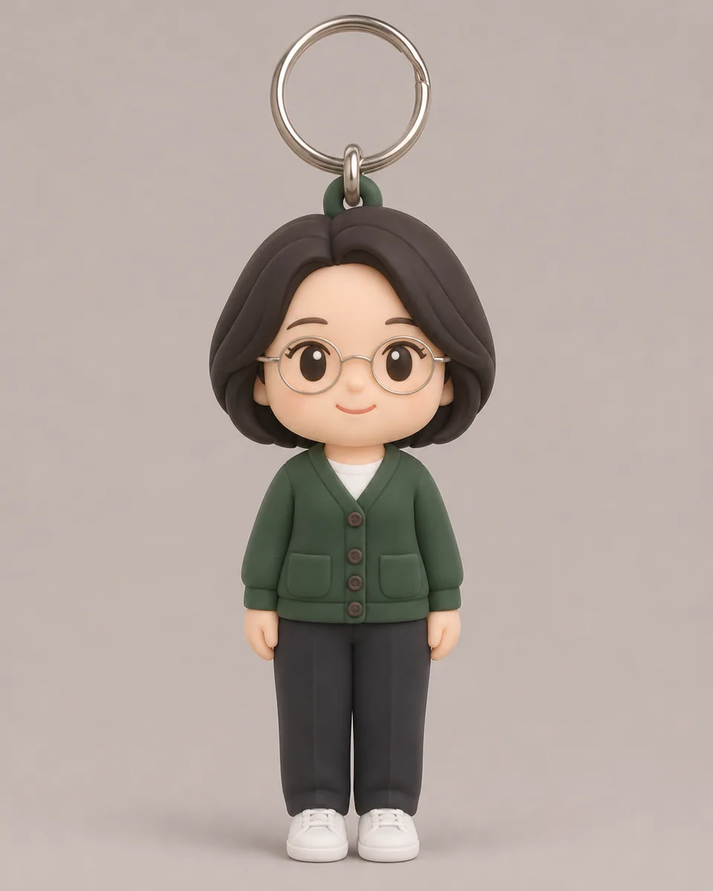

# 软胶人物钥匙串 · Silicone Chibi Keychain

把人物照片做成圆润可爱的软胶钥匙串，保留发型、眼镜和服装等识别点，用简化比例与真实金属挂环表现随身小物。

Turn a photographed person into a rounded silicone keychain with simplified toy proportions, recognizable hair and clothing, and a believable metal attachment.

本方法改编自 @miilesus; collected by langgptai 的 Apache-2.0 授权说明。原作者归属、来源与改动见 [provenance.json](provenance.json)，完整上游许可及其版权声明见 [LICENSE-THIRD-PARTY.txt](LICENSE-THIRD-PARTY.txt)。

Adapted from @miilesus; collected by langgptai's Apache-2.0-licensed instructions. [provenance.json](provenance.json) records the original author, pinned source and modifications; [LICENSE-THIRD-PARTY.txt](LICENSE-THIRD-PARTY.txt) retains the complete upstream license and copyright notices.

原始归属 · Original attribution: Author attribution: langgptai and the original author credited above. The upstream Apache license contains no completed copyright notice. Adapted by MuziGeek from @miilesus; collected by langgptai; repository and original-post credits are retained.

## 输入分析与实际保留

1. 读取用户提供的原图；若没有可用图片，先请求图片。不要用本仓库示例代替用户输入。
2. 观察原图主体、身份、数量、连接、遮挡、光线和画幅。依据本 Skill 的保留约束与几何边界，区分需要保留及明确允许转化的部分。样片说明不能当作用户输入的事实。
3. 使用支持参考图编辑的可用工具，把原图作为编辑输入。先说明观察到的主体，再结合下方机制及 [recipe.yaml](recipe.yaml) 按顺序组合指令；工具名称不是必须安装的依赖。
4. 默认沿用原图比例；仅按用户要求及本 Skill 明确写出的构图或几何转化调整。配方的 4:5 是目录样片比例，不授权裁去必须保留的主体。
5. 对照输入检查结果；只修正发现的问题，不为了增强风格改变身份或添加无关景物。区分已完成的视觉检查与尚未验证的效果。

## Input analysis and preservation

1. Inspect the supplied image; request an image only when none is available. Never substitute a repository example for the user's input.
2. Inspect the real subjects, identity, counts, attachments, overlaps, light and framing. Distinguish preserved attributes from explicitly permitted transformations using this Skill’s preservation and geometry rules; sample descriptions are not facts about user input.
3. Use an available reference-image editing tool. Combine the observed facts with the ordered mechanisms in [recipe.yaml](recipe.yaml); its model-family label does not require an installation script.
4. Keep the input ratio by default; change composition or geometry only as requested by the user and expressly permitted below. The recipe’s 4:5 ratio is a catalog-sample default, not permission to crop protected subjects.
5. Compare output with input and correct observed failures. Report only visual checks actually completed; stronger styling must not override identity or scene integrity.

## 风格机制 · Style mechanism

- 把人物照片做成圆润可爱的软胶钥匙串，保留发型、眼镜和服装等识别点，用简化比例与真实金属挂环表现随身小物。
- 识别特征：圆润软胶人物、保留服装识别点、金属小挂环。
- Medium anchor: A smooth pastel silicone chibi figure with a small physically attached metal keychain ring.

10. **medium** — Transform the observed person into a cute silicone keychain figure, retaining recognizable facial and outfit cues.
20. **palette** — Use softened source colors and restrained pastels rather than unrelated decorative patterns.
30. **line** — Simplify body proportions into a large rounded head and small coherent limbs while preserving the observed pose.
40. **texture** — Render smooth matte silicone with tiny molded seams and gentle surface softness, not knitted fabric.
50. **lighting** — Use soft studio light with minimal realistic contact shadows and small metallic highlights on the ring.
60. **composition** — Show the complete keychain figure centered against a simple neutral background with breathing room.
70. **detail** — Attach one small metal loop securely at the top without piercing facial features or creating floating hardware.
80. **finish** — Omit name tags, lettering, brands, packaging and additional toy copies.

## 保留约束 · Preservation constraints

在实际输入观察结果之上应用以下约束；清单不授权凭空添加图片中不存在的元素。

Apply these constraints to observed content; they never authorize inventing absent subjects.

- Source person identity, hairstyle, eyewear and clothing colors.
- Original person count and recognizable pose despite explicitly permitted toy proportions.
- Complete head, coherent limbs and secure attachment of the single added keyring.

## 适用范围与几何边界 · Applicability and geometry

- 适用：人像、合影。
- Applies to: Portrait, Group.
- 允许将头身比例改为Q版并增加头顶挂环，背景可简化；保留人物身份、发型、眼镜、服装配色与人数，不新增姓名牌文字。
- Allow chibi proportions and a top attachment ring; simplify the background while retaining identity, hair, eyewear, clothing colors and person count. Add no nameplate text.
- 未明确允许的结构变化均不属于此风格；不把这些方法解释为复刻某位艺术家、品牌或现成作品的授权。
- Structural changes not explicitly allowed above are outside this method. This is not permission to reproduce a named artist, brand or existing artwork.

## 排除项 · Avoid

- Unrequested people, duplicate subjects or malformed anatomy.
- New logos, watermarks or unreadable pseudo-lettering.
- Clipping the main subject or erasing its identifying features.

## 验收 · Acceptance

- 人物以Q版软胶形态出现，发型服装识别点保留。
  The person reads as a silicone chibi with recognizable hair and clothing.
- 人数、姿态及主要配件保持，肢体连接合理。
  Count, pose and key accessories remain coherent with connected limbs.
- 金属挂环与头顶结构真实连接，没有漂浮。
  The metal attachment is physically connected rather than floating.
- 无姓名文字、包装或无关玩具。
  No name lettering, packaging or unrelated toys appear.

## 配方、来源与许可 · Recipe, provenance and license

- [recipe.yaml](recipe.yaml): structured image-editing recipe / 结构化图像编辑配方。
- [provenance.json](provenance.json): original authorship, method context and example status / 原创归属、方法背景与示例状态。
- [LICENSE](LICENSE): MIT applies to MuziGeek's original contributions / MIT 适用于 MuziGeek 的原创贡献。
- [LICENSE-THIRD-PARTY.txt](LICENSE-THIRD-PARTY.txt): @miilesus; collected by langgptai · Apache-2.0. Adapted material retains these terms and attribution / 改编材料保留原许可和归属。
- 示例中的前后图均为 AI 合成，不是真人摄影或真实制作工艺的证据。结果会随模型与输入变化，不承诺相同输出。
- Example before/after images are AI-generated, not photographs of real people or evidence of physical craft production. Results vary by model and input.
- MIT 不授予用户输入、第三方作品、人物、商标或生成平台条款之外的权利；示例许可单独见 provenance。
- MIT grants no rights to user inputs, third-party works, likenesses or trademarks, and does not override generation-service terms; example terms are recorded separately in provenance.

## 示例状态 · Example status

ready：打包的原图与效果图均存在且记录了通过的视觉审核。

ready: both packaged source and effect exist and have recorded approved visual reviews.

| AI 合成原图 · Source | 通过审核的效果 · Approved effect |
| --- | --- |
|  |  |

- [AI source / AI 合成原图](examples/source.webp)
- [Generated interpretation / 生成效果](examples/effect.webp)
- [Generation and visual review / 生成与视觉审核记录](examples/generation.json)
