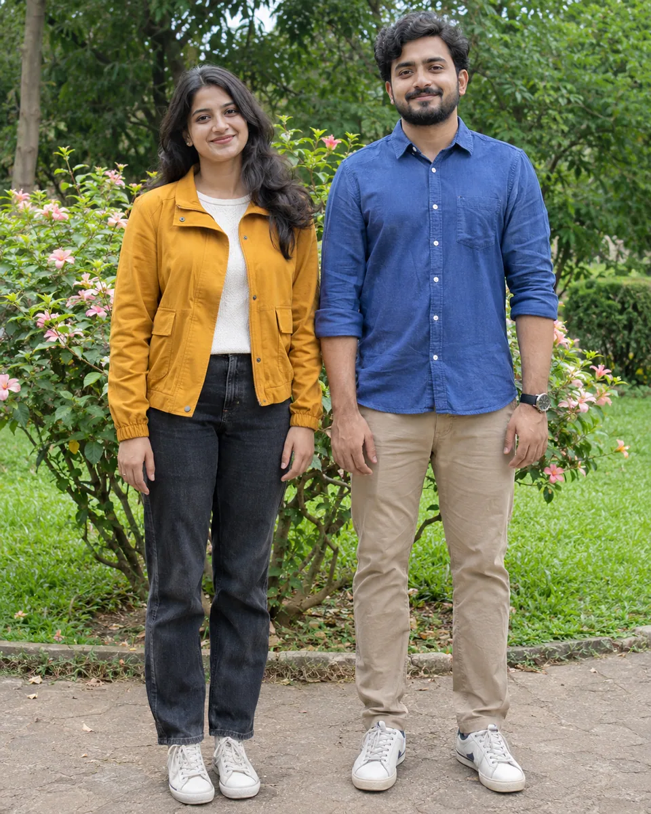
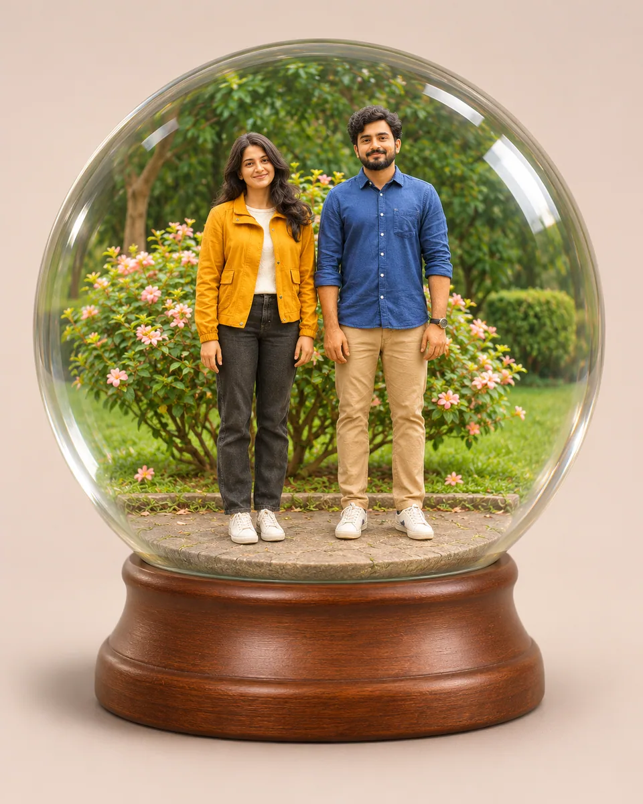

# 水晶球记忆场景 · Snow Globe Memory Scene

把照片人物与环境做成同一只透明水晶球中的微缩纪念场景，保留人数、服装和相互关系，以清晰球体和底座营造完整小世界。

Miniaturize the photographed people and setting inside one clear globe, preserving count, clothing and relationships as a coherent unbranded keepsake.

本方法改编自 阿曼达; collected by ImgEdify 的 MIT 授权说明。原作者归属、来源与改动见 [provenance.json](provenance.json)，完整上游许可及其版权声明见 [LICENSE-THIRD-PARTY.txt](LICENSE-THIRD-PARTY.txt)。

Adapted from 阿曼达; collected by ImgEdify's MIT-licensed instructions. [provenance.json](provenance.json) records the original author, pinned source and modifications; [LICENSE-THIRD-PARTY.txt](LICENSE-THIRD-PARTY.txt) retains the complete upstream license and copyright notices.

原始归属 · Original attribution: Copyright (c) 2024 Awesome GPT4o Image Prompts Adapted by MuziGeek from 阿曼达; collected by ImgEdify; repository and original-post credits are retained.

## 输入分析与实际保留

1. 读取用户提供的原图；若没有可用图片，先请求图片。不要用本仓库示例代替用户输入。
2. 观察原图主体、身份、数量、连接、遮挡、光线和画幅。依据本 Skill 的保留约束与几何边界，区分需要保留及明确允许转化的部分。样片说明不能当作用户输入的事实。
3. 使用支持参考图编辑的可用工具，把原图作为编辑输入。先说明观察到的主体，再结合下方机制及 [recipe.yaml](recipe.yaml) 按顺序组合指令；工具名称不是必须安装的依赖。
4. 默认沿用原图比例；仅按用户要求及本 Skill 明确写出的构图或几何转化调整。配方的 4:5 是目录样片比例，不授权裁去必须保留的主体。
5. 对照输入检查结果；只修正发现的问题，不为了增强风格改变身份或添加无关景物。区分已完成的视觉检查与尚未验证的效果。

## Input analysis and preservation

1. Inspect the supplied image; request an image only when none is available. Never substitute a repository example for the user's input.
2. Inspect the real subjects, identity, counts, attachments, overlaps, light and framing. Distinguish preserved attributes from explicitly permitted transformations using this Skill’s preservation and geometry rules; sample descriptions are not facts about user input.
3. Use an available reference-image editing tool. Combine the observed facts with the ordered mechanisms in [recipe.yaml](recipe.yaml); its model-family label does not require an installation script.
4. Keep the input ratio by default; change composition or geometry only as requested by the user and expressly permitted below. The recipe’s 4:5 ratio is a catalog-sample default, not permission to crop protected subjects.
5. Compare output with input and correct observed failures. Report only visual checks actually completed; stronger styling must not override identity or scene integrity.

## 风格机制 · Style mechanism

- 把照片人物与环境做成同一只透明水晶球中的微缩纪念场景，保留人数、服装和相互关系，以清晰球体和底座营造完整小世界。
- 识别特征：透明完整球体、人物关系保留、统一微缩地台。
- Medium anchor: A single clear glass snow globe containing a coherent miniature keepsake of the photographed subjects on one restrained base.

10. **medium** — Turn the observed people and setting into one coherent miniature memory scene contained inside a clear glass globe.
20. **palette** — Retain source clothing and landscape colors with warm restrained miniature materials.
30. **line** — Keep person counts, recognizable hairstyles, relative positions and shared pose relationships.
40. **texture** — Render smooth miniature figurines and a clear glossy globe with believable glass thickness, avoiding opaque milky glass.
50. **lighting** — Use soft studio light with controlled reflections and realistic contact shadows on the base.
60. **composition** — Reframe to show the complete globe and one simple unbranded base with generous margins.
70. **detail** — Keep the important source subjects inside the globe; add no construction toys or characters from the upstream example.
80. **finish** — Remove original template branding and inscriptions; add no text, logo, separate toy copies or watermark.

## 保留约束 · Preservation constraints

在实际输入观察结果之上应用以下约束；清单不授权凭空添加图片中不存在的元素。

Apply these constraints to observed content; they never authorize inventing absent subjects.

- Observed main subject identities, count and distinctive clothing or landmark colors.
- Relative left-right placement and coherent relationships among source subjects inside the new container.
- Complete primary subjects with no invented people or missing faces; miniature staging is explicitly permitted.

## 适用范围与几何边界 · Applicability and geometry

- 适用：人像、合影、风景、美食、夜景、产品、器物。
- Applies to: Portrait, Group, Landscape, Food, Night, Product, Object.
- 允许人物Q版化、场景缩微与添加球体底座，主体全部纳入球内；保留人数、左右关系、服装配色，不加入来源品牌或新角色。
- Allow gentle toy proportions, miniature staging and one added globe base; keep all subjects inside with count, left-right relationships and outfit colors preserved.
- 未明确允许的结构变化均不属于此风格；不把这些方法解释为复刻某位艺术家、品牌或现成作品的授权。
- Structural changes not explicitly allowed above are outside this method. This is not permission to reproduce a named artist, brand or existing artwork.

## 排除项 · Avoid

- Unrequested people, duplicate subjects or malformed anatomy.
- New logos, watermarks or unreadable pseudo-lettering.
- Clipping the main subject or erasing its identifying features.

## 验收 · Acceptance

- 球体和底座完整可见，人物均在球体内部。
  The globe and base are complete and all people remain inside.
- 人数、服装和左右关系来自原图。
  Count, clothing and left-right relationships derive from the source.
- 球壳透明可辨，反光没有遮住人脸。
  The shell reads as clear glass without obscuring faces.
- 无来源品牌、工程玩具、新角色或刻字。
  No source brand, construction toys, extra characters or inscription appears.

## 配方、来源与许可 · Recipe, provenance and license

- [recipe.yaml](recipe.yaml): structured image-editing recipe / 结构化图像编辑配方。
- [provenance.json](provenance.json): original authorship, method context and example status / 原创归属、方法背景与示例状态。
- [LICENSE](LICENSE): MIT applies to MuziGeek's original contributions / MIT 适用于 MuziGeek 的原创贡献。
- [LICENSE-THIRD-PARTY.txt](LICENSE-THIRD-PARTY.txt): 阿曼达; collected by ImgEdify · MIT. Adapted material retains these terms and attribution / 改编材料保留原许可和归属。
- 示例中的前后图均为 AI 合成，不是真人摄影或真实制作工艺的证据。结果会随模型与输入变化，不承诺相同输出。
- Example before/after images are AI-generated, not photographs of real people or evidence of physical craft production. Results vary by model and input.
- MIT 不授予用户输入、第三方作品、人物、商标或生成平台条款之外的权利；示例许可单独见 provenance。
- MIT grants no rights to user inputs, third-party works, likenesses or trademarks, and does not override generation-service terms; example terms are recorded separately in provenance.

## 示例状态 · Example status

ready：打包的原图与效果图均存在且记录了通过的视觉审核。

ready: both packaged source and effect exist and have recorded approved visual reviews.

| AI 合成原图 · Source | 通过审核的效果 · Approved effect |
| --- | --- |
|  |  |

- [AI source / AI 合成原图](examples/source.webp)
- [Generated interpretation / 生成效果](examples/effect.webp)
- [Generation and visual review / 生成与视觉审核记录](examples/generation.json)
