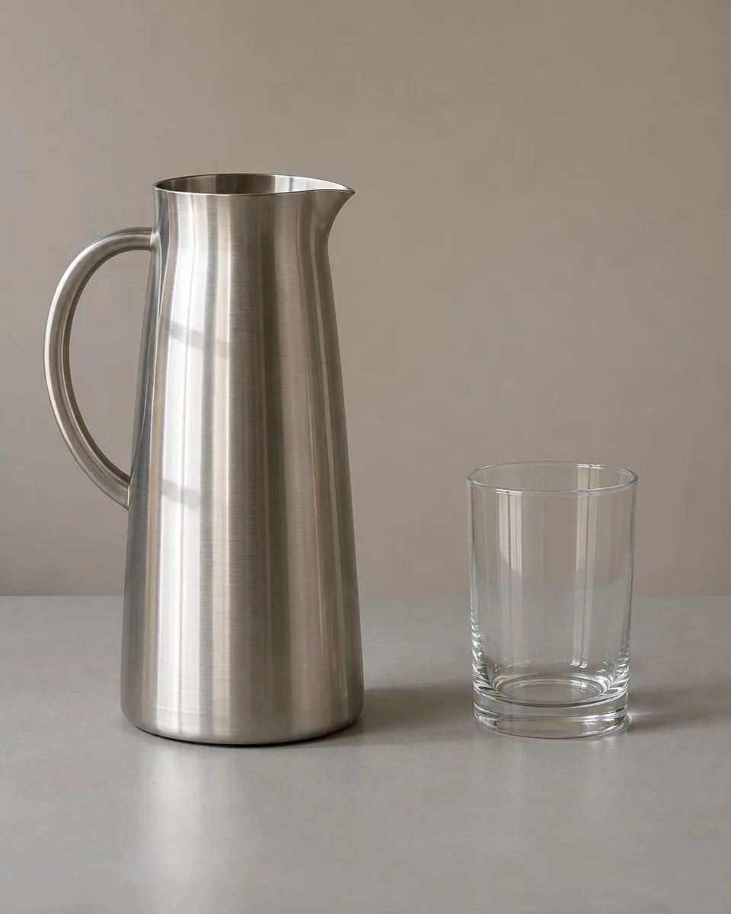
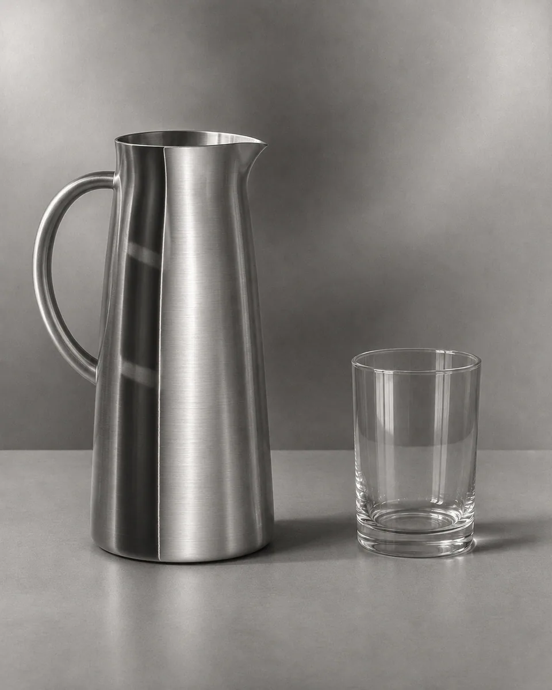

# 局部反转 · Partial Tonal Reversal

借暗房再曝光形成的局部影调反转，在连续灰阶中显出细窄边缘晕线，让日常材质呈现陌生而仍可信的摄影质感。

Use selective darkroom-style tonal reversal and delicate boundary lines to make familiar materials feel unfamiliar while retaining photographic depth and structure.

原创方法说明，由 MuziGeek 编写；没有声称改编自外部提示词。

Original method instructions authored by MuziGeek; no external prompt adaptation is asserted.

## 输入分析与实际保留

1. 读取用户提供的原图；若没有可用图片，先请求图片。不要用本仓库示例代替用户输入。
2. 观察实际主体数量、身份与表情、朝向、肢体和连接、物体开口、相互遮挡、前后层次、光向及画幅；据实形成简短保留清单。样片说明只是样片，不能当成其他输入的事实。
3. 使用支持参考图编辑的可用工具，把原图作为编辑输入。先说明观察到的主体，再结合下方机制及 [recipe.yaml](recipe.yaml) 按顺序组合指令；工具名称不是必须安装的依赖。
4. 实际编辑默认沿用原图比例和完整内容，除非用户另有要求。配方的 4:5 是目录样片比例，不代表可裁去用户照片中的主体。
5. 对照输入检查结果；只修正发现的问题，不为了增强风格改变身份或添加无关景物。区分已完成的视觉检查与尚未验证的效果。

## Input analysis and preservation

1. Inspect the supplied image; request an image only when none is available. Never substitute a repository example for the user's input.
2. Record the observed subject count, identity, expression, direction, anatomy, attachments, openings, overlaps, depth, light and framing. Build preservation instructions from this image, not from the sample description.
3. Use an available reference-image editing tool. Combine the observed facts with the ordered mechanisms in [recipe.yaml](recipe.yaml); its model-family label does not require an installation script.
4. Keep the input aspect ratio and complete composition unless the user requests another format. The recipe's 4:5 ratio is a catalog-sample default, not authorization to crop a subject.
5. Compare output with input and correct observed failures. Report only visual checks actually completed; stronger styling must not override identity or scene integrity.

## 风格机制 · Style mechanism

- 借暗房再曝光形成的局部影调反转，在连续灰阶中显出细窄边缘晕线，让日常材质呈现陌生而仍可信的摄影质感。
- 识别特征：局部灰阶反转、细窄明暗晕线、连续银灰质感。
- Medium anchor: A silver-print Sabattier interpretation with partial tonal reversal, continuous gray passages and restrained narrow boundary lines.

10. **medium** — Interpret the photograph as a partially solarized silver print; reverse selected upper-midtones while retaining continuous ordinary tones elsewhere.
20. **palette** — Use neutral black, pewter and pearl white; let selective tonal reversal create the unfamiliar effect without rainbow gradients.
30. **line** — Introduce very narrow dark-light boundary lines at a few strong tonal transitions, never tracing every object like vector artwork.
40. **lighting** — Retain the position of reflections and shadows even where their brightness reverses; preserve a legible three-dimensional light structure.
50. **texture** — Keep fine photographic grain, brushed surfaces and transparent details readable beneath the reversed tones.
60. **composition** — Lock object counts, silhouettes, openings, perspective and overlap order; apply tonal effects inside the existing geometry.
70. **detail** — Protect faces and small identifying details from full inversion; maintain recognizable eyes, fingers, lettering-free surfaces and material boundaries.
80. **finish** — Balance inverted and uninverted passages across the frame; avoid posterization, metallic embossing, illustration outlines or added borders.

## 保留约束 · Preservation constraints

在实际输入观察结果之上应用以下约束；清单不授权凭空添加图片中不存在的元素。

Apply these constraints to observed content; they never authorize inventing absent subjects.

- Exact object counts, silhouette openings and proportions
- Reflection placement and shadow geometry
- Original crop, perspective and overlap order
- Recognizable human features when present

## 适用范围与几何边界 · Applicability and geometry

- 适用：产品、器物、人像、风景、夜景。
- Applies to: Product, Object, Portrait, Landscape, Night.
- 反转仅改变已有像素区域的明暗关系；杯口、把手空隙和反射位置必须保留，不生成浮雕或金属化新结构。
- Reverse brightness relationships within existing regions; retain rims, handle gaps and reflection positions without inventing embossed or metallic geometry.
- 未明确允许的结构变化均不属于此风格；不把这些方法解释为复刻某位艺术家、品牌或现成作品的授权。
- Structural changes not explicitly allowed above are outside this method. This is not permission to reproduce a named artist, brand or existing artwork.

## 排除项 · Avoid

- complete negative inversion
- rainbow heat-map palette
- thick vector outlines
- embossed metallic relief
- posterized flat bands
- moved reflections or duplicated handles
- frame, added lettering or watermark

## 验收 · Acceptance

- 能同时看见正常影调和局部反转，不是整图负片。
  Ordinary and reversed tonal passages coexist rather than forming a complete negative.
- 边缘晕线细而有限，未变成描边插画。
  Boundary lines remain narrow and selective instead of becoming illustration outlines.
- 反射和阴影位置不变，器物开孔与透明结构正确。
  Reflections and shadows stay in place; openings and transparent structures remain correct.
- 人物若出现仍可辨认，画面不添加边框或文字。
  Any people remain recognizable, with no added borders or lettering.

## 配方、来源与许可 · Recipe, provenance and license

- [recipe.yaml](recipe.yaml): structured image-editing recipe / 结构化图像编辑配方。
- [provenance.json](provenance.json): original authorship, method context and example status / 原创归属、方法背景与示例状态。
- [LICENSE](LICENSE): MIT applies to MuziGeek's original contributions / MIT 适用于 MuziGeek 的原创贡献。
- 示例中的前后图均为 AI 合成，不是真人摄影或真实制作工艺的证据。结果会随模型与输入变化，不承诺相同输出。
- Example before/after images are AI-generated, not photographs of real people or evidence of physical craft production. Results vary by model and input.
- MIT 不授予用户输入、第三方作品、人物、商标或生成平台条款之外的权利；示例许可单独见 provenance。
- MIT grants no rights to user inputs, third-party works, likenesses or trademarks, and does not override generation-service terms; example terms are recorded separately in provenance.

## 示例状态 · Example status

ready：打包的原图与效果图均存在且记录了通过的视觉审核。

ready: both packaged source and effect exist and have recorded approved visual reviews.

| AI 合成原图 · Source | 通过审核的效果 · Approved effect |
| --- | --- |
|  |  |

- [AI source / AI 合成原图](examples/source.webp)
- [Generated interpretation / 生成效果](examples/effect.webp)
- [Generation and visual review / 生成与视觉审核记录](examples/generation.json)
