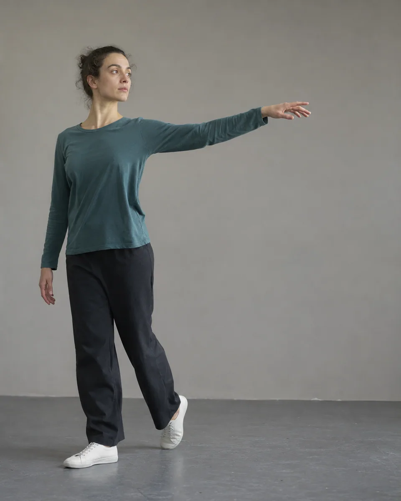
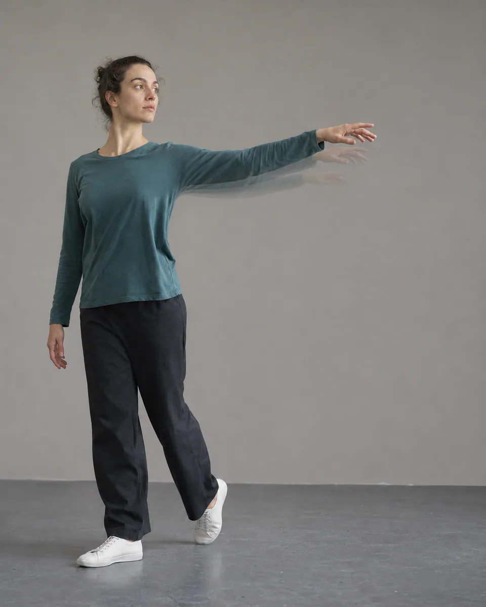

# 频闪轨迹 · Stroboscopic Motion Trace

保留一个清楚的主体，在确有运动方向的局部叠入少量递减曝光残影，像频闪记录动作节奏，不复制成多人或新增肢体。

Keep one clear subject and add a few fading exposure traces only along plausible moving parts, recording motion rhythm without cloning people or inventing anatomy.

原创方法说明，由 MuziGeek 编写；没有声称改编自外部提示词。

Original method instructions authored by MuziGeek; no external prompt adaptation is asserted.

## 输入分析与实际保留

1. 读取用户提供的原图；若没有可用图片，先请求图片。不要用本仓库示例代替用户输入。
2. 观察实际主体数量、身份与表情、朝向、肢体和连接、物体开口、相互遮挡、前后层次、光向及画幅；据实形成简短保留清单。样片说明只是样片，不能当成其他输入的事实。
3. 使用支持参考图编辑的可用工具，把原图作为编辑输入。先说明观察到的主体，再结合下方机制及 [recipe.yaml](recipe.yaml) 按顺序组合指令；工具名称不是必须安装的依赖。
4. 实际编辑默认沿用原图比例和完整内容，除非用户另有要求。配方的 4:5 是目录样片比例，不代表可裁去用户照片中的主体。
5. 对照输入检查结果；只修正发现的问题，不为了增强风格改变身份或添加无关景物。区分已完成的视觉检查与尚未验证的效果。

## Input analysis and preservation

1. Inspect the supplied image; request an image only when none is available. Never substitute a repository example for the user's input.
2. Record the observed subject count, identity, expression, direction, anatomy, attachments, openings, overlaps, depth, light and framing. Build preservation instructions from this image, not from the sample description.
3. Use an available reference-image editing tool. Combine the observed facts with the ordered mechanisms in [recipe.yaml](recipe.yaml); its model-family label does not require an installation script.
4. Keep the input aspect ratio and complete composition unless the user requests another format. The recipe's 4:5 ratio is a catalog-sample default, not authorization to crop a subject.
5. Compare output with input and correct observed failures. Report only visual checks actually completed; stronger styling must not override identity or scene integrity.

## 风格机制 · Style mechanism

- 保留一个清楚的主体，在确有运动方向的局部叠入少量递减曝光残影，像频闪记录动作节奏，不复制成多人或新增肢体。
- 识别特征：单一清晰主体、递减曝光残影、局部定向轨迹。
- Medium anchor: A photographic stroboscopic motion study with one dominant sharp subject and sparse fading exposure traces confined to a plausible movement path.

10. **medium** — Render a stroboscopic motion photograph with exactly one dominant sharp subject and faint sequential exposure traces of plausible moving parts only.
20. **composition** — Keep the source body, face, object counts and camera position unchanged; anchor every trace to the same subject and movement path.
30. **line** — Add at most two or three thin fading contour echoes behind the moving edge; never create complete duplicate bodies or detached limbs.
40. **lighting** — Let successive exposure traces decrease in brightness away from the sharp final position, with one consistent directional motion rhythm.
50. **palette** — Preserve subdued source colors and use translucent traces derived from the moving material, avoiding rainbow splitting or neon streaks.
60. **texture** — Keep the primary face, clothing and stationary background crisp; motion traces remain transparent photographic exposure, not opaque painted repetitions.
70. **detail** — Protect facial identity and planted contact points; if motion is ambiguous, use one minimal edge trail rather than inventing an action.
80. **finish** — Retain the original crop and readable anatomy; omit speed graphics, detached hands, mirrored clones, timestamps and decorative frames.

## 保留约束 · Preservation constraints

在实际输入观察结果之上应用以下约束；清单不授权凭空添加图片中不存在的元素。

Apply these constraints to observed content; they never authorize inventing absent subjects.

- Exactly one dominant instance of each original subject
- Facial identity, primary body anatomy and clothing
- Stationary contact points, environment and camera perspective
- Original crop and physically plausible movement direction

## 适用范围与几何边界 · Applicability and geometry

- 适用：人像、器物、夜景。
- Applies to: Portrait, Object, Night.
- 唯一允许的几何外延是运动边缘的低透明度曝光轨迹；主像人体结构不变，不复制头部、躯干或完整人物。
- Only low-opacity exposure trails may extend beyond moving edges; preserve the primary anatomy without duplicating heads, torsos or complete people.
- 未明确允许的结构变化均不属于此风格；不把这些方法解释为复刻某位艺术家、品牌或现成作品的授权。
- Structural changes not explicitly allowed above are outside this method. This is not permission to reproduce a named artist, brand or existing artwork.

## 排除项 · Avoid

- multiple complete people
- detached hands or new opaque limbs
- repeated faces or mirrored clones
- all-over camera shake
- rainbow chromatic split
- invented jumping or spinning action
- speed lines, timestamps, lettering, border or watermark

## 验收 · Acceptance

- 原有主体数量不变，始终只有一个占主导的清晰人像。
  Original subject counts remain unchanged, with one dominant clear image of each person.
- 最多两到三道透明残影沿合理方向递减。
  At most two or three transparent traces fade along a plausible direction.
- 残影局限于运动部位，不生成完整分身、独立手掌或新肢体。
  Traces stay on moving regions without creating whole clones, detached hands or new limbs.
- 脸部、落脚点和背景稳定，原始构图与裁切保留。
  Faces, planted contact points and background stay stable, preserving the original composition and crop.

## 配方、来源与许可 · Recipe, provenance and license

- [recipe.yaml](recipe.yaml): structured image-editing recipe / 结构化图像编辑配方。
- [provenance.json](provenance.json): original authorship, method context and example status / 原创归属、方法背景与示例状态。
- [LICENSE](LICENSE): MIT applies to MuziGeek's original contributions / MIT 适用于 MuziGeek 的原创贡献。
- 示例中的前后图均为 AI 合成，不是真人摄影或真实制作工艺的证据。结果会随模型与输入变化，不承诺相同输出。
- Example before/after images are AI-generated, not photographs of real people or evidence of physical craft production. Results vary by model and input.
- MIT 不授予用户输入、第三方作品、人物、商标或生成平台条款之外的权利；示例许可单独见 provenance。
- MIT grants no rights to user inputs, third-party works, likenesses or trademarks, and does not override generation-service terms; example terms are recorded separately in provenance.

## 示例状态 · Example status

ready：打包的原图与效果图均存在且记录了通过的视觉审核。

ready: both packaged source and effect exist and have recorded approved visual reviews.

| AI 合成原图 · Source | 通过审核的效果 · Approved effect |
| --- | --- |
|  |  |

- [AI source / AI 合成原图](examples/source.webp)
- [Generated interpretation / 生成效果](examples/effect.webp)
- [Generation and visual review / 生成与视觉审核记录](examples/generation.json)
