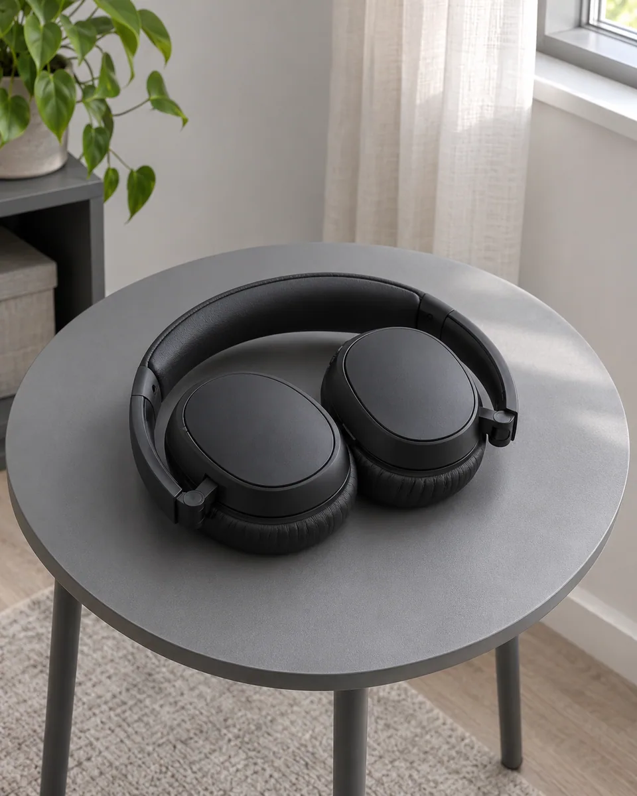
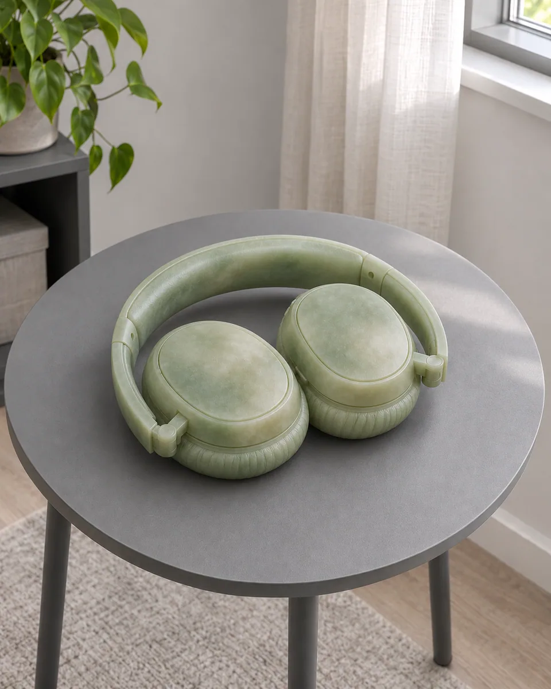

# 玉雕温润 · Soft translucent jade

将主体外表转译为细腻温润的玉石，通过薄处透光、低对比矿物云纹与柔和抛光表现厚度，保留原物形状。

Render the subject in softly polished jade with thin-edge transmission and restrained mineral clouds, retaining its original geometry.

原创方法说明，由 MuziGeek 编写；没有声称改编自外部提示词。

Original method instructions authored by MuziGeek; no external prompt adaptation is asserted.

## 输入分析与实际保留

1. 读取用户提供的原图；若没有可用图片，先请求图片。不要用本仓库示例代替用户输入。
2. 观察实际主体数量、身份与表情、朝向、肢体和连接、物体开口、相互遮挡、前后层次、光向及画幅；据实形成简短保留清单。样片说明只是样片，不能当成其他输入的事实。
3. 使用支持参考图编辑的可用工具，把原图作为编辑输入。先说明观察到的主体，再结合下方机制及 [recipe.yaml](recipe.yaml) 按顺序组合指令；工具名称不是必须安装的依赖。
4. 实际编辑默认沿用原图比例和完整内容，除非用户另有要求。配方的 4:5 是目录样片比例，不代表可裁去用户照片中的主体。
5. 对照输入检查结果；只修正发现的问题，不为了增强风格改变身份或添加无关景物。区分已完成的视觉检查与尚未验证的效果。

## Input analysis and preservation

1. Inspect the supplied image; request an image only when none is available. Never substitute a repository example for the user's input.
2. Record the observed subject count, identity, expression, direction, anatomy, attachments, openings, overlaps, depth, light and framing. Build preservation instructions from this image, not from the sample description.
3. Use an available reference-image editing tool. Combine the observed facts with the ordered mechanisms in [recipe.yaml](recipe.yaml); its model-family label does not require an installation script.
4. Keep the input aspect ratio and complete composition unless the user requests another format. The recipe's 4:5 ratio is a catalog-sample default, not authorization to crop a subject.
5. Compare output with input and correct observed failures. Report only visual checks actually completed; stronger styling must not override identity or scene integrity.

## 风格机制 · Style mechanism

- 将主体外表转译为细腻温润的玉石，通过薄处透光、低对比矿物云纹与柔和抛光表现厚度，保留原物形状。
- 识别特征：薄缘透光、矿物云纹、温润蜡光。
- Medium anchor: Fine-grained nephrite-like jade with gentle subsurface scattering, cloudy mineral variation, and restrained polish.

10. **medium** — Translate existing solid subject surfaces into fine-grained jade with gentle subsurface scattering, retaining all holes, gaps, and attached parts.
20. **palette** — Use pale sage, milky ivory, and muted green-gray veins sampled as subtle mineral variation rather than decorative patterns.
30. **line** — Define contours through smooth rounded edges and changing thickness; do not carve new relief patterns.
40. **texture** — Introduce restrained cloudy inclusions and fine mineral grain within solid areas, never large contrasting marble veins.
50. **lighting** — Keep source lighting; thin edges transmit softly while thick volumes remain denser and less translucent.
60. **composition** — Preserve subject count, camera angle, framing, placement, and negative spaces between components.
70. **detail** — Retain small functional joints and surface transitions as recognizable shapes without inventing carved ornaments.
80. **finish** — Use a low-gloss waxy polish with softened highlights and grounded shadows, avoiding plastic opacity or emerald brilliance.

## 保留约束 · Preservation constraints

在实际输入观察结果之上应用以下约束；清单不授权凭空添加图片中不存在的元素。

Apply these constraints to observed content; they never authorize inventing absent subjects.

- Subject count, outer silhouette, openings, attachments, and contact points.
- Source camera viewpoint, framing, relative scale, and placement.
- Recognizable subject identity and existing background structure.

## 适用范围与几何边界 · Applicability and geometry

- 适用：产品、器物、美食。
- Applies to: Product, Object, Food.
- 仅改变原有实体外表和材质表现，不增减部件，不改变轮廓、开口或摆放。
- Change existing solid surfaces and their material response only; retain parts, silhouettes, openings, and placement.
- 未明确允许的结构变化均不属于此风格；不把这些方法解释为复刻某位艺术家、品牌或现成作品的授权。
- Structural changes not explicitly allowed above are outside this method. This is not permission to reproduce a named artist, brand or existing artwork.

## 排除项 · Avoid

- Carved dragons, floral relief, symbols, tassels, or decorative pedestals.
- Closed gaps, fused parts, duplicated components, or changed proportions.
- Neon green glass, plastic shine, text, logos, or watermarks.

## 验收 · Acceptance

- 主体数量、孔隙和部件连接保持原样。
  Counts, gaps, and component connections remain intact.
- 薄缘透光强于厚体，体积可信。
  Thin edges transmit more light than thick volumes.
- 矿物云纹轻微，不抢夺主体结构。
  Mineral clouds remain subtle and subordinate to structure.
- 无额外雕花、配饰或底座。
  No carved ornament, accessory, or pedestal is added.

## 配方、来源与许可 · Recipe, provenance and license

- [recipe.yaml](recipe.yaml): structured image-editing recipe / 结构化图像编辑配方。
- [provenance.json](provenance.json): original authorship, method context and example status / 原创归属、方法背景与示例状态。
- [LICENSE](LICENSE): MIT applies to MuziGeek's original contributions / MIT 适用于 MuziGeek 的原创贡献。
- 示例中的前后图均为 AI 合成，不是真人摄影或真实制作工艺的证据。结果会随模型与输入变化，不承诺相同输出。
- Example before/after images are AI-generated, not photographs of real people or evidence of physical craft production. Results vary by model and input.
- MIT 不授予用户输入、第三方作品、人物、商标或生成平台条款之外的权利；示例许可单独见 provenance。
- MIT grants no rights to user inputs, third-party works, likenesses or trademarks, and does not override generation-service terms; example terms are recorded separately in provenance.

## 示例状态 · Example status

ready：打包的原图与效果图均存在且记录了通过的视觉审核。

ready: both packaged source and effect exist and have recorded approved visual reviews.

| AI 合成原图 · Source | 通过审核的效果 · Approved effect |
| --- | --- |
|  |  |

- [AI source / AI 合成原图](examples/source.webp)
- [Generated interpretation / 生成效果](examples/effect.webp)
- [Generation and visual review / 生成与视觉审核记录](examples/generation.json)
