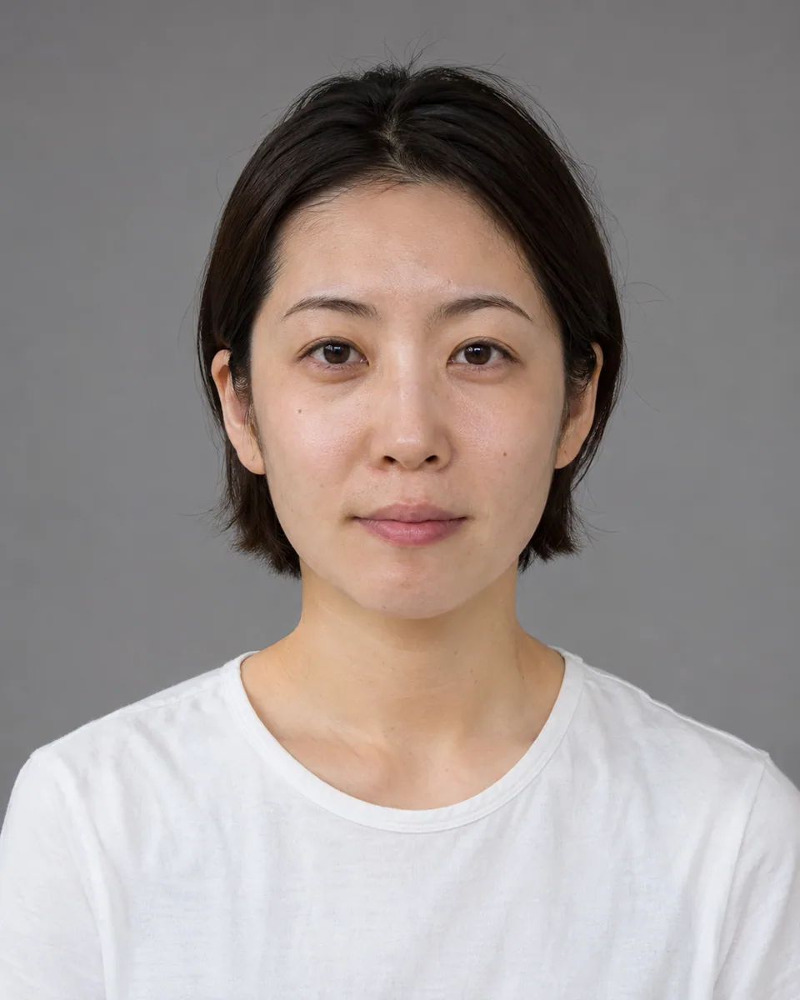
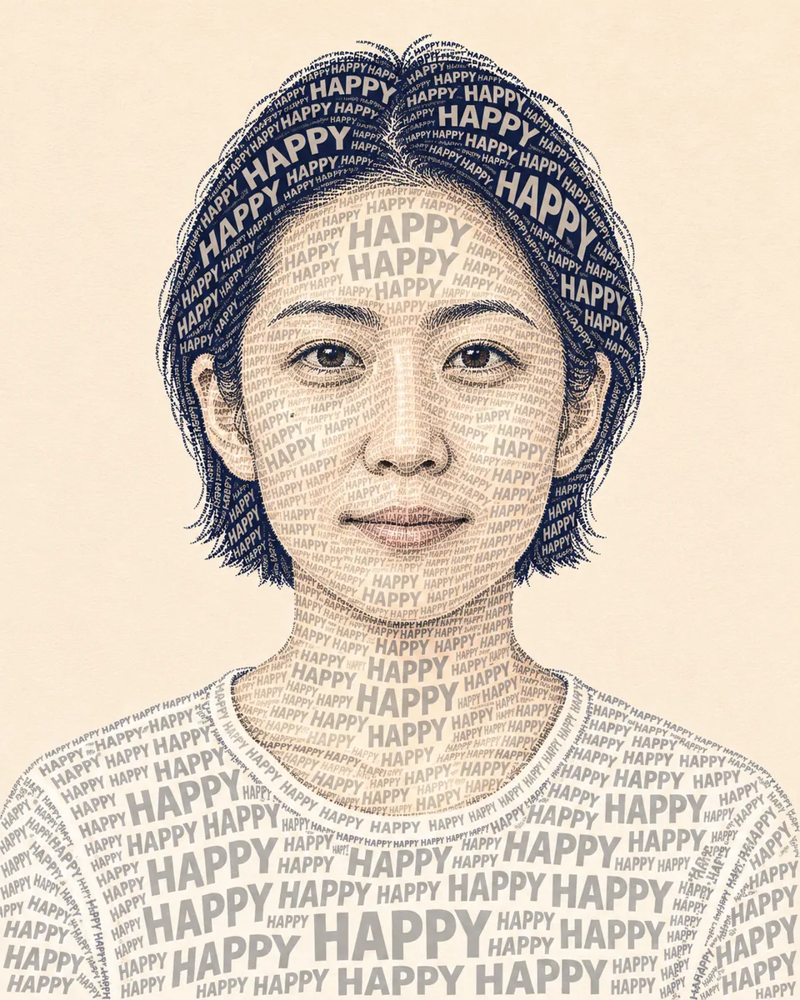

# 文字构成肖像 · Typographic Photo Portrait

用同一组可读的小字沿明暗和形体方向排布，重构照片人物的面部轮廓，让文字本身成为肖像，而不是覆盖在照片上的说明。

Construct the portrait from readable repeated words arranged along facial planes and tonal density, making typography form the likeness rather than overlay a photograph.

本方法改编自 firatbilal; collected by ImgEdify 的 MIT 授权说明。原作者归属、来源与改动见 [provenance.json](provenance.json)，完整上游许可及其版权声明见 [LICENSE-THIRD-PARTY.txt](LICENSE-THIRD-PARTY.txt)。

Adapted from firatbilal; collected by ImgEdify's MIT-licensed instructions. [provenance.json](provenance.json) records the original author, pinned source and modifications; [LICENSE-THIRD-PARTY.txt](LICENSE-THIRD-PARTY.txt) retains the complete upstream license and copyright notices.

原始归属 · Original attribution: Copyright (c) 2024 Awesome GPT4o Image Prompts Adapted by MuziGeek from firatbilal; collected by ImgEdify; repository and original-post credits are retained.

## 输入分析与实际保留

1. 读取用户提供的原图；若没有可用图片，先请求图片。不要用本仓库示例代替用户输入。
2. 观察原图主体、身份、数量、连接、遮挡、光线和画幅。依据本 Skill 的保留约束与几何边界，区分需要保留及明确允许转化的部分。样片说明不能当作用户输入的事实。
3. 使用支持参考图编辑的可用工具，把原图作为编辑输入。先说明观察到的主体，再结合下方机制及 [recipe.yaml](recipe.yaml) 按顺序组合指令；工具名称不是必须安装的依赖。
4. 默认沿用原图比例；仅按用户要求及本 Skill 明确写出的构图或几何转化调整。配方的 4:5 是目录样片比例，不授权裁去必须保留的主体。
5. 对照输入检查结果；只修正发现的问题，不为了增强风格改变身份或添加无关景物。区分已完成的视觉检查与尚未验证的效果。

## Input analysis and preservation

1. Inspect the supplied image; request an image only when none is available. Never substitute a repository example for the user's input.
2. Inspect the real subjects, identity, counts, attachments, overlaps, light and framing. Distinguish preserved attributes from explicitly permitted transformations using this Skill’s preservation and geometry rules; sample descriptions are not facts about user input.
3. Use an available reference-image editing tool. Combine the observed facts with the ordered mechanisms in [recipe.yaml](recipe.yaml); its model-family label does not require an installation script.
4. Keep the input ratio by default; change composition or geometry only as requested by the user and expressly permitted below. The recipe’s 4:5 ratio is a catalog-sample default, not permission to crop protected subjects.
5. Compare output with input and correct observed failures. Report only visual checks actually completed; stronger styling must not override identity or scene integrity.

## 风格机制 · Style mechanism

- 用同一组可读的小字沿明暗和形体方向排布，重构照片人物的面部轮廓，让文字本身成为肖像，而不是覆盖在照片上的说明。
- 识别特征：文字组成明暗、五官轮廓可辨、字形疏密层次。
- Medium anchor: A portrait made entirely from clean readable typographic shapes, with repeated words defining facial planes and tonal masses.

10. **medium** — Recreate the observed person as a typographic portrait, using actual letterforms to construct the face rather than overlaying text on skin.
20. **palette** — Use only dark navy and muted gray letters against warm off-white paper for clear tonal separation.
30. **line** — Repeat the exact word HAPPY in varied sizes, aligning baselines with facial contours and hair direction.
40. **texture** — Build shadows through denser small words and highlights through generous gaps, without photographic texture beneath.
50. **lighting** — Preserve the observed facial proportions, eye spacing, expression and recognizable hair silhouette.
60. **composition** — Keep a single complete head-and-shoulders portrait with comfortable headroom and no extra faces.
70. **detail** — Make letterforms legible where large enough; avoid random pseudo-letters and unrequested slogans.
80. **finish** — Return the finished typographic artwork only, without borders, logos, captions or watermark.

## 保留约束 · Preservation constraints

在实际输入观察结果之上应用以下约束；清单不授权凭空添加图片中不存在的元素。

Apply these constraints to observed content; they never authorize inventing absent subjects.

- Recognizable identity, expression, subject count and distinctive source colors.
- Observed anatomical connections, essential openings and relationships between subjects.
- Complete main subjects within the final frame; no accidental crop.

## 适用范围与几何边界 · Applicability and geometry

- 适用：人像、合影。
- Applies to: Portrait, Group.
- 允许用重复文字替换所有肤色与发丝纹理，疏密构成五官；保留脸型、视线、发型轮廓和神态，文字不要求复制无关源图标志。
- Replace surface texture with repeated typography; retain face shape, gaze, hair silhouette and expression. Do not reproduce unrelated source branding.
- 未明确允许的结构变化均不属于此风格；不把这些方法解释为复刻某位艺术家、品牌或现成作品的授权。
- Structural changes not explicitly allowed above are outside this method. This is not permission to reproduce a named artist, brand or existing artwork.

## 排除项 · Avoid

- Unrequested people, duplicate subjects or malformed anatomy.
- New logos, watermarks or unreadable pseudo-lettering.
- Clipping the main subject or erasing its identifying features.

## 验收 · Acceptance

- 五官由文字疏密实际构成，没有底层照片。
  Letter density constructs facial tones without an underlying photo.
- 人物脸型、眼距、发型与表情仍可辨认。
  Face shape, eye spacing, hair and expression remain recognizable.
- 大字清晰可读，只使用约定词语。
  Larger type remains readable and uses only the specified word.
- 无额外人物、标题、标志或水印。
  No extra person, headline, logo or watermark is added.

## 配方、来源与许可 · Recipe, provenance and license

- [recipe.yaml](recipe.yaml): structured image-editing recipe / 结构化图像编辑配方。
- [provenance.json](provenance.json): original authorship, method context and example status / 原创归属、方法背景与示例状态。
- [LICENSE](LICENSE): MIT applies to MuziGeek's original contributions / MIT 适用于 MuziGeek 的原创贡献。
- [LICENSE-THIRD-PARTY.txt](LICENSE-THIRD-PARTY.txt): firatbilal; collected by ImgEdify · MIT. Adapted material retains these terms and attribution / 改编材料保留原许可和归属。
- 示例中的前后图均为 AI 合成，不是真人摄影或真实制作工艺的证据。结果会随模型与输入变化，不承诺相同输出。
- Example before/after images are AI-generated, not photographs of real people or evidence of physical craft production. Results vary by model and input.
- MIT 不授予用户输入、第三方作品、人物、商标或生成平台条款之外的权利；示例许可单独见 provenance。
- MIT grants no rights to user inputs, third-party works, likenesses or trademarks, and does not override generation-service terms; example terms are recorded separately in provenance.

## 示例状态 · Example status

ready：打包的原图与效果图均存在且记录了通过的视觉审核。

ready: both packaged source and effect exist and have recorded approved visual reviews.

| AI 合成原图 · Source | 通过审核的效果 · Approved effect |
| --- | --- |
|  |  |

- [AI source / AI 合成原图](examples/source.webp)
- [Generated interpretation / 生成效果](examples/effect.webp)
- [Generation and visual review / 生成与视觉审核记录](examples/generation.json)
