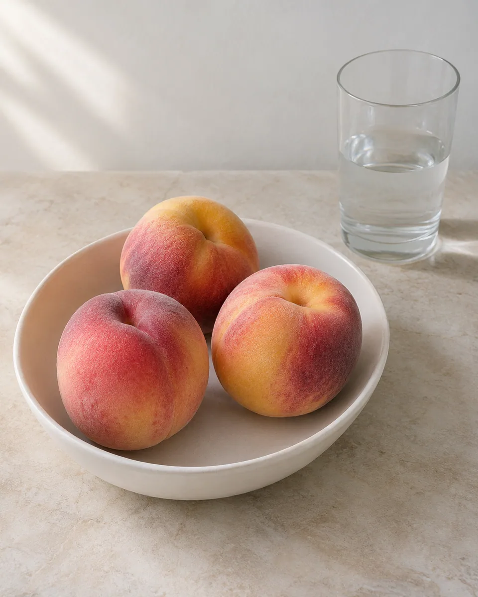
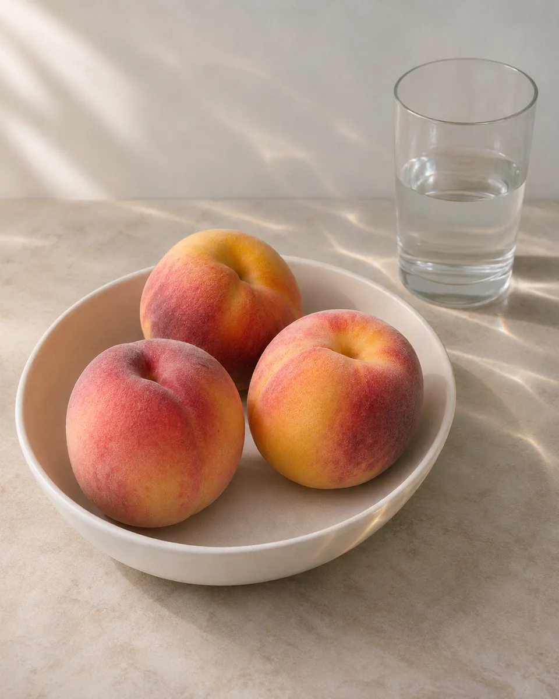

# 水光焦散 · Water Caustic Light

让折射聚焦形成的细碎水光落在现有表面，明暗网纹随曲面轻轻转折，保留食物与器物的自然色泽和真实形体。

Project restrained refracted-water light onto existing surfaces, letting narrow luminous networks follow real contours while preserving natural materials and colors.

原创方法说明，由 MuziGeek 编写；没有声称改编自外部提示词。

Original method instructions authored by MuziGeek; no external prompt adaptation is asserted.

## 输入分析与实际保留

1. 读取用户提供的原图；若没有可用图片，先请求图片。不要用本仓库示例代替用户输入。
2. 观察实际主体数量、身份与表情、朝向、肢体和连接、物体开口、相互遮挡、前后层次、光向及画幅；据实形成简短保留清单。样片说明只是样片，不能当成其他输入的事实。
3. 使用支持参考图编辑的可用工具，把原图作为编辑输入。先说明观察到的主体，再结合下方机制及 [recipe.yaml](recipe.yaml) 按顺序组合指令；工具名称不是必须安装的依赖。
4. 实际编辑默认沿用原图比例和完整内容，除非用户另有要求。配方的 4:5 是目录样片比例，不代表可裁去用户照片中的主体。
5. 对照输入检查结果；只修正发现的问题，不为了增强风格改变身份或添加无关景物。区分已完成的视觉检查与尚未验证的效果。

## Input analysis and preservation

1. Inspect the supplied image; request an image only when none is available. Never substitute a repository example for the user's input.
2. Record the observed subject count, identity, expression, direction, anatomy, attachments, openings, overlaps, depth, light and framing. Build preservation instructions from this image, not from the sample description.
3. Use an available reference-image editing tool. Combine the observed facts with the ordered mechanisms in [recipe.yaml](recipe.yaml); its model-family label does not require an installation script.
4. Keep the input aspect ratio and complete composition unless the user requests another format. The recipe's 4:5 ratio is a catalog-sample default, not authorization to crop a subject.
5. Compare output with input and correct observed failures. Report only visual checks actually completed; stronger styling must not override identity or scene integrity.

## 风格机制 · Style mechanism

- 让折射聚焦形成的细碎水光落在现有表面，明暗网纹随曲面轻轻转折，保留食物与器物的自然色泽和真实形体。
- 识别特征：细碎折射光网、沿曲面自然转折、保留干燥材质。
- Medium anchor: Natural photographic lighting with restrained refractive water caustics projected onto existing surfaces, not a liquid or glass material transformation.

10. **medium** — Keep a natural photograph and introduce subtle refractive water caustics as illumination on existing surfaces, never as newly added objects.
20. **lighting** — Project sparse branching bands of concentrated light from a coherent direction; follow surface curvature and let existing occluders interrupt the pattern.
30. **palette** — Retain the source's natural material colors; allow pale cool highlights and softly warm ambient shadows without a blue underwater wash.
40. **line** — Make light bands irregular, narrow and softly graded; avoid uniform geometric grids, painted white veins or hard luminous outlines.
50. **texture** — Preserve skin, fruit fuzz, ceramic grain and fabric beneath the light; matte surfaces must stay matte and dry.
60. **composition** — Keep all subjects, containers, openings and positions unchanged; add no pool, water sheet, droplets, glass layer or reflected duplicate objects.
70. **detail** — Keep caustics sparse near faces and identifying details; retain readable highlights, real cast shadows and existing transparent-water boundaries.
80. **finish** — Balance the light pattern below the subject's visual priority; preserve photographic exposure without glitter, neon glow, borders or overlays.

## 保留约束 · Preservation constraints

在实际输入观察结果之上应用以下约束；清单不授权凭空添加图片中不存在的元素。

Apply these constraints to observed content; they never authorize inventing absent subjects.

- Exact subject, food and container counts
- Natural material identity, color and dry surfaces
- Source geometry, overlaps and liquid boundaries
- Readable identifying details and coherent cast shadows

## 适用范围与几何边界 · Applicability and geometry

- 适用：美食、产品、器物、人像。
- Applies to: Food, Product, Object, Portrait.
- 焦散纹样可以沿现有曲面弯折，但不得改变碗口、玻璃边界和食物形状，也不得生成新的水面或倒影主体。
- Caustic patterns may bend across existing surfaces but must not alter rims, glass boundaries or food shapes, or introduce new water planes and reflected subjects.
- 未明确允许的结构变化均不属于此风格；不把这些方法解释为复刻某位艺术家、品牌或现成作品的授权。
- Structural changes not explicitly allowed above are outside this method. This is not permission to reproduce a named artist, brand or existing artwork.

## 排除项 · Avoid

- underwater scene replacement
- wet or melting subjects
- glass-transformed fruit or skin
- uniform grid overlay
- neon white veins
- added droplets, pool or duplicate reflections
- sparkle filter, border, lettering or watermark

## 验收 · Acceptance

- 焦散是表面照明变化，不是增加水池或液体材质。
  Caustics change surface illumination without adding pools or turning materials into liquid.
- 光网随曲率和遮挡变化，没有整图平铺。
  Light networks follow curvature and occlusion instead of tiling across the whole image.
- 主体数量、器物边界、原有水位与材质不变。
  Subject counts, container boundaries, existing water levels and materials remain unchanged.
- 高光不过曝，主体仍为视觉重点，无霓虹描边。
  Highlights stay controlled and the subject remains primary, without neon outlines.

## 配方、来源与许可 · Recipe, provenance and license

- [recipe.yaml](recipe.yaml): structured image-editing recipe / 结构化图像编辑配方。
- [provenance.json](provenance.json): original authorship, method context and example status / 原创归属、方法背景与示例状态。
- [LICENSE](LICENSE): MIT applies to MuziGeek's original contributions / MIT 适用于 MuziGeek 的原创贡献。
- 示例中的前后图均为 AI 合成，不是真人摄影或真实制作工艺的证据。结果会随模型与输入变化，不承诺相同输出。
- Example before/after images are AI-generated, not photographs of real people or evidence of physical craft production. Results vary by model and input.
- MIT 不授予用户输入、第三方作品、人物、商标或生成平台条款之外的权利；示例许可单独见 provenance。
- MIT grants no rights to user inputs, third-party works, likenesses or trademarks, and does not override generation-service terms; example terms are recorded separately in provenance.

## 示例状态 · Example status

ready：打包的原图与效果图均存在且记录了通过的视觉审核。

ready: both packaged source and effect exist and have recorded approved visual reviews.

| AI 合成原图 · Source | 通过审核的效果 · Approved effect |
| --- | --- |
|  |  |

- [AI source / AI 合成原图](examples/source.webp)
- [Generated interpretation / 生成效果](examples/effect.webp)
- [Generation and visual review / 生成与视觉审核记录](examples/generation.json)
