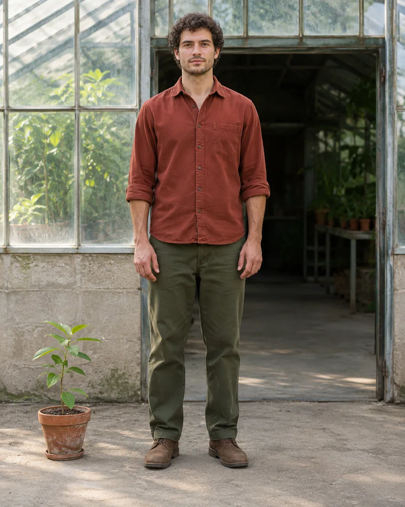
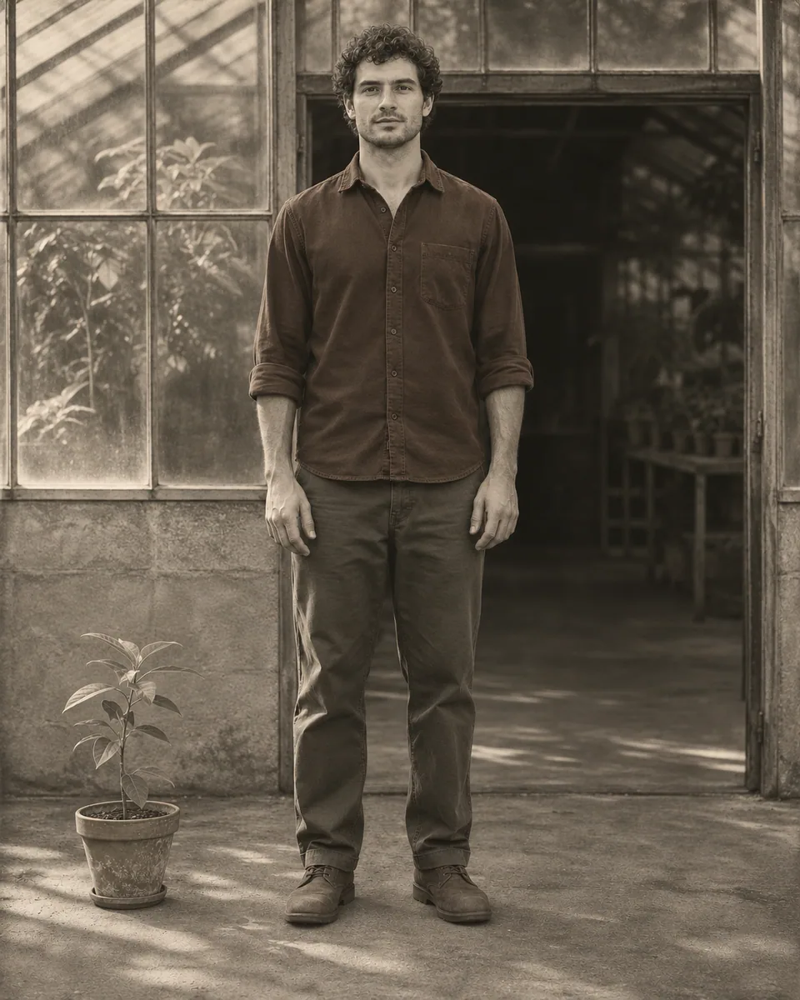

# 湿版肖像 · Wet Plate Portrait

以湿版摄影的温灰银质、深色背景和缓慢曝光感描绘人物，保留真实面貌，让微弱乳剂流痕只在空白处出现。

Render the subject with warm-gray silver tones, dark surroundings and the stillness of a wet-plate exposure, keeping subtle emulsion variations away from facial details.

原创方法说明，由 MuziGeek 编写；没有声称改编自外部提示词。

Original method instructions authored by MuziGeek; no external prompt adaptation is asserted.

## 输入分析与实际保留

1. 读取用户提供的原图；若没有可用图片，先请求图片。不要用本仓库示例代替用户输入。
2. 观察实际主体数量、身份与表情、朝向、肢体和连接、物体开口、相互遮挡、前后层次、光向及画幅；据实形成简短保留清单。样片说明只是样片，不能当成其他输入的事实。
3. 使用支持参考图编辑的可用工具，把原图作为编辑输入。先说明观察到的主体，再结合下方机制及 [recipe.yaml](recipe.yaml) 按顺序组合指令；工具名称不是必须安装的依赖。
4. 实际编辑默认沿用原图比例和完整内容，除非用户另有要求。配方的 4:5 是目录样片比例，不代表可裁去用户照片中的主体。
5. 对照输入检查结果；只修正发现的问题，不为了增强风格改变身份或添加无关景物。区分已完成的视觉检查与尚未验证的效果。

## Input analysis and preservation

1. Inspect the supplied image; request an image only when none is available. Never substitute a repository example for the user's input.
2. Record the observed subject count, identity, expression, direction, anatomy, attachments, openings, overlaps, depth, light and framing. Build preservation instructions from this image, not from the sample description.
3. Use an available reference-image editing tool. Combine the observed facts with the ordered mechanisms in [recipe.yaml](recipe.yaml); its model-family label does not require an installation script.
4. Keep the input aspect ratio and complete composition unless the user requests another format. The recipe's 4:5 ratio is a catalog-sample default, not authorization to crop a subject.
5. Compare output with input and correct observed failures. Report only visual checks actually completed; stronger styling must not override identity or scene integrity.

## 风格机制 · Style mechanism

- 以湿版摄影的温灰银质、深色背景和缓慢曝光感描绘人物，保留真实面貌，让微弱乳剂流痕只在空白处出现。
- 识别特征：温灰银质影调、静止长曝光感、微弱乳剂流痕。
- Medium anchor: A restrained wet-collodion plate portrait with warm silver-gray tonality, subtle spectral separation and faint emulsion variation outside the subject.

10. **medium** — Render a wet-collodion plate photograph with dense silver-gray tones, patient exposure stillness and a slightly luminous central subject.
20. **palette** — Use warm graphite, pewter gray and subdued ivory; translate red fabric slightly darker without exaggerating facial blemishes or altering skin identity.
30. **lighting** — Keep the original light direction; deepen surrounding shadows gently while preserving eyes, cheeks and the outline of dark clothing.
40. **texture** — Allow faint irregular emulsion density only in quiet background areas; keep the face, hands and important object surfaces clean.
50. **line** — Hold eyes and facial contours clearly; soften distant detail slightly without radial blur, warped anatomy or an artificial portrait vignette.
60. **composition** — Preserve the source crop, pose, perspective and object counts; do not add period clothing, studio props or historical scenery.
70. **detail** — Retain natural pores, hair structure and textile folds; avoid retouching the subject into an anonymous antique face.
80. **finish** — Present a clean full-frame plate image without metal rims, glass corners, scratches, cracks, oval masks or paper mounts.

## 保留约束 · Preservation constraints

在实际输入观察结果之上应用以下约束；清单不授权凭空添加图片中不存在的元素。

Apply these constraints to observed content; they never authorize inventing absent subjects.

- Subject identity, age, expression and original clothing
- Exact people, objects and visible limbs
- Source pose, framing and architectural perspective
- Recognizable facial texture and directional light

## 适用范围与几何边界 · Applicability and geometry

- 适用：人像、合影、器物、产品、风景。
- Applies to: Portrait, Group, Object, Product, Landscape.
- 保留当代衣着与现场布局，只转换影调和感光表面；乳剂痕迹不得切断轮廓或遮盖关键五官。
- Keep contemporary clothing and the original setting; change tones and emulsion character without breaking contours or obscuring essential facial features.
- 未明确允许的结构变化均不属于此风格；不把这些方法解释为复刻某位艺术家、品牌或现成作品的授权。
- Structural changes not explicitly allowed above are outside this method. This is not permission to reproduce a named artist, brand or existing artwork.

## 排除项 · Avoid

- generic antique face
- invented historical costume
- heavy sepia wash
- diseased-looking skin
- emulsion damage across eyes or hands
- oval portrait mask or dark corner vignette
- plate frame, cracks, signatures or watermark

## 验收 · Acceptance

- 有温灰银质与乳剂感，不只是叠加棕色滤镜。
  Warm silver tones and restrained emulsion character go beyond a simple brown tint.
- 人物面貌、年龄、衣着、姿态及数量不变。
  Identity, age, clothing, pose and subject counts remain unchanged.
- 乳剂变化只在低信息背景中轻微出现。
  Emulsion variation stays subtle and confined to low-detail background areas.
- 五官清楚，完整画面没有玻璃边框、裂纹或椭圆蒙版。
  Facial features remain clear, with no plate frame, cracks or oval mask.

## 配方、来源与许可 · Recipe, provenance and license

- [recipe.yaml](recipe.yaml): structured image-editing recipe / 结构化图像编辑配方。
- [provenance.json](provenance.json): original authorship, method context and example status / 原创归属、方法背景与示例状态。
- [LICENSE](LICENSE): MIT applies to MuziGeek's original contributions / MIT 适用于 MuziGeek 的原创贡献。
- 示例中的前后图均为 AI 合成，不是真人摄影或真实制作工艺的证据。结果会随模型与输入变化，不承诺相同输出。
- Example before/after images are AI-generated, not photographs of real people or evidence of physical craft production. Results vary by model and input.
- MIT 不授予用户输入、第三方作品、人物、商标或生成平台条款之外的权利；示例许可单独见 provenance。
- MIT grants no rights to user inputs, third-party works, likenesses or trademarks, and does not override generation-service terms; example terms are recorded separately in provenance.

## 示例状态 · Example status

ready：打包的原图与效果图均存在且记录了通过的视觉审核。

ready: both packaged source and effect exist and have recorded approved visual reviews.

| AI 合成原图 · Source | 通过审核的效果 · Approved effect |
| --- | --- |
|  |  |

- [AI source / AI 合成原图](examples/source.webp)
- [Generated interpretation / 生成效果](examples/effect.webp)
- [Generation and visual review / 生成与视觉审核记录](examples/generation.json)
